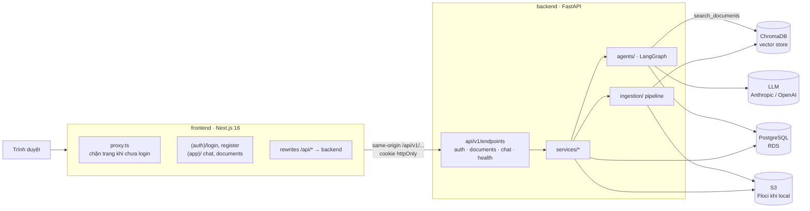
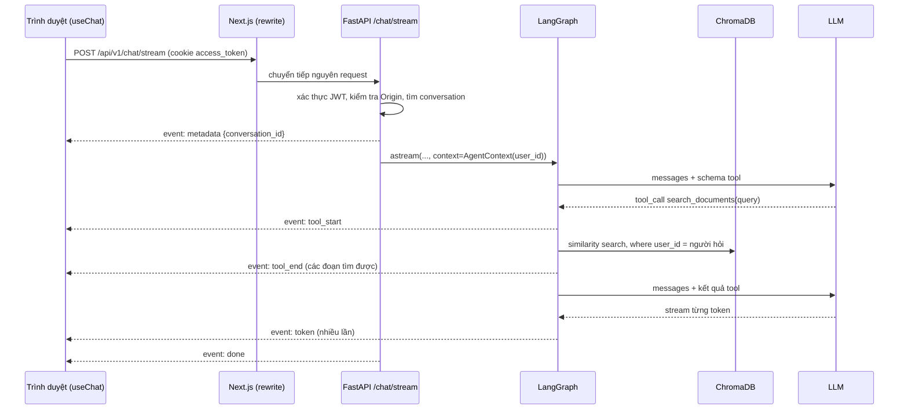

# 00 · Tổng quan dự án & lộ trình học

## 🎯 Mục tiêu

- Hiểu toàn bộ kiến trúc của một **AI Document Assistant** chạy theo kiểu production: **Next.js → FastAPI → LangGraph → LLM**, cùng **PostgreSQL**, **S3** và **ChromaDB**.
- Chạy được project trên máy (hạ tầng bằng Docker Compose).
- Biết nên đọc tutorial theo thứ tự nào.

## 🧭 Ứng dụng làm gì?

1. Người dùng **đăng ký / đăng nhập** (email + mật khẩu).
2. **Tải lên tài liệu** (PDF, TXT, Markdown). File gốc được lưu vào **S3**, metadata vào **PostgreSQL**.
3. Ở nền, tài liệu được **cắt thành chunk → tạo embedding → lưu vào ChromaDB** (gọi là *ingestion*).
4. Người dùng **chat**: agent LangGraph tự quyết định gọi tool `search_documents` để tìm đoạn liên quan **trong tài liệu của chính người đó**, rồi trả lời kèm trích dẫn `[file, p.N]`. Đây là mô hình **RAG** (Retrieval-Augmented Generation).
5. Lịch sử hội thoại được lưu trong PostgreSQL (bảng `conversations` + checkpoint của LangGraph), nên tải lại trang vẫn còn.

## 🏗️ Kiến trúc



| Thành phần | Local (docker compose) | Production | Lưu gì |
|---|---|---|---|
| Database | `postgres:17` (cổng **5433**) | AWS RDS for PostgreSQL | users, refresh_tokens, documents, conversations, checkpoint LangGraph |
| Blob storage | `floci` (giả lập AWS, cổng 4566) | AWS S3 | file gốc người dùng tải lên |
| Vector store | `chromadb/chroma` (cổng **8001**) | Chroma self-host / Chroma Cloud | chunk + embedding, gắn `user_id` |
| LLM + embeddings | API của provider | như local | — |

Các tầng được tách bạch — best practice quan trọng nhất của project:

| Tầng | Thư mục | Trách nhiệm | **Không** được biết về |
|---|---|---|---|
| Agent / RAG | `backend/app/agents/`, `ingestion/`, `vectorstore/` | Prompt, tools, graph, chunking, embedding | HTTP, cookie |
| Hạ tầng | `backend/app/db/`, `models/`, `storage/` | SQLAlchemy, S3 | Logic nghiệp vụ |
| API | `backend/app/api/`, `services/`, `schemas/` | HTTP, auth, validate, streaming, lỗi | Chi tiết bên trong graph |
| UI | `frontend/src/` | Hiển thị, state UI, gọi API | Python, LLM provider, token |

## 🔄 Một câu hỏi đi qua hệ thống như thế nào?



## 📁 Cấu trúc thư mục

```
ai-agent-fullstack/
├── docker-compose.yml       # postgres, floci, chroma (+ profile "app": migrate, backend, frontend)
├── Makefile                 # make infra-up / migrate / dev-backend / dev-frontend / up / test / lint
├── backend/
│   ├── Dockerfile, alembic.ini, pyproject.toml, .env.example
│   ├── migrations/          # Alembic: env.py + versions/
│   ├── app/
│   │   ├── main.py          # create_app() + lifespan (engine, S3, Chroma, checkpointer, graph)
│   │   ├── core/            # config, security (JWT, Argon2), logging, exceptions
│   │   ├── db/ + models/    # SQLAlchemy async: User, RefreshToken, Document, Conversation
│   │   ├── storage/         # S3Storage (boto3)
│   │   ├── vectorstore/     # DocumentVectorStore (Chroma)
│   │   ├── ingestion/       # loaders + pipeline (chunk → embed → Chroma)
│   │   ├── agents/          # llm, prompts, tools, context, state, nodes, graph
│   │   ├── services/        # auth_service, document_service, chat_service
│   │   ├── schemas/         # Pydantic request/response
│   │   └── api/             # deps.py + v1/endpoints/{health,auth,documents,chat}.py
│   ├── scripts/run_agent.py # chat với agent trong terminal
│   └── tests/               # pytest: SQLite + moto + Chroma in-memory + fake LLM
├── frontend/
│   ├── Dockerfile, next.config.ts (rewrites, standalone), .env.example
│   └── src/
│       ├── proxy.ts         # redirect về /login nếu chưa có cookie phiên
│       ├── app/             # (auth)/login, (auth)/register, (app)/ chat, (app)/documents
│       ├── components/      # auth/, chat/, documents/, layout/, BackendStatus
│       ├── hooks/           # useChat + chatReducer, useConversations, useDocuments
│       ├── lib/             # config, sse, utils, auth/ (AuthProvider), api/ (client có auto-refresh)
│       └── types/           # api.ts (mirror schema backend), chat.ts (model UI)
└── tutorial/                # bạn đang ở đây
```

## 🚀 Chạy project

Yêu cầu: Python ≥ 3.12 + [uv](https://docs.astral.sh/uv/), Node.js ≥ 20 + npm, Docker (có Compose), và API key.

```bash
make install                                   # uv sync + npm install
cp backend/.env.example backend/.env           # điền ANTHROPIC_API_KEY và OPENAI_API_KEY
cp frontend/.env.example frontend/.env.local

make infra-up        # Postgres :5433, Floci (S3) :4566, Chroma :8001
make migrate         # alembic upgrade head → tạo bảng
make dev-backend     # terminal 1 → http://localhost:8000/docs
make dev-frontend    # terminal 2 → http://localhost:3000
```

> ⚠️ Mặc định chat dùng `anthropic:claude-sonnet-5-5` (cần `ANTHROPIC_API_KEY`) còn embedding dùng `openai:text-embedding-3-small` (cần `OPENAI_API_KEY`) — Anthropic không có API embedding. Muốn đổi, sửa `LLM_MODEL` / `EMBEDDING_MODEL` trong `backend/.env`.

Muốn chạy **tất cả** trong Docker: `make up` (build image, chạy migration rồi backend + frontend), dừng bằng `make down`.

Kiểm tra chất lượng: `make test` và `make lint`. Test **không** cần Docker hay API key: DB là SQLite, S3 là `moto`, Chroma chạy in-memory, LLM là fake.

## 🗺️ Lộ trình học đề xuất

Mỗi thư mục được đánh số `xx_FileName.md`. Lộ trình đi từ "khung + hạ tầng" → "lõi AI/RAG" → "nối vào API" → "giao diện":

1. **Backend nền tảng & hạ tầng** — [backend/01](backend/01_ProjectSetup.md) → [backend/12](backend/12_BlobStorageS3.md)
   Setup, config, Docker Compose, app factory, router, schema, SQLAlchemy, Alembic, dependency injection, **authentication**, service layer, S3.
2. **Agent & RAG** — [agent/01](agent/01_LangChainFundamentals.md) → [agent/13](agent/13_NextSteps.md)
   LangChain cơ bản, prompt, loader & chunking, embedding & vector store, ingestion pipeline, tool có context, state, node, graph, Postgres checkpointer, streaming, test agent.
   Thử nghiệm ngay: `cd backend && uv run python -m scripts.run_agent --email you@example.com`.
3. **Hoàn thiện API** — [backend/13](backend/13_StreamingSSE.md) → [backend/16](backend/16_DockerAndProduction.md)
   SSE streaming, xử lý lỗi & health check, testing, Docker & checklist production.
4. **Frontend** — [frontend/01](frontend/01_ProjectSetup.md) → [frontend/15](frontend/15_DockerAndDeployment.md)
   App Router & route groups, Server/Client Components, proxy rewrites, API client tự refresh token, luồng đăng nhập, SSE, reducer, custom hooks, trang chat & tài liệu, test, Docker.

> 💡 Mỗi bài đều có mục **🧪 Thực hành** — hãy làm, vì đó là lúc kiến thức "dính".

## ✅ Các best practice xuyên suốt

- **Tách tầng & dependency injection**: DB session, storage, vector store, graph đều được *inject* → dễ test, dễ thay.
- **Config qua environment**: không hard-code secret; app từ chối khởi động ở production nếu còn dùng secret mặc định.
- **Auth an toàn**: Argon2id, access token ngắn hạn + refresh token xoay vòng có phát hiện tái sử dụng, cookie `httpOnly`, chống CSRF bằng kiểm tra `Origin`.
- **Multi-tenancy**: mọi truy vấn (SQL lẫn vector) đều lọc theo người dùng; tài liệu của người khác trả về **404**, không phải 403.
- **Schema DB có version**: mọi thay đổi bảng đi qua Alembic migration.
- **Liveness vs readiness**: `/health` (process sống) khác `/health/ready` (DB, S3, Chroma đều kết nối được).
- **Streaming**: Server-Sent Events để người dùng thấy câu trả lời ngay khi LLM sinh ra.
- **Test không phụ thuộc hạ tầng thật**: fake/mock cho LLM, S3, DB, vector store → nhanh, miễn phí, ổn định.
- **Tooling**: `ruff` + `mypy --strict` (Python), `eslint` + `tsc` + `prettier` (TS), `pytest` + `vitest`.

➡️ Tiếp: [backend/01_ProjectSetup.md](backend/01_ProjectSetup.md)
