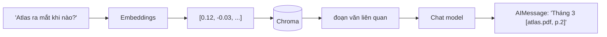
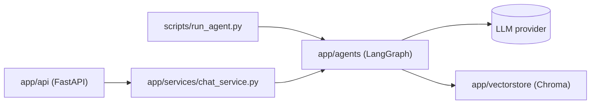

# 01 · LangChain Fundamentals: Chat Model, Embeddings & Messages

## 🎯 Mục tiêu

- Hiểu **chat model** và **embedding model** trong LangChain là gì, khác nhau thế nào.
- Phân biệt 4 loại message: `SystemMessage`, `HumanMessage`, `AIMessage`, `ToolMessage`.
- Hiểu vì sao project dùng `init_chat_model` / `init_embeddings` với chuỗi `"<provider>:<model>"`.
- Biết API key được truyền vào model như thế nào, và vì sao package `app/agents` **độc lập với FastAPI**.

## 📁 File liên quan

- `backend/app/agents/llm.py` — factory tạo chat model và embedding model
- `backend/app/agents/__init__.py` — public API của package agent
- `backend/app/core/config.py` — `LLM_MODEL`, `EMBEDDING_MODEL`, API key
- `backend/scripts/run_agent.py` — chat với agent trong terminal

---

## 1. Hai loại model trong một ứng dụng RAG

Document assistant cần **hai** model khác nhau:

| Model | Input → Output | Dùng ở đâu |
|---|---|---|
| **Chat model** (`BaseChatModel`) | danh sách message → một `AIMessage` | Node `agent`: suy nghĩ, gọi tool, viết câu trả lời |
| **Embedding model** (`Embeddings`) | chuỗi văn bản → vector số (vd. 1536 chiều) | Ingestion (embed các chunk) và search (embed câu truy vấn) |



Embedding biến "ý nghĩa" thành toạ độ: hai câu cùng nghĩa → hai vector gần nhau. Đó là nền tảng của
semantic search (bài [04](04_EmbeddingsAndVectorStore.md)).

Các method chính của chat model:

| Method | Khi nào dùng |
|---|---|
| `await model.ainvoke(messages)` | Gọi async, đợi trả lời đầy đủ — **dùng trong FastAPI/LangGraph** |
| `model.astream(messages)` | Nhận từng chunk token khi model đang sinh |
| `model.bind_tools(tools)` | Gắn danh sách tool (bài [08](08_NodesAndBindTools.md)) |

Của embedding model: `await emb.aembed_query("câu hỏi")` → `list[float]`, `await emb.aembed_documents([...])` → `list[list[float]]`.

## 2. Bốn loại message

| Class | `type` | Ai tạo ra | Ý nghĩa |
|---|---|---|---|
| `SystemMessage` | `system` | Developer | Chỉ dẫn hành vi (persona, luật trích dẫn nguồn) |
| `HumanMessage` | `human` | User | Câu hỏi của người dùng |
| `AIMessage` | `ai` | Model | Câu trả lời; có thể chứa `tool_calls` |
| `ToolMessage` | `tool` | Code của bạn | Kết quả tool (vd. các đoạn văn tìm được), gắn `tool_call_id` |

```python
from langchain_core.messages import HumanMessage, SystemMessage

reply = await model.ainvoke([SystemMessage("You are concise."), HumanMessage("Xin chào!")])
print(reply.text)
```

**Dùng `.text`, không dùng `.content`**: `content` có thể là chuỗi *hoặc* list content block (Anthropic
trả `[{"type": "text", ...}, {"type": "tool_use", ...}]`). `.text` luôn gom thành chuỗi. Project dùng
`.text` ở mọi nơi, ví dụ `backend/app/services/chat_service.py`:

```python
            elif isinstance(msg, AIMessage) and msg.text:
                result.append(ChatMessage(role="assistant", content=msg.text))
```

## 3. `init_chat_model` & `init_embeddings` — đổi provider bằng config

`backend/app/agents/llm.py`:

```python
def _provider_kwargs(model: str, settings: Settings) -> dict[str, Any]:
    provider = model.split(":", 1)[0]
    if provider == "anthropic" and settings.anthropic_api_key:
        return {"api_key": settings.anthropic_api_key.get_secret_value()}
    if provider == "openai" and settings.openai_api_key:
        return {"api_key": settings.openai_api_key.get_secret_value()}
    return {}


def get_chat_model(settings: Settings) -> BaseChatModel:
    model: BaseChatModel = init_chat_model(
        settings.llm_model,
        temperature=settings.llm_temperature,
        **_provider_kwargs(settings.llm_model, settings),
    )
    return model


def get_embeddings(settings: Settings) -> Embeddings:
    return init_embeddings(
        settings.embedding_model, **_provider_kwargs(settings.embedding_model, settings)
    )
```

Giá trị mặc định trong `backend/app/core/config.py`:

```python
    llm_model: str = "anthropic:claude-sonnet-5-5"
    llm_temperature: float = Field(default=0.2, ge=0.0, le=2.0)
    embedding_model: str = "openai:text-embedding-3-small"
```

Điểm đáng học:

- **Một chuỗi config** quyết định provider + model. Đổi chat model sang OpenAI: `LLM_MODEL=openai:gpt-5-mini`.
  Package tích hợp (`langchain-anthropic`, `langchain-openai`) phải được cài — cả hai đã có trong `pyproject.toml`.
- **Chat và embedding có thể khác provider.** Mặc định: Claude để trả lời, OpenAI để embed (Anthropic
  không cung cấp embedding API). Vì vậy bạn cần **cả** `ANTHROPIC_API_KEY` **và** `OPENAI_API_KEY`
  — hoặc đổi `EMBEDDING_MODEL` sang provider khác bạn có key (vd. `ollama:nomic-embed-text` sau khi `uv add langchain-ollama`).
- `_provider_kwargs` dùng chung cho cả hai factory → logic chọn API key nằm một chỗ.
- API key là `SecretStr` → không bị in lộ ra log; `.get_secret_value()` chỉ gọi đúng chỗ cần.
- **Factory function**: phần còn lại của code chỉ thấy `BaseChatModel` / `Embeddings`. Test truyền fake
  (bài [12](12_TestingAgents.md)) mà không cần API key.

> ⚠️ **Đổi embedding model = phải ingest lại toàn bộ tài liệu.** Vector từ hai model khác nhau không so
> sánh được (khác số chiều, khác "không gian"). Docstring của `get_embeddings` nhắc đúng điều này.

## 4. Vì sao `app/agents` độc lập với FastAPI?

`backend/app/agents/__init__.py`:

```python
"""LangChain / LangGraph agent package. Independent of FastAPI on purpose."""

from app.agents.context import AgentContext
from app.agents.graph import build_agent_graph
from app.agents.llm import get_chat_model, get_embeddings
from app.agents.tools import get_tools
```

Trong `app/agents/` **không có** `import fastapi`. Cùng một agent chạy được trong API, CLI, worker,
notebook; test agent không cần HTTP server; HTTP (status code, SSE, cookie) là việc của tầng API.



## 5. Chạy agent trong terminal

```bash
docker compose up -d                       # Postgres, Floci, Chroma
cd backend && cp .env.example .env         # điền ANTHROPIC_API_KEY + OPENAI_API_KEY
uv run python -m scripts.run_agent --email you@example.com
```

Script tìm user theo email trong Postgres, rồi dựng graph y hệt API (chỉ khác: checkpointer in-memory):

```python
    context = AgentContext(user_id=await find_user_id(email))
    vector_store = DocumentVectorStore(
        create_chroma_client(settings), get_embeddings(settings), settings.chroma_collection
    )
    graph = build_agent_graph(
        get_chat_model(settings),
        get_tools(vector_store, k=settings.retrieval_k),
        checkpointer=InMemorySaver(),
    )
```

User phải tồn tại và đã upload tài liệu (qua frontend hoặc Swagger UI `/docs`), nếu không tool sẽ trả
"No relevant passages found".

## ⚠️ Lỗi thường gặp

- **Chỉ có `ANTHROPIC_API_KEY`** → upload tài liệu bị `failed` (bước embed gọi OpenAI). Thêm `OPENAI_API_KEY` hoặc đổi `EMBEDDING_MODEL`.
- **Đổi `EMBEDDING_MODEL` khi đã có dữ liệu** → search trả kết quả vô nghĩa hoặc lỗi số chiều. Xoá collection Chroma và upload lại.
- **Dùng `invoke`/`embed_query` sync trong code async** → chặn event loop. Dùng `ainvoke`/`aembed_query`.
- **Đọc `message.content` như chuỗi** → vỡ khi provider trả list block. Dùng `.text`.

## 🧪 Thực hành

1. Trong REPL (`uv run python`), tạo `emb = get_embeddings(get_settings())`, embed "con mèo", "chú mèo con", "báo cáo tài chính". Tính cosine similarity từng cặp (dùng `numpy`) — cặp nào gần nhất?
2. Gọi `model = get_chat_model(get_settings())`, `await model.ainvoke("Hello")`, in `reply.usage_metadata`.
3. Đổi `LLM_TEMPERATURE=1.0`, hỏi cùng một câu 3 lần, so sánh.

---

⬅️ Trước: [Backend 12 · Blob Storage S3](../backend/12_BlobStorageS3.md) · ➡️ Tiếp: [02 · Prompts](02_Prompts.md)
