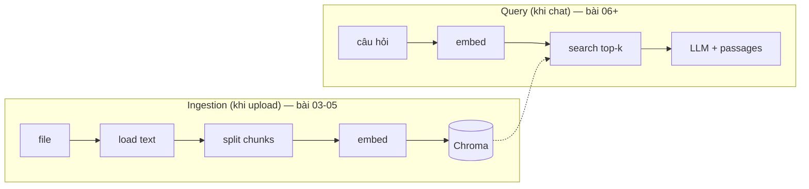

# 03 · Document Loaders & Chunking

## 🎯 Mục tiêu

- Hiểu bước đầu tiên của RAG: **trích xuất văn bản** từ file (PDF, TXT, Markdown).
- Hiểu vì sao PDF được tách **theo trang** (để trích dẫn `p.N`).
- Hiểu **allow-list content type** và vì sao không tin header của client.
- Hiểu **chunking** với `RecursiveCharacterTextSplitter`: `chunk_size`, `chunk_overlap`, metadata.

## 📁 File liên quan

- `backend/app/ingestion/loaders.py` — loader theo content type
- `backend/app/ingestion/pipeline.py` — `IngestionPipeline.split()`
- `backend/app/services/document_service.py` — chọn content type khi upload
- `backend/app/core/config.py` — `chunk_size`, `chunk_overlap`
- `backend/tests/test_unit.py` — test loader

---

## 1. RAG gồm hai pha



Bài này lo hai bước đầu của pha ingestion: **load** và **split**.

## 2. Loader: từ bytes thành `Document`

LangChain biểu diễn văn bản bằng `langchain_core.documents.Document`: `page_content` (chuỗi) +
`metadata` (dict). Project import nó với tên `LCDocument` để không nhầm với model SQLAlchemy `Document`.

`backend/app/ingestion/loaders.py`:

```python
def _load_pdf(data: bytes) -> list[LCDocument]:
    reader = PdfReader(io.BytesIO(data))
    # One LangChain Document per page keeps the page number for citations.
    return [
        LCDocument(page_content=text, metadata={"page": number})
        for number, page in enumerate(reader.pages, start=1)
        if (text := page.extract_text() or "").strip()
    ]


def _load_text(data: bytes) -> list[LCDocument]:
    return [LCDocument(page_content=data.decode("utf-8", errors="replace"))]
```

- **PDF → một `LCDocument` mỗi trang**, metadata `{"page": number}` (đánh số từ 1 như người đọc).
  Metadata này đi theo mọi chunk cắt ra từ trang đó → tool in được `[report.pdf, p.3]`.
- Trang không có chữ (ảnh scan, trang trắng) bị bỏ qua. PDF *chỉ* có ảnh scan → 0 trang → pipeline đánh
  dấu `failed` với lỗi "No text could be extracted" (cần OCR, xem bài [13](13_NextSteps.md)).
- **Text/Markdown → một `LCDocument`**, không có `page`. `errors="replace"` → file không phải UTF-8 vẫn
  đọc được (ký tự lỗi thành `�`) thay vì crash.
- Loader nhận **bytes** (không phải đường dẫn file) vì file nằm trên S3, không trên đĩa server.

## 3. Allow-list: dict vừa là router vừa là whitelist

```python
# content type -> loader. Also the allow-list of accepted uploads.
LOADERS: dict[str, Callable[[bytes], list[LCDocument]]] = {
    "application/pdf": _load_pdf,
    "text/plain": _load_text,
    "text/markdown": _load_text,
}

EXTENSION_TO_CONTENT_TYPE = {
    ".pdf": "application/pdf",
    ".txt": "text/plain",
    ".md": "text/markdown",
}


def load_document(data: bytes, content_type: str) -> list[LCDocument]:
    try:
        loader = LOADERS[content_type]
    except KeyError:
        raise ValueError(f"Unsupported content type: {content_type}") from None
    return loader(data)
```

Content type được **server quyết định từ phần mở rộng**, không lấy header `Content-Type` của client
(`backend/app/services/document_service.py`):

```python
        # Decide the type from the extension allow-list, never trust the client's header.
        content_type = EXTENSION_TO_CONTENT_TYPE.get(PurePath(filename).suffix.lower())
        if content_type is None:
            allowed = ", ".join(EXTENSION_TO_CONTENT_TYPE)
            raise ValidationFailedError(f"Unsupported file type. Allowed: {allowed}")
```

Muốn hỗ trợ `.docx`? Viết `_load_docx`, thêm một dòng vào `LOADERS` và một dòng vào
`EXTENSION_TO_CONTENT_TYPE` — không phải sửa chỗ nào khác (Open/Closed principle).

## 4. Vì sao phải chunk?

Không đưa cả file 200 trang vào LLM được: vượt context window, tốn token, và embedding của một văn bản
dài là "trung bình" của quá nhiều ý → search kém chính xác. Ta cắt thành các **chunk** nhỏ, embed từng chunk,
và khi hỏi chỉ lấy vài chunk liên quan nhất.

`backend/app/ingestion/pipeline.py`:

```python
        # Splits on paragraphs, then sentences, then words: keeps chunks semantically whole.
        self._splitter = RecursiveCharacterTextSplitter(
            chunk_size=chunk_size, chunk_overlap=chunk_overlap, add_start_index=True
        )
```

Cấu hình trong `Settings`: `chunk_size: int = 1000`, `chunk_overlap: int = 150` (đơn vị: **ký tự**).

| Tham số | Ý nghĩa | Đánh đổi |
|---|---|---|
| `chunk_size` | Độ dài tối đa mỗi chunk | Nhỏ → chính xác nhưng thiếu ngữ cảnh; lớn → đủ ngữ cảnh nhưng "loãng" |
| `chunk_overlap` | Số ký tự lặp lại giữa hai chunk liền kề | Câu bị cắt ngang ở biên vẫn xuất hiện trọn vẹn ở chunk kia |
| `add_start_index` | Thêm `metadata["start_index"]` | Biết chunk nằm ở đâu trong trang gốc (debug, highlight) |

"Recursive" nghĩa là thử tách theo `"\n\n"` (đoạn văn) trước; chunk vẫn quá dài thì tách theo `"\n"`,
rồi `" "`, rồi từng ký tự. Nhờ vậy chunk thường kết thúc ở ranh giới tự nhiên.

## 5. Gắn metadata cho từng chunk

```python
    def split(self, document: Document, pages: list[LCDocument]) -> list[LCDocument]:
        chunks = self._splitter.split_documents(pages)
        for index, chunk in enumerate(chunks):
            # Metadata used for tenant filtering (user_id) and for citations.
            chunk.metadata.update(
                user_id=str(document.owner_id),
                document_id=str(document.id),
                filename=document.filename,
                chunk_index=index,
            )
        return chunks
```

`split_documents` **giữ lại metadata** của trang gốc (`page`) cho mọi chunk con, rồi ta thêm:

| Key | Dùng cho |
|---|---|
| `user_id` | **Multi-tenancy**: mọi search đều lọc theo key này (bài [04](04_EmbeddingsAndVectorStore.md)) |
| `document_id` | Truy ngược về bản ghi Postgres |
| `filename`, `page` | Nhãn trích dẫn `[file, p.N]` |
| `chunk_index` | Thứ tự chunk, khớp với id `{document_id}:{chunk_index}` trong Chroma |

UUID được chuyển thành `str` vì Chroma chỉ lưu metadata kiểu `str/int/float/bool`.

## ⚠️ Lỗi thường gặp

- **Tin `UploadFile.content_type` từ client** → kẻ tấn công gửi `.exe` với header `text/plain`. Luôn suy ra từ allow-list phía server.
- **`chunk_overlap >= chunk_size`** → splitter báo lỗi. Overlap thường 10–20% chunk size.
- **Parse PDF trực tiếp trên event loop** → request khác bị treo. Pipeline dùng `asyncio.to_thread(load_document, ...)` (bài [05](05_IngestionPipeline.md)).
- **Quên metadata `user_id`** → chunk không bao giờ được tìm thấy (filter không khớp) — hoặc tệ hơn, nếu bỏ filter thì lộ dữ liệu.

## 🧪 Thực hành

1. Trong REPL: `from app.ingestion.loaders import load_document`, đọc một PDF thật bằng `open(..., "rb").read()`, in số trang và 200 ký tự đầu mỗi trang.
2. Tạo `RecursiveCharacterTextSplitter(chunk_size=200, chunk_overlap=20)`, `split_documents` kết quả trên, in `len(chunk.page_content)` và `chunk.metadata` của 3 chunk đầu — `page` có được giữ lại không?
3. Thêm hỗ trợ `.csv` (`text/csv` → `_load_text`) và viết test trong `tests/test_unit.py` giống `test_text_loader`.

---

⬅️ Trước: [02 · Prompts](02_Prompts.md) · ➡️ Tiếp: [04 · Embeddings & Vector Store](04_EmbeddingsAndVectorStore.md)
