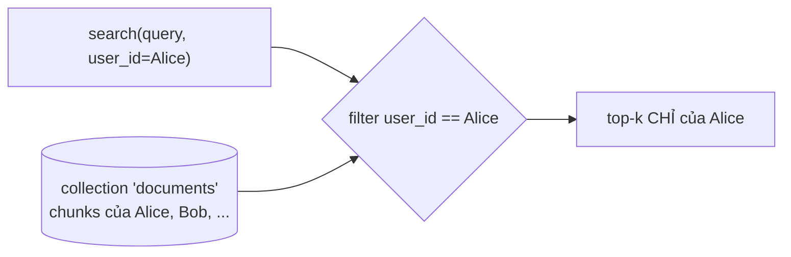

# 04 · Embeddings & Vector Store (ChromaDB)

## 🎯 Mục tiêu

- Hiểu **embedding** và **semantic search** hoạt động thế nào.
- Biết cách kết nối ChromaDB qua `HttpClient` và bọc `langchain_chroma.Chroma` sau một interface riêng.
- Hiểu **id tất định** `{document_id}:{i}` và lợi ích khi ingest lại / xoá.
- Hiểu **multi-tenancy bằng metadata filter** `user_id` — quy tắc bảo mật quan trọng nhất của RAG nhiều người dùng.
- Đổi **cosine distance** thành **similarity** dễ đọc.

## 📁 File liên quan

- `backend/app/vectorstore/chroma.py` — `DocumentVectorStore`, `create_chroma_client`
- `backend/app/main.py` — tạo vector store trong lifespan
- `docker-compose.yml` — service `chroma` (host port 8001)
- `backend/tests/conftest.py` — `chromadb.EphemeralClient` cho test

---

## 1. Embedding & semantic search

Embedding model biến văn bản thành vector. Hai đoạn **cùng ý** (dù khác từ ngữ) → hai vector **gần nhau**:

| Câu | Gần với "Khi nào Atlas ra mắt?" |
|---|---|
| "Atlas launches in March." | ✅ rất gần (cùng ý, khác ngôn ngữ) |
| "The project lead is Minh Tran." | ~ trung bình (cùng tài liệu) |
| "Công thức nấu phở" | ❌ xa |

**Vector store** lưu vector + văn bản + metadata, và trả về *k* vector gần nhất với vector câu hỏi
(thuật toán HNSW — tìm gần đúng nhưng rất nhanh). Khác full-text search: không cần trùng từ khoá.

## 2. Kết nối Chroma

```python
def create_chroma_client(settings: Settings) -> ClientAPI:
    return chromadb.HttpClient(host=settings.chroma_host, port=settings.chroma_port)
```

Chroma chạy như một **server riêng** (container `chromadb/chroma`), app kết nối qua HTTP — giống
Postgres, nhiều instance backend dùng chung một kho vector. Trong test dùng `chromadb.EphemeralClient()`
(in-memory, cùng interface `ClientAPI`) → không cần Docker.

Client được tạo **một lần** trong lifespan (`backend/app/main.py`) cùng embedding model:

```python
    chroma_client = create_chroma_client(settings)
    vector_store = DocumentVectorStore(
        chroma_client, get_embeddings(settings), settings.chroma_collection
    )
```

## 3. `DocumentVectorStore` — interface nhỏ, đặc thù cho app

`backend/app/vectorstore/chroma.py`:

```python
class DocumentVectorStore:
    def __init__(self, client: ClientAPI, embeddings: Embeddings, collection_name: str) -> None:
        self._store = Chroma(
            client=client,
            collection_name=collection_name,
            embedding_function=embeddings,
            # Cosine distance is the usual choice for text embeddings.
            collection_metadata={"hnsw:space": "cosine"},
        )
```

Vì sao không dùng thẳng `Chroma` ở khắp nơi? Class bọc chỉ lộ **3 thao tác app cần** (`add_chunks`,
`delete_document`, `search`) và **bắt buộc** tham số `user_id` khi search. Không ai có thể "quên" filter,
và đổi sang pgvector/Qdrant sau này chỉ sửa một file.

`embedding_function=embeddings`: `Chroma` tự gọi `aembed_documents` khi thêm và `aembed_query` khi search.

## 4. Id tất định

```python
    @staticmethod
    def _chunk_ids(document_id: uuid.UUID, count: int) -> list[str]:
        # Deterministic ids: re-ingesting overwrites instead of duplicating,
        # and deleting needs no extra lookup.
        return [f"{document_id}:{i}" for i in range(count)]

    async def add_chunks(self, document_id: uuid.UUID, chunks: list[LCDocument]) -> None:
        await self._store.aadd_documents(chunks, ids=self._chunk_ids(document_id, len(chunks)))

    async def delete_document(self, document_id: uuid.UUID, chunk_count: int) -> None:
        if chunk_count:
            await self._store.adelete(ids=self._chunk_ids(document_id, chunk_count))
```

Nếu để Chroma tự sinh id ngẫu nhiên:

- Ingest lại (retry sau lỗi) → **chunk trùng lặp**, search trả cùng một đoạn nhiều lần.
- Xoá tài liệu → phải query "tìm mọi chunk có `document_id = X`" trước.

Với id `{document_id}:{i}`, chỉ cần biết `chunk_count` (lưu trong bảng `documents` của Postgres) là
dựng lại được toàn bộ id để xoá. `DocumentService.delete` gọi `delete_document` **trước** khi xoá file S3
và row DB — lỗi giữa chừng thì retry được.

## 5. Multi-tenancy: mọi search đều lọc theo `user_id`

```python
    async def search(
        self, query: str, user_id: uuid.UUID, k: int
    ) -> list[tuple[LCDocument, float]]:
        results = await self._store.asimilarity_search_with_score(
            query, k=k, filter={"user_id": str(user_id)}
        )
        # Chroma returns cosine *distance* (lower is closer): convert to similarity.
        return [(doc, 1.0 - distance) for doc, distance in results]
```

Tất cả user dùng **chung một collection**. Cách ly dựa trên metadata `user_id` mà pipeline gắn vào mỗi
chunk (bài [03](03_DocumentLoadersAndChunking.md)) và filter ở đây.



| Cách cách ly | Ưu | Nhược |
|---|---|---|
| **Metadata filter** (project dùng) | Một collection, đơn giản, scale tốt với nhiều user nhỏ | Một bug quên filter = lộ dữ liệu → vì vậy filter nằm *bên trong* `search` |
| Một collection mỗi user | Cách ly vật lý | Hàng nghìn collection, khó quản lý |
| Database/tenant riêng (Chroma tenants) | Cách ly mạnh nhất | Phức tạp, hợp với B2B lớn |

Test `test_search_never_returns_other_users_documents` (`backend/tests/test_chat.py`) kiểm chứng: Bob
hỏi về tài liệu của Alice → tool trả "No relevant passages".

## 6. Distance → similarity

Collection dùng `hnsw:space = cosine`. Chroma trả **cosine distance** = `1 - cosine_similarity`
(0 = giống hệt, càng lớn càng khác). Đổi thành similarity (`1 - distance`, 1 = giống hệt) để người (và LLM)
đọc dễ hơn: `(similarity 0.82)` trong output của tool.

> Với fake embedding trong test (vector ngẫu nhiên tất định), similarity có thể âm — bình thường, vì
> fake không mang nghĩa. Với embedding thật, đoạn liên quan thường > 0.3–0.5 (tuỳ model).

## ⚠️ Lỗi thường gặp

- **Tạo collection với metric khác lần trước** → `hnsw:space` chỉ có hiệu lực khi collection *được tạo*. Đổi metric phải xoá collection cũ.
- **Đổi embedding model mà không xoá collection** → số chiều không khớp, Chroma báo lỗi khi add/query.
- **Gọi `similarity_search` (sync) trong async code** → chặn event loop. Dùng bản `a*`.
- **Filter bằng UUID object** thay vì `str(user_id)` → không khớp metadata đã lưu dạng chuỗi → luôn rỗng.
- **Port nhầm**: Chroma map ra host `8001` (vì backend dùng 8000); trong Docker network vẫn là `chroma:8000`.

## 🧪 Thực hành

1. Mở `http://localhost:8001/api/v2/heartbeat` để chắc Chroma đang chạy. Trong REPL, `chromadb.HttpClient(port=8001).list_collections()`.
2. Upload một tài liệu, rồi `client.get_collection("documents").get(limit=3, include=["metadatas"])` — xem id dạng `{uuid}:0` và metadata.
3. Viết hàm `search_all(query)` **không** có filter, chạy với 2 user — thấy ngay vì sao filter phải nằm trong `search`. (Đừng commit hàm này!)

---

⬅️ Trước: [03 · Document Loaders & Chunking](03_DocumentLoadersAndChunking.md) · ➡️ Tiếp: [05 · Ingestion Pipeline](05_IngestionPipeline.md)
