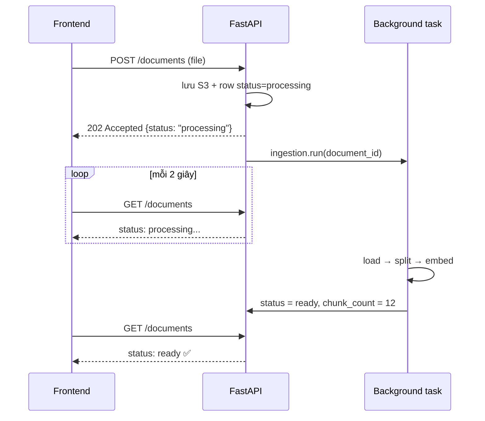

# 05 · Ingestion Pipeline: từ upload đến "ready"

## 🎯 Mục tiêu

- Ghép các bước load → split → embed thành **một pipeline** chạy nền.
- Hiểu vòng đời trạng thái tài liệu: `processing → ready | failed`.
- Hiểu vì sao task nền phải **tự mở DB session** riêng.
- Biết khi nào `BackgroundTasks` là đủ và khi nào cần **job queue thật** (Celery, arq, SQS + worker).

## 📁 File liên quan

- `backend/app/ingestion/pipeline.py` — `IngestionPipeline`
- `backend/app/api/v1/endpoints/documents.py` — `POST /documents` (202 + `BackgroundTasks`)
- `backend/app/models/document.py` — `DocumentStatus`, `chunk_count`, `error`
- `backend/app/main.py` — tạo pipeline trong lifespan
- `backend/tests/test_documents.py` — `test_upload_is_ingested`

---

## 1. Bức tranh tổng thể

`backend/app/ingestion/pipeline.py` mở đầu bằng sơ đồ:

```text
upload ──► [S3] ──► load (pypdf / utf-8) ──► split ──► embed + store [Chroma]
                                                          │
                                 documents.status = ready / failed  [Postgres]
```

Ba hệ thống lưu trữ, mỗi hệ thống một vai trò:

| Lưu ở | Cái gì | Vì sao |
|---|---|---|
| **S3** (Floci local) | File gốc (bytes) | Rẻ, bền, tải về qua presigned URL |
| **Postgres** | Metadata: tên file, owner, `status`, `chunk_count`, `error` | Truy vấn, ràng buộc, ownership |
| **Chroma** | Chunk + embedding + metadata | Semantic search |

## 2. Upload trả 202 ngay, ingest chạy sau

`backend/app/api/v1/endpoints/documents.py`:

```python
    document = await service.upload(user, file)
    # Runs after the response is sent. For heavy workloads use a real job queue
    # (Celery, arq, SQS + worker) so work survives restarts and scales separately.
    background_tasks.add_task(ingestion.run, document.id)
    return DocumentResponse.model_validate(document)
```

Embed một PDF 100 trang có thể mất hàng chục giây (nhiều lời gọi API embedding). Bắt user đợi trong một
HTTP request là trải nghiệm tệ và dễ timeout. Thay vào đó:



`202 Accepted` = "đã nhận, đang xử lý". Frontend poll cho tới khi `ready`/`failed`.

## 3. `run()` từng bước

```python
    async def run(self, document_id: uuid.UUID) -> None:
        """Ingest one document. Runs in the background, so it opens its own DB session."""
        async with self._session_factory() as session:
            document = await session.get(Document, document_id)
            if document is None:
                return
            try:
                data = await self._storage.download(document.s3_key)
                # Parsing a big PDF is CPU-bound: keep it off the event loop.
                pages = await asyncio.to_thread(load_document, data, document.content_type)
                chunks = self.split(document, pages)
                if not chunks:
                    raise ValueError("No text could be extracted from this file")
                await self._vector_store.add_chunks(document.id, chunks)

                document.chunk_count = len(chunks)
                document.status = DocumentStatus.READY
            except Exception as exc:
                logger.exception("Ingestion failed for document %s", document_id)
                document.status = DocumentStatus.FAILED
                document.error = str(exc)[:500]
            await session.commit()
```

| Chi tiết | Lý do |
|---|---|
| Nhận `document_id`, không nhận object `Document` | Task chạy **sau** khi request kết thúc → session của request đã đóng; object gắn với nó không dùng được nữa |
| `self._session_factory()` — session riêng | Mỗi đơn vị công việc một session. Cũng là điều kiện để chuyển sang worker process sau này |
| `if document is None: return` | User có thể xoá tài liệu trước khi task kịp chạy |
| Tải lại bytes từ **S3** | Task không phụ thuộc bộ nhớ của request; worker ở máy khác cũng làm được |
| `asyncio.to_thread(load_document, ...)` | `pypdf` là code sync, CPU-bound. Chạy trong thread để event loop vẫn phục vụ request khác |
| `except Exception` rộng | Task nền không có ai "bắt" lỗi giúp. Mọi lỗi → `failed` + log đầy đủ stack trace |
| `str(exc)[:500]` | Lưu thông điệp lỗi cho UI (tooltip ở badge `failed`), giới hạn độ dài |
| `chunk_count` | Dùng để dựng lại id chunk khi xoá (bài [04](04_EmbeddingsAndVectorStore.md)) |

`DocumentStatus` là `StrEnum` lưu dạng `VARCHAR + CHECK` (`native_enum=False`) → thêm trạng thái mới
(vd. `queued`) không cần `ALTER TYPE`.

## 4. Pipeline được dựng một lần

`backend/app/main.py` (lifespan):

```python
    app.state.ingestion = IngestionPipeline(
        session_factory, storage, vector_store, settings.chunk_size, settings.chunk_overlap
    )
```

Mọi dependency (session factory, storage, vector store) được **inject qua constructor** → test dựng
pipeline với SQLite + moto + `EphemeralClient` và fake embeddings (xem `backend/tests/conftest.py`).

Trong test, `test_upload_is_ingested` kiểm tra luôn trạng thái `ready` ngay sau upload:

```python
    # Background ingestion has finished once the ASGI call returns.
    document = (await client.get(f"/api/v1/documents/{document_id}")).json()
    assert document["status"] == "ready", document
    assert document["chunk_count"] > 1
```

Điều này đúng vì `BackgroundTasks` chạy xong trước khi ASGI call (qua `httpx.ASGITransport`) kết thúc.

## 5. `BackgroundTasks` vs job queue thật

`BackgroundTasks` chạy **trong cùng process** web server, sau khi response được gửi. Đơn giản, không cần
hạ tầng thêm — đủ cho project học và tải nhỏ. Nhưng:

| Vấn đề | `BackgroundTasks` | Job queue (Celery / arq / SQS + worker) |
|---|---|---|
| Server restart / deploy giữa chừng | ❌ Task mất, tài liệu kẹt ở `processing` mãi | ✅ Job nằm trong queue, worker khác nhận |
| Retry khi lỗi tạm thời (API embedding 429) | Tự viết | Có sẵn (backoff, max retries) |
| Scale | Ingest tranh CPU/RAM với request chat | Worker scale riêng, máy riêng |
| Giới hạn đồng thời | Không có | Concurrency per worker, rate limit |
| Quan sát | Chỉ log | Dashboard, dead-letter queue |

Thiết kế hiện tại đã **sẵn sàng** chuyển đổi: `run(document_id)` chỉ cần một id, tự mở session, tự tải
file từ S3. Đổi sang queue = endpoint gửi `document_id` vào queue thay vì `background_tasks.add_task`,
và một worker process gọi `pipeline.run(document_id)`.

> Gợi ý thêm cho production: một job định kỳ quét tài liệu `processing` quá lâu (vd. > 10 phút) và
> đánh dấu `failed` hoặc đưa lại vào queue.

## ⚠️ Lỗi thường gặp

- **Truyền `AsyncSession` của request vào task nền** → `Session is closed` / lỗi connection, vì `get_db` đã đóng session khi response xong.
- **Gọi `load_document` trực tiếp trong async function** → PDF lớn làm cả server "đơ" vài giây.
- **Nuốt lỗi mà không log** → tài liệu `failed` không rõ lý do. Dùng `logger.exception` để có stack trace.
- **Quên `await session.commit()`** → status không bao giờ đổi, frontend poll mãi.
- **Thiếu API key của embedding** → mọi upload `failed` với lỗi authentication; xem cột `error`.

## 🧪 Thực hành

1. Upload một PDF chỉ có ảnh scan → quan sát `status: failed` và `error: "No text could be extracted..."`.
2. Thêm `await asyncio.sleep(5)` đầu `run()`, upload và xem frontend hiển thị `processing` rồi tự đổi sang `ready` nhờ polling.
3. Thêm trường `duration_ms` vào log: đo thời gian từ đầu `run()` tới commit, log bằng `logger.info`.

---

⬅️ Trước: [04 · Embeddings & Vector Store](04_EmbeddingsAndVectorStore.md) · ➡️ Tiếp: [06 · Tools](06_Tools.md)
