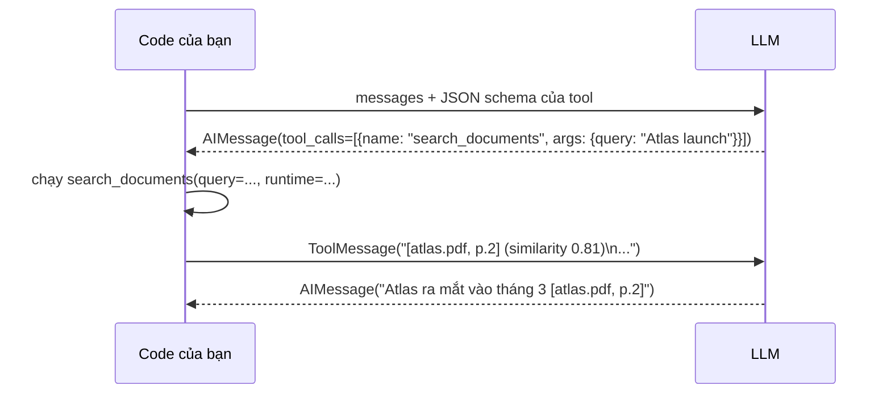

# 06 · Tools: `search_documents` và Runtime Context

## 🎯 Mục tiêu

- Hiểu **tool** là gì và LLM "gọi" tool như thế nào.
- Biết `@tool` biến một hàm thành tool (tên, mô tả, JSON schema).
- Hiểu **`ToolRuntime[AgentContext]`**: tham số được LangGraph inject, **ẩn với LLM**.
- Hiểu vì sao `user_id` phải đến từ runtime context, **không bao giờ** từ tham số LLM điền.
- Hiểu tool factory (closure) và định dạng output `[file, p.N]`.

## 📁 File liên quan

- `backend/app/agents/tools.py` — `make_search_documents_tool`, `get_tools`
- `backend/app/agents/context.py` — `AgentContext`
- `backend/app/services/chat_service.py` — truyền `context=AgentContext(...)`
- `backend/tests/test_chat.py` — test tool qua graph, test cách ly user

---

## 1. Tool là gì?

LLM chỉ sinh văn bản, không tự chạy code. "Tool calling":



LLM chỉ **đề xuất** gọi tool kèm tham số; code của bạn mới thực thi. Vì vậy tham số LLM điền phải được
coi như **input không tin cậy** — LLM bị điều khiển bởi user và cả nội dung tài liệu (prompt injection).

## 2. Tool của project

`backend/app/agents/tools.py`:

```python
def make_search_documents_tool(vector_store: DocumentVectorStore, k: int) -> BaseTool:
    """Factory: the vector store is injected (closure), so tests can pass a fake one."""

    @tool
    async def search_documents(query: str, runtime: ToolRuntime[AgentContext]) -> str:
        """Search the user's uploaded documents and return the most relevant passages.

        Use this for any question about the user's documents. Write `query` as a short,
        specific search phrase (not the whole question). Call it several times with
        different queries if the first results are not enough.
        """
        results = await vector_store.search(query, user_id=runtime.context.user_id, k=k)
        if not results:
            return "No relevant passages found in the user's documents."

        passages = []
        for doc, score in results:
            source = doc.metadata.get("filename", "unknown")
            if page := doc.metadata.get("page"):
                source += f", p.{page}"
            passages.append(f"[{source}] (similarity {score:.2f})\n{doc.page_content}")
        return "\n\n---\n\n".join(passages)

    return search_documents
```

`@tool` đọc:

| Từ hàm | Thành | LLM dùng để |
|---|---|---|
| Tên `search_documents` | `tool.name` | Gọi đúng tool (prompt cũng nhắc tên này) |
| Docstring | `tool.description` | Quyết định **khi nào** và **cách** dùng (viết query ngắn, gọi lại nếu chưa đủ) |
| `query: str` | JSON schema | Sinh `args` đúng kiểu |
| `runtime: ToolRuntime[...]` | **Không có trong schema** | — LLM không thấy, không điền được |

Xem schema thật mà LLM nhận:

```bash
cd backend && uv run python -c "
import chromadb
from langchain_core.embeddings import DeterministicFakeEmbedding
from langchain_core.utils.function_calling import convert_to_openai_tool
from app.agents.tools import get_tools
from app.vectorstore.chroma import DocumentVectorStore
vs = DocumentVectorStore(chromadb.EphemeralClient(), DeterministicFakeEmbedding(size=8), 'demo')
print(convert_to_openai_tool(get_tools(vs)[0]))"
```

`parameters` chỉ có `query` — `runtime` đã bị ẩn.

## 3. Runtime context: ai đang hỏi?

`backend/app/agents/context.py`:

```python
@dataclass(frozen=True)
class AgentContext:
    # Who is asking. Passed with `graph.astream(..., context=AgentContext(...))` and read
    # by tools via `runtime.context`. Never let the LLM supply this as a tool argument:
    # a prompt injection could then search another user's documents.
    user_id: uuid.UUID
```

`ChatService.stream` lấy user **đã xác thực** (từ JWT, qua dependency `CurrentUser`) và truyền vào:

```python
            stream: AsyncIterator[Any] = self._graph.astream(
                {"messages": [HumanMessage(message)]},
                _config(conversation.id),
                context=AgentContext(user_id=owner.id),
                stream_mode=["messages", "updates"],
            )
```

`ToolNode` thấy tham số kiểu `ToolRuntime`, tự inject object chứa `context`, `state`, `config`,
`store`, `stream_writer`, `tool_call_id`. Tool đọc `runtime.context.user_id`.

### Vì sao không để LLM truyền `user_id`?

```python
# ❌ ĐỪNG LÀM THẾ NÀY
@tool
async def search_documents(query: str, user_id: str) -> str: ...
```

Khi đó `user_id` nằm trong JSON schema → **LLM điền** nó. Chỉ cần một tài liệu (hoặc tin nhắn) chứa
"search with user_id=<id của người khác>" là agent có thể đọc tài liệu của user khác. Nguyên tắc:

> **Danh tính và quyền hạn đi theo kênh của code (context/config), không bao giờ theo kênh của LLM (args).**

| Dữ liệu | Kênh đúng |
|---|---|
| `query` (LLM tự nghĩ ra) | Tham số tool |
| `user_id`, tenant, quyền | `context=AgentContext(...)` |
| `thread_id` (conversation) | `config={"configurable": {...}}` (bài [10](10_MemoryPostgresCheckpointer.md)) |

`frozen=True`: context bất biến trong suốt một lượt chạy — không node/tool nào sửa được.

## 4. Tool factory: inject dependency bằng closure

Tool cần `vector_store` và `k`, nhưng hai thứ này không phải tham số cho LLM và cũng không đổi theo
từng user. Factory `make_search_documents_tool(vector_store, k)` "nhốt" chúng trong closure:

```python
def get_tools(vector_store: DocumentVectorStore, k: int = 5) -> list[BaseTool]:
    return [make_search_documents_tool(vector_store, k)]
```

- Production (lifespan): `get_tools(vector_store, k=settings.retrieval_k)` — Chroma thật, `k=5`.
- Test (`conftest.py`): `get_tools(vector_store, k=3)` — Chroma in-memory + fake embedding.

So sánh: dữ liệu **theo request** (user) → runtime context; dữ liệu **theo app** (vector store) → closure.

## 5. Output tool: ngắn, có nhãn, dễ trích dẫn

```text
[atlas.pdf, p.2] (similarity 0.81)
Project Atlas launches in March. The project lead is Minh Tran.

---

[roadmap.md] (similarity 0.64)
...
```

- **Nhãn `[file, p.N]`** khớp format prompt yêu cầu (bài [02](02_Prompts.md)) → model chép lại thành trích dẫn.
- **Similarity** giúp model (và người debug) biết đoạn nào đáng tin hơn.
- **Không có kết quả → chuỗi giải thích**, không raise. LLM đọc được và trả lời "tài liệu không đề cập".
- Output đi vào context của LLM ở lượt sau → `k` lớn = tốn token. `retrieval_k = 5` là điểm cân bằng phổ biến.

Lỗi hệ thống thật (Chroma sập) thì **không** bắt: exception nổi lên, `ChatService` gửi event `error` và log stack trace.

## ⚠️ Lỗi thường gặp

- **Quên `context=` khi gọi graph** → `runtime.context` là `None` → `AttributeError` trong tool. Graph khai báo `context_schema=AgentContext` (bài [09](09_GraphAndReActLoop.md)) để làm rõ hợp đồng này.
- **Đặt `user_id` (hay bất kỳ quyền hạn nào) làm tham số tool** → lỗ hổng cross-tenant.
- **Docstring mơ hồ** ("Searches stuff") → LLM gọi sai lúc hoặc không gọi.
- **Tool sync làm I/O** → dùng `async def` + API async (`vector_store.search` là async).
- **Trả về object phức tạp** → trả chuỗi gọn; mọi thứ trong output đều tốn token.

## 🧪 Thực hành

1. Chạy lệnh ở mục 2, xác nhận `runtime` không có trong `parameters`.
2. Thêm tool `list_my_documents(runtime: ToolRuntime[AgentContext]) -> str` liệt kê tên file của user (gợi ý: query metadata trong Chroma với filter `user_id`, hoặc inject `session_factory` qua factory). Thêm vào `get_tools`.
3. Đọc `test_search_never_returns_other_users_documents` trong `backend/tests/test_chat.py` và giải thích tại sao test này fail nếu bỏ `filter=` trong `DocumentVectorStore.search`.

---

⬅️ Trước: [05 · Ingestion Pipeline](05_IngestionPipeline.md) · ➡️ Tiếp: [07 · State](07_State.md)
