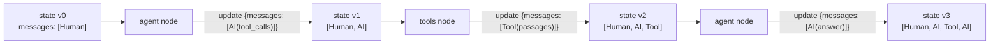

# 07 · State: dữ liệu chảy qua graph

## 🎯 Mục tiêu

- Hiểu **state** trong LangGraph là gì.
- Hiểu **reducer** (`add_messages`) và vì sao node chỉ trả về *partial update*.
- Phân biệt rõ **state** vs **runtime context** vs **config** — ba "kênh" dữ liệu của một lượt chạy.
- Biết `MessagesState` có sẵn và khi nào tự định nghĩa state.

## 📁 File liên quan

- `backend/app/agents/state.py` — `AgentState`
- `backend/app/agents/context.py` — `AgentContext` (để so sánh)
- `backend/app/services/chat_service.py` — input của mỗi lượt

---

## 1. State là gì?

LangGraph là một máy trạng thái: mỗi **node** đọc state hiện tại, trả về một **bản cập nhật**,
LangGraph gộp bản cập nhật vào state rồi chuyển sang node tiếp theo.



## 2. Định nghĩa state

`backend/app/agents/state.py`:

```python
class AgentState(TypedDict):
    # `add_messages` is a *reducer*: when a node returns {"messages": [new_msg]},
    # LangGraph appends (or updates by id) instead of overwriting the list.
    messages: Annotated[list[AnyMessage], add_messages]
```

- `TypedDict`: state là dict có kiểu → mypy kiểm tra được `state["messages"]`.
- `AnyMessage`: union của mọi loại message.
- `Annotated[..., add_messages]`: gắn **reducer** cho key `messages`.

State của document assistant chỉ có **lịch sử hội thoại** — kể cả các `ToolMessage` chứa đoạn văn đã
tìm được. Nhờ vậy ở câu hỏi tiếp theo ("còn trưởng dự án là ai?"), model vẫn thấy các đoạn đã đọc.

## 3. Reducer: "gộp" chứ không "ghi đè"

Không có reducer, node trả `{"messages": [ai_msg]}` → state chỉ còn 1 message.

| State cũ | Node trả về | State mới với `add_messages` |
|---|---|---|
| `[Human]` | `{"messages": [AI]}` | `[Human, AI]` (append) |
| `[Human, AI(id="x")]` | `{"messages": [AI(id="x", content="sửa")]}` | `[Human, AI(id="x", content="sửa")]` (update theo id) |

```python
from langchain_core.messages import AIMessage, HumanMessage
from langgraph.graph.message import add_messages

print(add_messages([HumanMessage("hi", id="1")], [AIMessage("hello", id="2")]))  # 2 messages
```

Vì vậy node chỉ trả **phần thay đổi**, và input mỗi lượt chat chỉ là **tin nhắn mới** — lịch sử cũ đã nằm
trong checkpointer Postgres (bài [10](10_MemoryPostgresCheckpointer.md)):

```python
                {"messages": [HumanMessage(message)]},
```

## 4. Ba kênh dữ liệu: state, context, config

Đây là điểm dễ nhầm nhất khi thiết kế agent:

| Kênh | Project dùng cho | Được lưu (checkpoint)? | Node/tool đọc bằng |
|---|---|---|---|
| **State** (`AgentState`) | `messages` | ✅ Có, sau mỗi bước | `state["messages"]`, `runtime.state` |
| **Context** (`AgentContext`) | `user_id` | ❌ Không — truyền lại mỗi lượt | `runtime.context` |
| **Config** (`RunnableConfig`) | `thread_id`, `recursion_limit` | ❌ Không | `config["configurable"]` |

```python
            self._graph.astream(
                {"messages": [HumanMessage(message)]},        # -> state (gộp vào lịch sử)
                _config(conversation.id),                     # -> config (thread_id)
                context=AgentContext(user_id=owner.id),       # -> context (ai đang hỏi)
                stream_mode=["messages", "updates"],
            )
```

Vì sao `user_id` **không** nằm trong state?

- State được lưu lại và có thể bị node khác **ghi đè** qua update. Danh tính phải bất biến và do code
  quyết định mỗi lượt (lấy từ JWT), không phải "nhớ" từ lần trước.
- Context không bị serialize vào Postgres → không cần lo dữ liệu nhạy cảm nằm trong bảng checkpoint.

## 5. `MessagesState` & mở rộng state

LangGraph có sẵn `from langgraph.graph import MessagesState` — tương đương `AgentState`. Project tự
định nghĩa để thấy rõ cơ chế reducer và dễ mở rộng:

```python
class AgentState(TypedDict):
    messages: Annotated[list[AnyMessage], add_messages]
    searches: Annotated[int, operator.add]   # reducer cộng dồn: đếm số lần search
    summary: str                             # không reducer -> ghi đè
```

## 6. Nguyên tắc thiết kế state

- Chỉ lưu thứ **cần qua nhiều node** hoặc **cần nhớ qua nhiều lượt**.
- Mọi thứ trong state phải **serializable** (checkpointer lưu vào Postgres) — không đặt DB session,
  Chroma client, model vào state.
- Dependency dùng chung (model, vector store) → inject qua constructor/closure (bài [06](06_Tools.md),
  [08](08_NodesAndBindTools.md)). Dữ liệu theo request (user) → context.

## ⚠️ Lỗi thường gặp

- **Quên `Annotated[..., add_messages]`** → mỗi node ghi đè lịch sử; agent mất trí nhớ ngay trong một lượt.
- **Trả về toàn bộ list** (`state["messages"] + [response]`) → khó hiểu, dễ trùng. Chỉ trả phần mới.
- **Mutate state trực tiếp** (`state["messages"].append(x)`) → LangGraph không biết có thay đổi.
- **Nhét `user_id` vào state "cho tiện"** → nó bị lưu vào checkpoint và có thể bị ghi đè; dùng context.

## 🧪 Thực hành

1. Thêm `searches: Annotated[int, operator.add]` vào `AgentState`; trong một node bọc quanh `ToolNode` (hoặc trong `AgentNode` khi có `tool_calls`), trả thêm `"searches": 1`. Sau vài câu hỏi, đọc `(await graph.aget_state(config)).values["searches"]`.
2. Chạy đoạn `add_messages` ở mục 3 với hai message **cùng id** và quan sát.
3. Thay `AgentState` bằng `MessagesState` trong `graph.py`/`nodes.py`, chạy `uv run pytest` — còn pass không?

---

⬅️ Trước: [06 · Tools](06_Tools.md) · ➡️ Tiếp: [08 · Nodes & bind_tools](08_NodesAndBindTools.md)
