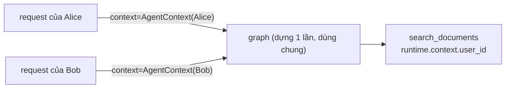
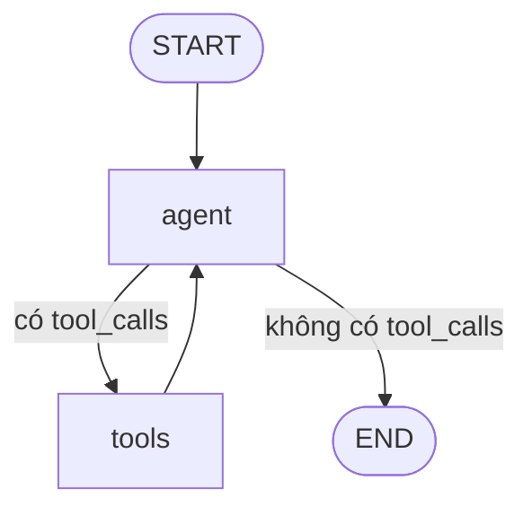

# 09 · Graph & vòng lặp ReAct (với Runtime Context)

## 🎯 Mục tiêu

- Dựng graph bằng `StateGraph`: `add_node`, `add_edge`, `START`/`END`.
- Hiểu **conditional edge** với `tools_condition` và vòng lặp **ReAct**.
- Hiểu `context_schema=AgentContext` và cách truyền `context=` khi chạy graph.
- Biết `compile()` làm gì và cách vẽ graph ra mermaid.

## 📁 File liên quan

- `backend/app/agents/graph.py` — `build_agent_graph`
- `backend/app/services/chat_service.py` — `astream(..., context=...)`
- `backend/scripts/run_agent.py` — chạy graph ngoài FastAPI

---

## 1. Toàn bộ graph

`backend/app/agents/graph.py`:

```python
def build_agent_graph(
    model: BaseChatModel,
    tools: Sequence[BaseTool],
    checkpointer: BaseCheckpointSaver[str] | None = None,
) -> CompiledStateGraph[AgentState, AgentContext]:
    # `context_schema` declares what every run must receive via `context=...`.
    builder = StateGraph(AgentState, context_schema=AgentContext)
    builder.add_node(AGENT_NODE, AgentNode(model, tools))
    builder.add_node(TOOLS_NODE, ToolNode(list(tools)))

    builder.add_edge(START, AGENT_NODE)
    # `tools_condition` routes to "tools" if the last AI message has tool_calls, else END.
    builder.add_conditional_edges(AGENT_NODE, tools_condition, {"tools": TOOLS_NODE, END: END})
    builder.add_edge(TOOLS_NODE, AGENT_NODE)

    # The checkpointer saves state after every step, keyed by `thread_id`,
    # which gives the agent multi-turn memory (persisted in Postgres).
    return builder.compile(checkpointer=checkpointer)
```

| Dòng | Ý nghĩa |
|---|---|
| `StateGraph(AgentState, context_schema=AgentContext)` | Builder với schema state (bài [07](07_State.md)) **và** schema context |
| `add_node(name, callable)` | Đăng ký node. Tên xuất hiện trong metadata streaming |
| `add_edge(START, AGENT_NODE)` | Graph luôn bắt đầu ở `agent` |
| `add_conditional_edges(...)` | Sau `agent`, gọi `tools_condition(state)` để chọn đường |
| `add_edge(TOOLS_NODE, AGENT_NODE)` | Tool chạy xong **quay lại** `agent` → vòng lặp |
| `compile(checkpointer=...)` | Validate, trả `CompiledStateGraph` chạy được |

`tools` là tham số **bắt buộc**: graph không tự tạo tool vì tool cần vector store (được dựng trong
lifespan). Tên node là hằng số `AGENT_NODE = "agent"`, `TOOLS_NODE = "tools"` — `ChatService` import lại
để lọc sự kiện streaming (bài [11](11_Streaming.md)).

Kiểu trả về `CompiledStateGraph[AgentState, AgentContext]` cho mypy biết graph này cần context gì.

## 2. `context_schema` và truyền context lúc chạy

`context_schema` là **hợp đồng**: mọi lần chạy graph phải kèm một `AgentContext`. Graph được dựng **một
lần** cho cả app, nhưng mỗi request có một user khác nhau — context là cách đưa "ai đang hỏi" vào lượt
chạy cụ thể:

```python
# backend/app/services/chat_service.py
            stream: AsyncIterator[Any] = self._graph.astream(
                {"messages": [HumanMessage(message)]},
                _config(conversation.id),
                context=AgentContext(user_id=owner.id),
                stream_mode=["messages", "updates"],
            )
```

```python
# backend/scripts/run_agent.py
        async for update in graph.astream(
            {"messages": [HumanMessage(text)]}, config, context=context, stream_mode="updates"
        ):
```



Graph dùng chung là an toàn vì nó **không giữ trạng thái theo user**: state nằm trong checkpointer (theo
`thread_id`), danh tính nằm trong context (theo lượt chạy).

## 3. Conditional edge & `tools_condition`

`tools_condition` nhìn message cuối: `AIMessage` có `tool_calls` → `"tools"`, ngược lại → `END`. Dict
`{"tools": TOOLS_NODE, END: END}` ánh xạ giá trị trả về → node đích (giúp LangGraph biết mọi nhánh để
vẽ và validate). Tương đương tự viết:

```python
def route(state: AgentState) -> str:
    last = state["messages"][-1]
    return "tools" if getattr(last, "tool_calls", None) else END
```

## 4. Vòng lặp ReAct trong RAG



Câu hỏi *"So sánh ngày ra mắt Atlas và Orion"*:

```mermaid
sequenceDiagram
    participant A as agent (LLM)
    participant T as tools
    Note over A: Reason: cần thông tin 2 dự án
    A->>T: search_documents("Atlas launch date"), search_documents("Orion launch date")
    T->>A: ToolMessage([atlas.pdf, p.2] ...), ToolMessage([orion.md] ...)
    Note over A: Observe: Orion chưa rõ → tìm lại
    A->>T: search_documents("Orion release timeline")
    T->>A: ToolMessage(...)
    A-->>A: AIMessage("Atlas: tháng 3 [atlas.pdf, p.2]; Orion: Q3 [orion.md]") → END
```

**ReAct** = *Reasoning + Acting*: LLM xen kẽ suy nghĩ và hành động, quan sát kết quả rồi quyết định
tiếp — ở đây là **agentic RAG**: chính LLM quyết định search gì, search mấy lần. Khác RAG "cổ điển"
(luôn search đúng một lần bằng nguyên câu hỏi), agent có thể tách câu hỏi, viết lại query, hoặc không
search khi chỉ là lời chào.

## 5. Giới hạn số bước: `recursion_limit`

LLM search mãi không dừng → LangGraph raise `GraphRecursionError` sau một số super-step (mặc định 25):

```python
config = {"configurable": {"thread_id": "t1"}, "recursion_limit": 10}
```

`ChatService` bắt mọi exception trong stream và gửi event `error` cho frontend.

## 6. Vẽ graph

```bash
cd backend && uv run python -c "
import chromadb
from langchain_core.embeddings import DeterministicFakeEmbedding
from tests.conftest import FakeToolCallingModel
from app.agents import build_agent_graph, get_tools
from app.vectorstore.chroma import DocumentVectorStore
vs = DocumentVectorStore(chromadb.EphemeralClient(), DeterministicFakeEmbedding(size=8), 'demo')
print(build_agent_graph(FakeToolCallingModel(messages=iter([])), get_tools(vs)).get_graph().draw_mermaid())"
```

Output (rút gọn) — dán vào https://mermaid.live:

```text
	__start__ --> agent;
	agent -.-> __end__;
	agent -.-> tools;
	tools --> agent;
```

Mũi tên nét đứt `-.->` là conditional edge.

## ⚠️ Lỗi thường gặp

- **Quên `context=` khi gọi graph** → `runtime.context` là `None` trong tool → `AttributeError: 'NoneType' object has no attribute 'user_id'`.
- **Tạo graph mới cho mỗi user để "nhốt" user_id** → lãng phí và không cần: dùng context.
- **Quên `add_edge(TOOLS_NODE, AGENT_NODE)`** → tool chạy xong graph dừng, user không nhận câu trả lời.
- **Gọi `builder.astream`** thay vì graph đã `compile()`.
- **Dựng graph mỗi request** → project dựng một lần trong lifespan (`app.state.graph`).

## 🧪 Thực hành

1. Thay `tools_condition` bằng hàm `route` ở mục 3, chạy `uv run pytest` để xác nhận hành vi không đổi.
2. Thêm field `language: str = "vi"` vào `AgentContext`, truyền từ `ChatService`, và trong `AgentNode` đọc nó để thêm "Answer in {language}" vào system prompt. (Gợi ý: node có thể nhận tham số `runtime: Runtime[AgentContext]` từ `langgraph.runtime`.)
3. Gọi graph với `"recursion_limit": 2` và một câu hỏi cần tool — quan sát `GraphRecursionError`.

---

⬅️ Trước: [08 · Nodes & bind_tools](08_NodesAndBindTools.md) · ➡️ Tiếp: [10 · Memory với Postgres Checkpointer](10_MemoryPostgresCheckpointer.md)
