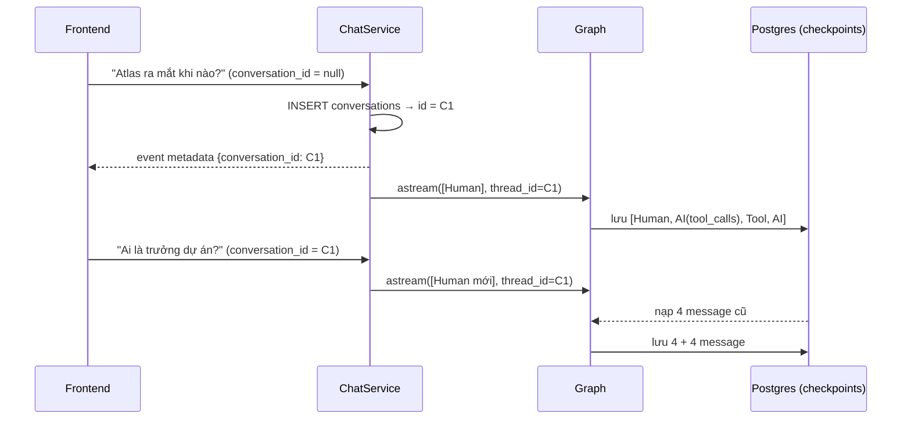

# 10 · Memory với Postgres Checkpointer

## 🎯 Mục tiêu

- Hiểu cách agent "nhớ" hội thoại nhiều lượt: **checkpointer + `thread_id`**.
- Dựng `AsyncPostgresSaver` trên `AsyncConnectionPool` trong lifespan, gọi `setup()`.
- Hiểu quan hệ giữa bảng `conversations` (của ta) và các bảng `checkpoint*` (của LangGraph).
- Biết vì sao Alembic phải **bỏ qua** bảng của LangGraph, và cách xoá hội thoại thật sự (`adelete_thread`).
- Biết vì sao test dùng `InMemorySaver`.

## 📁 File liên quan

- `backend/app/main.py` — tạo pool + checkpointer trong lifespan
- `backend/app/core/config.py` — `checkpointer_conninfo`
- `backend/app/models/conversation.py` — bảng `conversations`
- `backend/app/services/chat_service.py` — `_config`, `messages`, `delete_conversation`
- `backend/migrations/env.py` — `include_object`
- `backend/tests/test_chat.py` — test lịch sử & xoá

---

## 1. LLM không có trí nhớ

Mỗi lần gọi LLM là độc lập; muốn nó "nhớ", phải gửi lại lịch sử. Project để **server** giữ lịch sử:
client chỉ gửi tin nhắn mới + `conversation_id`. Khi graph được compile với checkpointer, **sau mỗi
bước** LangGraph lưu một *checkpoint* (snapshot state) theo `thread_id`; lượt sau nạp lại và gộp input
mới qua reducer `add_messages`.



## 2. `thread_id` = id của conversation

```python
def _config(conversation_id: uuid.UUID) -> RunnableConfig:
    # `thread_id` tells the checkpointer which conversation to load/save.
    return {"configurable": {"thread_id": str(conversation_id)}}
```

Hai nơi lưu, hai trách nhiệm:

| Bảng | Ai quản lý | Chứa |
|---|---|---|
| `conversations` | Ta (SQLAlchemy + Alembic) | `id`, `owner_id`, `title`, `created_at`, `updated_at` — **ownership** và sidebar |
| `checkpoints`, `checkpoint_blobs`, `checkpoint_writes`, `checkpoint_migrations` | LangGraph | Message đã serialize — **nội dung** hội thoại |

`backend/app/models/conversation.py`:

```python
class Conversation(UUIDPrimaryKeyMixin, TimestampMixin, Base):
    """Ownership + title of a chat thread.

    The messages themselves are stored by the LangGraph Postgres checkpointer,
    keyed by `thread_id == str(conversation.id)`.
    """
```

**Vì sao không để client tự sinh `thread_id`?** Checkpointer không biết khái niệm "user". Nếu ai đoán
được `thread_id` của người khác thì đọc được hội thoại. Bảng `conversations` gắn mỗi thread với
`owner_id`, và **mọi** truy cập đi qua kiểm tra ownership trước:

```python
    async def get_conversation(self, owner: User, conversation_id: uuid.UUID) -> Conversation:
        conversation = await self._session.scalar(
            select(Conversation).where(
                Conversation.id == conversation_id, Conversation.owner_id == owner.id
            )
        )
        if conversation is None:
            raise NotFoundError("Conversation not found")
```

Với `POST /chat/stream`, việc này chạy trong dependency `ChatConversation` **trước** khi SSE bắt đầu,
để trả được 404 thật (sau khi stream bắt đầu, status 200 đã gửi đi rồi).

## 3. Dựng checkpointer trong lifespan

`backend/app/main.py`:

```python
    # Postgres (psycopg pool) for LangGraph checkpoints = the agent's conversation memory.
    checkpoint_pool = AsyncConnectionPool(
        settings.checkpointer_conninfo,
        max_size=settings.db_pool_size,
        kwargs={"autocommit": True, "prepare_threshold": 0, "row_factory": dict_row},
        open=False,
    )
    await checkpoint_pool.open()
    checkpointer = AsyncPostgresSaver(checkpoint_pool)  # type: ignore[arg-type]
    await checkpointer.setup()  # creates/migrates LangGraph's own tables (idempotent)
```

| Chi tiết | Lý do |
|---|---|
| `AsyncConnectionPool` | Nhiều request chat đồng thời dùng chung vài connection, không mở mới mỗi lần |
| `autocommit=True` | `AsyncPostgresSaver` yêu cầu: mỗi lần ghi checkpoint commit ngay |
| `row_factory=dict_row` | Saver đọc row dạng dict |
| `prepare_threshold=0` | Tắt prepared statements — an toàn khi đi qua PgBouncer / RDS Proxy |
| `open=False` + `await open()` | Mở pool **bên trong** event loop (khuyến nghị của psycopg cho async) |
| `setup()` | Tạo/migrate bảng `checkpoint*`. Idempotent → gọi mỗi lần khởi động được |
| `await checkpoint_pool.close()` trong `finally` | Shutdown gọn: trả connection thay vì cắt ngang |

`checkpointer_conninfo` trong `Settings` đổi URL SQLAlchemy sang URL libpq thuần:

```python
    @property
    def checkpointer_conninfo(self) -> str:
        """LangGraph's Postgres checkpointer wants a plain libpq URL (no `+psycopg`)."""
        return self.database_url.replace("postgresql+psycopg://", "postgresql://", 1)
```

Cùng một database (RDS ở production), hai "client": SQLAlchemy cho bảng của ta, psycopg pool cho LangGraph.

## 4. Alembic phải bỏ qua bảng của LangGraph

Bảng `checkpoint*` không có trong `Base.metadata`. Nếu không chặn, `alembic revision --autogenerate`
sẽ thấy "bảng thừa" và sinh lệnh **DROP** chúng. `backend/migrations/env.py`:

```python
# Tables owned by LangGraph's checkpointer (created by `AsyncPostgresSaver.setup()`).
# Alembic must not try to drop them just because they aren't in our models.
LANGGRAPH_TABLES = {"checkpoints", "checkpoint_blobs", "checkpoint_writes", "checkpoint_migrations"}


def include_object(
    obj: Any, name: str | None, type_: str, reflected: bool, compare_to: Any
) -> bool:
    return not (type_ == "table" and name in LANGGRAPH_TABLES)
```

Nguyên tắc: **mỗi bảng có đúng một chủ** quản lý schema.

## 5. Đọc lại và xoá lịch sử

```python
    async def messages(self, owner: User, conversation_id: uuid.UUID) -> list[ChatMessage]:
        conversation = await self.get_conversation(owner, conversation_id)  # ownership check
        snapshot = await self._graph.aget_state(_config(conversation.id))
        result: list[ChatMessage] = []
        for msg in snapshot.values.get("messages", []):
            if isinstance(msg, HumanMessage):
                result.append(ChatMessage(role="user", content=msg.text))
            elif isinstance(msg, AIMessage) and msg.text:
                result.append(ChatMessage(role="assistant", content=msg.text))
        return result
```

`aget_state` trả checkpoint mới nhất; ta lọc bỏ `ToolMessage` (đoạn văn đã search) và `AIMessage` chỉ
có tool call → UI chỉ hiện phần hội thoại.

Xoá hội thoại phải xoá **cả** checkpoint, không chỉ row của ta:

```python
        # Delete the stored messages too, not just our row (privacy: "delete" means delete).
        if isinstance(self._graph.checkpointer, BaseCheckpointSaver):
            await self._graph.checkpointer.adelete_thread(str(conversation.id))
        await self._session.delete(conversation)
```

## 6. Test dùng `InMemorySaver`

`backend/tests/conftest.py` compile graph với `checkpointer=InMemorySaver()` — cùng interface
`BaseCheckpointSaver`, không cần Postgres. Nhờ `build_agent_graph` nhận checkpointer qua tham số, đổi
storage không sửa code agent. `test_conversation_is_persisted_and_listed` kiểm tra lịch sử sau 2 lượt là
`["Hello there", "First answer", "And again", "Second answer"]`.

## ⚠️ Lỗi thường gặp

- **Truyền `postgresql+psycopg://...` cho psycopg** → lỗi parse URL. Dùng `checkpointer_conninfo`.
- **Quên `autocommit=True` / `dict_row`** → lỗi khó hiểu khi saver ghi/đọc.
- **Quên `checkpointer.setup()`** trên DB mới → `relation "checkpoints" does not exist`.
- **Autogenerate migration mà không có `include_object`** → migration xoá sạch lịch sử chat.
- **Chỉ xoá row `conversations`** → message vẫn nằm trong `checkpoint*` (vi phạm quyền riêng tư).
- **Dùng `InMemorySaver` ở production với nhiều worker** → mỗi worker một bộ nhớ, mất hết khi restart.

## 🧪 Thực hành

1. Chat 2 lượt qua frontend, rồi `docker compose exec postgres psql -U app -c "select thread_id, count(*) from checkpoints group by 1;"`. Đối chiếu `thread_id` với `select id, title from conversations;`.
2. Restart backend và mở lại hội thoại — lịch sử còn không? (So với phase 1 dùng `InMemorySaver`.)
3. Dùng `graph.aget_state_history(config)` trong `scripts/run_agent.py` để in số checkpoint sau mỗi câu hỏi.

---

⬅️ Trước: [09 · Graph & ReAct loop](09_GraphAndReActLoop.md) · ➡️ Tiếp: [11 · Streaming](11_Streaming.md)
