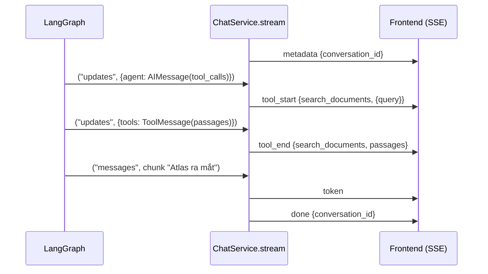

# 11 · Streaming: từ token LLM tới `StreamEvent`

## 🎯 Mục tiêu

- Phân biệt các `stream_mode` của LangGraph: `values`, `updates`, `messages`.
- Hiểu khi dùng **nhiều mode cùng lúc**, mỗi item là tuple `(mode, payload)`.
- Dùng `metadata["langgraph_node"]` để chỉ lấy token từ node `agent`.
- Hiểu `ChatService.stream()` chuyển dữ liệu LangGraph thành giao thức sự kiện
  `metadata → (token | tool_start | tool_end)* → done | error`.

## 📁 File liên quan

- `backend/app/services/chat_service.py` — `stream()`, `_events_from_update()`
- `backend/app/schemas/chat.py` — `StreamEvent`
- `backend/scripts/run_agent.py` — ví dụ `stream_mode="updates"`

---

## 1. Vì sao stream?

Một câu hỏi RAG = ít nhất 2 lượt LLM + 1 lần search → vài giây. Streaming hiển thị **từng token** và
**từng bước tool** ("🔎 search_documents…") ngay khi có, user không nhìn màn hình trống.

## 2. Các stream mode

`graph.astream(input, config, context=..., stream_mode=...)`:

| Mode | Mỗi item là | Dùng cho |
|---|---|---|
| `"values"` | **Toàn bộ state** sau mỗi bước | Debug |
| `"updates"` | `{node_name: update}` — phần thay đổi của node vừa chạy | Biết tool nào được gọi, kết quả gì |
| `"messages"` | `(message_chunk, metadata)` — **từng token** LLM | Hiệu ứng "đang gõ" |

Với câu hỏi cần search, `stream_mode="updates"` cho ra:

```python
{"agent": {"messages": [AIMessage("", tool_calls=[{"name": "search_documents", "args": {"query": "Atlas"}, ...}])]}}
{"tools": {"messages": [ToolMessage("[atlas.pdf, p.2] (similarity 0.81)\n...", name="search_documents")]}}
{"agent": {"messages": [AIMessage("Atlas ra mắt vào tháng 3 [atlas.pdf, p.2].")]}}
```

`backend/scripts/run_agent.py` dùng đúng mode này để in từng bước:

```python
        async for update in graph.astream(
            {"messages": [HumanMessage(text)]}, config, context=context, stream_mode="updates"
        ):
            for node, state_update in update.items():
```

## 3. Nhiều mode cùng lúc

API cần **cả** token **lẫn** sự kiện tool. Truyền list mode → mỗi item là `(mode, payload)`:

```python
            # Two stream modes at once -> items are (mode, payload) tuples:
            #   "messages": (message_chunk, metadata) for every LLM token
            #   "updates":  {node_name: state_update} after every node finishes
            stream: AsyncIterator[Any] = self._graph.astream(
                {"messages": [HumanMessage(message)]},
                _config(conversation.id),
                context=AgentContext(user_id=owner.id),
                stream_mode=["messages", "updates"],
            )
            async for mode, payload in stream:
```

## 4. Lọc token theo node

```python
                if mode == "messages":
                    chunk, metadata = payload
                    # Usually AIMessageChunk; a full AIMessage if the model doesn't stream.
                    if (
                        isinstance(chunk, AIMessage)
                        and metadata.get("langgraph_node") == AGENT_NODE
                        and chunk.text
                    ):
                        yield StreamEvent(type="token", content=chunk.text)
```

- Mode `messages` bắt token từ **mọi** lời gọi LLM trong graph. Nếu sau này thêm node dùng LLM (viết lại
  query, chấm điểm passage — xem bài [13](13_NextSteps.md)), token của chúng cũng xuất hiện.
  `metadata["langgraph_node"]` cho biết token từ node nào → chỉ giữ `agent`.
- `isinstance(chunk, AIMessage)`: `AIMessageChunk` là subclass của `AIMessage` → đúng cho cả chunk lẫn
  message nguyên vẹn (fake model trong test không stream). Nó cũng loại `ToolMessage` — vì sao? Mode
  `messages` phát cả message do **node** trả về, gồm `ToolMessage` của node `tools`; ta không muốn đoạn
  văn thô từ tài liệu "chảy" vào câu trả lời.
- `chunk.text` rỗng với chunk chỉ chứa mảnh tool call → bỏ qua.

## 5. Sự kiện tool từ `updates`

```python
def _events_from_update(update: dict[str, Any]) -> list[StreamEvent]:
    events: list[StreamEvent] = []
    for node, node_update in update.items():
        for msg in (node_update or {}).get("messages", []):
            if node == AGENT_NODE and isinstance(msg, AIMessage):
                events += [
                    StreamEvent(type="tool_start", tool_name=tc["name"], tool_input=tc["args"])
                    for tc in msg.tool_calls
                ]
            elif node == TOOLS_NODE and isinstance(msg, ToolMessage):
                events.append(StreamEvent(type="tool_end", tool_name=msg.name, content=msg.text))
    return events
```

Lấy `tool_calls` từ `updates` (không từ `messages`) vì ở mode `messages` tham số đến theo **mảnh JSON**
(`'{"que'`, `'ry": "Atl'`…). Ở `updates`, `AIMessage` đã hoàn chỉnh, `args` là dict.

`tool_end.content` chứa các đoạn văn tìm được → frontend hiển thị trong card thu gọn để user kiểm chứng
nguồn mà agent đã đọc.

## 6. Giao thức sự kiện



`backend/app/schemas/chat.py`:

```python
StreamEventType = Literal["metadata", "token", "tool_start", "tool_end", "done", "error"]


class StreamEvent(BaseModel):
    """One SSE event. `type` is sent as the SSE `event:` field, the rest as JSON `data:`."""

    type: StreamEventType
    conversation_id: uuid.UUID | None = None
    content: str | None = None
    tool_name: str | None = None
    tool_input: dict[str, object] | None = None
```

| `type` | Khi nào |
|---|---|
| `metadata` | Đầu tiên — frontend biết `conversation_id` ngay (hội thoại mới vừa được tạo) |
| `token` | Mỗi mẩu text của LLM |
| `tool_start` / `tool_end` | Agent gọi tool / tool trả kết quả |
| `done` | Kết thúc thành công |
| `error` | Có exception — gửi *trong luồng* vì HTTP 200 đã được gửi |

```python
        except Exception:
            # Headers (200 OK) are already sent, so we report errors in-band.
            logger.exception("Agent stream failed")
            yield StreamEvent(type="error", content="The assistant failed to answer.")
            return
```

Thông điệp gửi client là chung chung; chi tiết (stack trace) chỉ nằm trong log server.

Cách endpoint đóng gói `StreamEvent` thành SSE (`EventSourceResponse`, header `Cache-Control:
no-transform` để proxy không gzip/buffer) được giải thích ở [Backend 13 · Streaming SSE](../backend/13_StreamingSSE.md).

## ⚠️ Lỗi thường gặp

- **Không lọc theo `langgraph_node`** → token của LLM phụ trợ lẫn vào câu trả lời.
- **Không kiểm tra `isinstance(chunk, AIMessage)`** → nội dung `ToolMessage` (đoạn văn tài liệu) bị stream như câu trả lời.
- **Unpack sai**: một mode → item là payload; list mode → item là `(mode, payload)`.
- **Quên `context=` trong `astream`** → tool lỗi ngay lần search đầu (bài [09](09_GraphAndReActLoop.md)).
- **Raise exception giữa stream** → client chỉ thấy kết nối đứt. Bắt lỗi, gửi event `error`.

## 🧪 Thực hành

1. Trong `scripts/run_agent.py`, đổi sang `stream_mode="values"` và in `len(state["messages"])` mỗi bước.
2. Viết script nhỏ dùng `stream_mode="messages"`, in `type(chunk).__name__`, `metadata["langgraph_node"]` cho từng item — thấy `ToolMessage` từ node `tools` xuất hiện ở đâu?
3. Thêm event `sources` (gửi danh sách tên file duy nhất tìm thấy trong `tool_end`) vào `StreamEventType` và `_events_from_update`; cập nhật `backend/tests/test_chat.py`.

---

⬅️ Trước: [10 · Memory với Postgres Checkpointer](10_MemoryPostgresCheckpointer.md) · ➡️ Tiếp: [12 · Testing Agents](12_TestingAgents.md)
