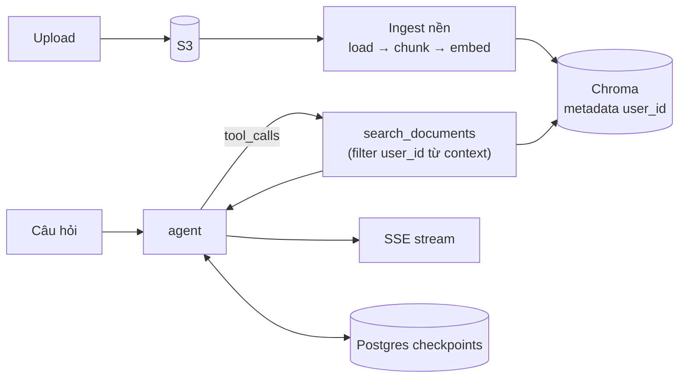

# 13 · Next Steps: đưa trợ lý tài liệu đi xa hơn

## 🎯 Mục tiêu

- Nhìn lại kiến trúc agent RAG đã xây và biết **giới hạn** hiện tại của nó.
- Biết các hướng nâng cấp phổ biến: chất lượng retrieval, quan sát (observability), vận hành, tính năng agent.
- Với mỗi hướng: **vì sao cần**, **sửa ở đâu** trong project, và test thế nào.

## 📁 File liên quan

- `backend/app/agents/` — `graph.py`, `nodes.py`, `tools.py`, `prompts.py`, `state.py`
- `backend/app/vectorstore/chroma.py` — `DocumentVectorStore`
- `backend/app/ingestion/loaders.py`, `backend/app/ingestion/pipeline.py`
- `backend/app/services/chat_service.py`
- `backend/tests/` — mọi thay đổi nên kèm test theo kiểu bài [12](12_TestingAgents.md)

---

## 1. Nhìn lại: ta đã có gì?



| Bài | Khái niệm |
|---|---|
| [01](01_LangChainFundamentals.md)–[02](02_Prompts.md) | Model, message, prompt có trích dẫn |
| [03](03_DocumentLoadersAndChunking.md)–[05](05_IngestionPipeline.md) | Loader, chunking, embeddings, Chroma, pipeline ingest |
| [06](06_Tools.md)–[09](09_GraphAndReActLoop.md) | Tool với `ToolRuntime`, state, node, graph ReAct, context |
| [10](10_MemoryPostgresCheckpointer.md)–[12](12_TestingAgents.md) | Memory Postgres, streaming, testing |

Phần còn lại là danh sách hướng đi — chọn theo vấn đề bạn **thực sự gặp**, đừng làm tất cả.

## 2. Viết gọn hơn với `create_agent`

LangChain v1 có `create_agent` dựng sẵn vòng ReAct (model ↔ tools) mà ta tự viết ở bài 08–09:

```python
from langchain.agents import create_agent

graph = create_agent(
    model, tools=get_tools(vector_store), system_prompt=SYSTEM_PROMPT,
    context_schema=AgentContext, checkpointer=checkpointer,
)
```

Project tự dựng `StateGraph` để bạn **thấy** từng mảnh. Nếu chuyển sang `create_agent`, lưu ý tên node
là `"model"` và `"tools"` — phải sửa `AGENT_NODE` mà `ChatService` dùng để lọc token (bài [11](11_Streaming.md)),
nếu không frontend sẽ không nhận token nào. Test hiện có sẽ bắt được lỗi này.

## 3. Quan sát & đánh giá: LangSmith

Test với fake model chứng minh code đúng, **không** chứng minh câu trả lời tốt. Cần:

- **Tracing**: xem từng lượt LLM, query agent gửi cho tool, passage trả về, token, độ trễ.
- **Evaluation**: bộ câu hỏi mẫu + đáp án, chạy định kỳ, chấm "có trích dẫn đúng nguồn không",
  "có bịa khi tài liệu không có không".

```bash
export LANGSMITH_TRACING=true
export LANGSMITH_API_KEY=...
export LANGSMITH_PROJECT=document-assistant
```

⚠️ Biến phải nằm trong **môi trường process**. `Settings` (pydantic-settings) đọc `.env` vào object
nhưng **không** export ra `os.environ`, nên chỉ thêm vào `.env` của backend là chưa đủ — đặt trong
`environment:` của docker compose / task definition.

## 4. Chất lượng retrieval

| Kỹ thuật | Vấn đề giải quyết | Sửa ở đâu |
|---|---|---|
| **Reranking** (Cohere Rerank, cross-encoder) | Top-k theo vector chưa chắc là đoạn tốt nhất | Lấy `k=20` từ Chroma, rerank còn 4 trong `DocumentVectorStore.search` |
| **Hybrid search** (BM25 + vector) | Từ khoá chính xác (mã lỗi, tên riêng) mà embedding bỏ lỡ | Thêm index từ khoá, gộp điểm bằng Reciprocal Rank Fusion |
| **Query rewriting** | Câu hỏi nối tiếp "còn dự án kia thì sao?" thiếu ngữ cảnh | Agent đã tự viết query; có thể thêm node rewrite trước `agent` |
| **Ngưỡng similarity** | Đoạn "gần nhất" vẫn không liên quan | Lọc theo điểm trong tool, trả "No relevant passages" |
| **Chunking theo cấu trúc** | Bảng, heading bị cắt ngang | Splitter theo Markdown/HTML header (bài [03](03_DocumentLoadersAndChunking.md)) |

Thêm node dùng LLM (rewrite, chấm điểm) → nhớ token của nó cũng vào mode `messages`; filter
`langgraph_node` hiện tại đã chặn đúng.

## 5. Ingestion cho production

- **Task queue thật** (Celery, arq, SQS + worker): `BackgroundTasks` chạy trong process API — restart là
  mất việc đang dở, file lớn chiếm CPU của API. Queue cho retry, giới hạn đồng thời, scale worker riêng.
- **OCR cho PDF scan**: `pypdf` (`_load_pdf`) chỉ đọc text layer; PDF ảnh cho 0 chunk. Dùng Textract / Unstructured
  / Tesseract, hoặc ít nhất đánh dấu `failed` với thông báo rõ.
- **Định dạng mới** (DOCX, HTML): thêm hàm vào `LOADERS` + `EXTENSION_TO_CONTENT_TYPE` trong `loaders.py`, kèm test như `test_text_loader`.
- **Re-ingest khi đổi model embedding**: vector của model cũ và mới không so được với nhau — cần collection
  mới và chạy lại toàn bộ.

## 6. Trải nghiệm & an toàn

- **Event `sources` khi stream**: gửi danh sách file đã trích dẫn để frontend hiện chip nguồn, click mở
  presigned URL (bài [11](11_Streaming.md), thực hành 3).
- **Rate limit theo user**: mỗi câu hỏi tốn tiền LLM + embedding. Giới hạn số request/phút theo `user_id`
  (Redis token bucket), và hạn mức upload.
- **Giới hạn ngữ cảnh**: hội thoại dài + nhiều `ToolMessage` → vượt context window, chi phí tăng.
  Dùng `trim_messages` trong `AgentNode` hoặc `SummarizationMiddleware` (nếu dùng `create_agent`). Chỉ cắt
  phần gửi LLM, checkpoint vẫn giữ đầy đủ.
- **Prompt injection từ tài liệu**: passage là dữ liệu do user tải lên, có thể chứa "bỏ qua hướng dẫn…".
  Bọc passage trong delimiter rõ ràng và nhắc trong system prompt rằng đó là dữ liệu, không phải lệnh.

## 7. Tính năng agent nâng cao

- **Structured output**: `model.with_structured_output(Answer)` với `Answer(text, citations: list[Citation])`
  → frontend render trích dẫn chắc chắn thay vì parse `[file, p.N]`.
- **Human-in-the-loop**: `interrupt()` của LangGraph dừng graph chờ user xác nhận (vd. trước khi tool
  xoá/gửi gì đó); resume bằng `Command(resume=...)`. Cần checkpointer — ta đã có.
- **Multi-agent**: agent "nghiên cứu" search sâu, agent "viết" tổng hợp. Chỉ nên làm khi một agent với
  vài tool không còn đủ.
- **Long-term memory**: `BaseStore` của LangGraph lưu sở thích của user **xuyên hội thoại** (namespace
  theo `user_id`), khác checkpointer chỉ nhớ trong một thread.

## ⚠️ Lỗi thường gặp

- **Tối ưu trước khi đo**: thêm reranker/hybrid khi chưa có bộ eval → không biết tốt lên hay xấu đi.
- **Đổi tên node khi chuyển sang `create_agent`** mà quên `AGENT_NODE` → stream không có token.
- **Bật LangSmith ở production mà không nghĩ tới dữ liệu**: trace chứa nội dung tài liệu của user. Kiểm
  tra chính sách dữ liệu, hoặc ẩn input/output (`LANGSMITH_HIDE_INPUTS`).
- **Bỏ filter `user_id` khi thêm đường search mới** (BM25, reranker…) → rò dữ liệu giữa user. Copy test
  `test_search_never_returns_other_users_documents` cho mọi đường mới.

## 🧪 Thực hành

1. Tạo 10 câu hỏi + đáp án từ một tài liệu của bạn, chạy qua `scripts/run_agent.py` với LangSmith bật, ghi lại câu sai.
2. Thêm ngưỡng similarity vào tool, viết test với fake embedding (truy vấn đúng nguyên văn chunk → similarity cao nhất).
3. Thêm `trim_messages` vào `AgentNode` (giữ ~4000 token cuối) và test rằng checkpoint vẫn đủ message.

---

⬅️ Trước: [12 · Testing Agents](12_TestingAgents.md) · ➡️ Tiếp: [Backend 13 · Streaming SSE](../backend/13_StreamingSSE.md)
