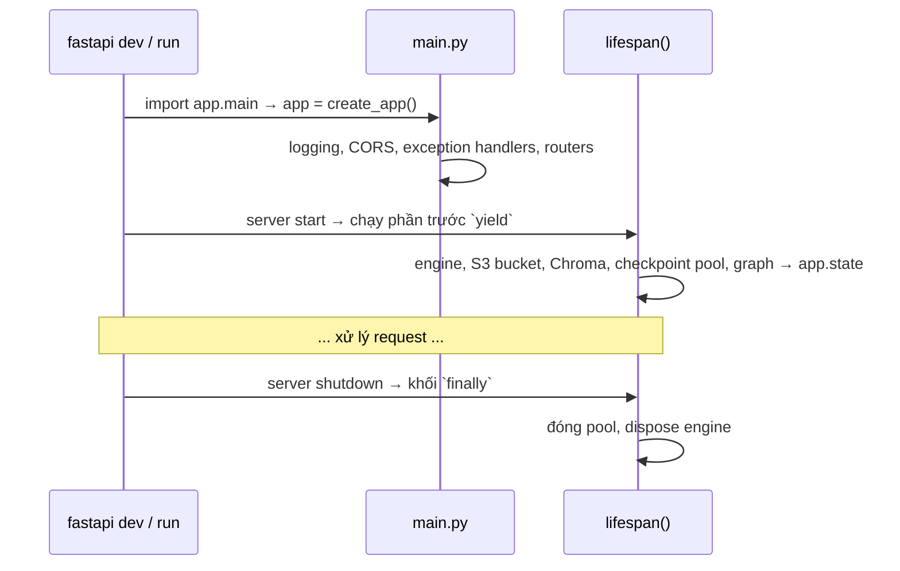

# 04 · App Factory & Lifespan

## 🎯 Mục tiêu

- Hiểu pattern **app factory** (`create_app()`).
- Dùng **lifespan** để tạo tài nguyên đắt đỏ **một lần**: DB engine, S3 client, Chroma client, connection pool của checkpointer, agent graph.
- Chia sẻ tài nguyên qua `app.state` và **đóng chúng gọn gàng** khi tắt server.
- Hiểu vì sao vẫn có CORS dù frontend gọi qua proxy cùng origin.

## 📁 File liên quan

- `backend/app/main.py`
- `backend/app/db/session.py`, `backend/app/storage/s3.py`, `backend/app/vectorstore/chroma.py`
- `backend/app/core/logging.py`

---

## 1. Toàn cảnh



## 2. App factory

```python
def create_app() -> FastAPI:
    """App factory: makes it easy to build isolated apps in tests."""
    settings = get_settings()
    setup_logging(settings.log_level)

    app = FastAPI(
        title=settings.app_name,
        lifespan=lifespan,
        # Hide interactive docs in production.
        docs_url=None if settings.is_production else "/docs",
        redoc_url=None,
    )
    ...
    register_exception_handlers(app)
    app.include_router(api_router, prefix=settings.api_v1_prefix)
    return app


app = create_app()
```

- **Test**: mỗi test gọi `create_app()` để có app mới, sạch (bài 15).
- `docs_url=None` ở production → không phơi toàn bộ schema API ra internet.
- Biến `app` ở cuối file cần cho `fastapi dev app/main.py` / uvicorn.

## 3. Lifespan — từng tài nguyên một

```python
@asynccontextmanager
async def lifespan(app: FastAPI) -> AsyncIterator[None]:
    """Startup/shutdown hook: build expensive, shared objects exactly once."""
    settings = get_settings()

    # Postgres (SQLAlchemy) for our own tables: users, documents, conversations...
    engine = create_engine(settings)
    session_factory = create_session_factory(engine)

    # S3 (Floci locally) for the raw files.
    storage = S3Storage(settings)
    await storage.ensure_bucket()

    # Chroma for the chunk embeddings.
    chroma_client = create_chroma_client(settings)
    vector_store = DocumentVectorStore(
        chroma_client, get_embeddings(settings), settings.chroma_collection
    )
```

| Tài nguyên | Vì sao tạo một lần | Bài chi tiết |
| --- | --- | --- |
| `engine` (SQLAlchemy) | Giữ **connection pool**; tạo engine mỗi request = mở kết nối TCP + TLS mỗi lần | 07 |
| `S3Storage` + `ensure_bucket()` | boto3 client thread-safe, tạo tốn kém; bucket tạo nếu chưa có (Floci khởi động rỗng) | 12 |
| `chroma_client` + `DocumentVectorStore` | HTTP client tới Chroma + model embedding | [agent/04](../agent/04_EmbeddingsAndVectorStore.md) |

```python
    # Postgres (psycopg pool) for LangGraph checkpoints = the agent's conversation memory.
    checkpoint_pool = AsyncConnectionPool(
        settings.checkpointer_conninfo,
        max_size=settings.db_pool_size,
        kwargs={"autocommit": True, "prepare_threshold": 0, "row_factory": dict_row},
        open=False,
    )
    await checkpoint_pool.open()
    checkpointer = AsyncPostgresSaver(checkpoint_pool)  # type: ignore[arg-type]
    await checkpointer.setup()  # creates/migrates LangGraph's own tables (idempotent)
```

LangGraph checkpointer dùng **psycopg trực tiếp**, không qua SQLAlchemy, nên có pool riêng. `open=False` + `await pool.open()` là cách khuyến nghị trong code async (tránh mở pool trong constructor). Vì sao cần `autocommit`, `dict_row`… → [agent/10](../agent/10_MemoryPostgresCheckpointer.md).

```python
    app.state.session_factory = session_factory
    app.state.storage = storage
    app.state.chroma_client = chroma_client
    app.state.vector_store = vector_store
    app.state.ingestion = IngestionPipeline(
        session_factory, storage, vector_store, settings.chunk_size, settings.chunk_overlap
    )
    app.state.graph = build_agent_graph(
        model=get_chat_model(settings),
        tools=get_tools(vector_store, k=settings.retrieval_k),
        checkpointer=checkpointer,
    )
    try:
        yield
    finally:
        # Graceful shutdown: return DB connections instead of dropping them.
        await checkpoint_pool.close()
        await engine.dispose()
```

- Mọi thứ gắn vào `app.state`; endpoint **không** đọc `app.state` trực tiếp mà qua dependency (`get_db`, `get_storage`…, bài 09) → test thay được.
- `try/finally`: dù server tắt vì Ctrl+C hay lỗi, pool vẫn được đóng. Với RDS, kết nối "mồ côi" chiếm slot `max_connections` cho tới khi timeout.
- `IngestionPipeline` nhận `session_factory` (không phải session) vì nó chạy **sau** khi request kết thúc và cần session riêng ([agent/05](../agent/05_IngestionPipeline.md)).

> `@app.on_event("startup")` là cách cũ, đã deprecated. Hãy dùng `lifespan`.

### Fail fast

Nếu Postgres chưa chạy, `checkpoint_pool.open()` / `checkpointer.setup()` ném lỗi; nếu thiếu `OPENAI_API_KEY`, `get_embeddings()` ném lỗi → **server không khởi động**. Tốt hơn nhiều so với khởi động "thành công" rồi lỗi ở request đầu tiên. Trong Docker, container sẽ thoát với log rõ ràng (bài 16).

## 4. CORS — vẫn cần không?

```python
    # Only needed for clients calling the API directly from another origin. The Next.js
    # frontend proxies /api/* (same origin), so browsers never need CORS for it.
    app.add_middleware(
        CORSMiddleware,
        allow_origins=settings.cors_origins,
        allow_credentials=True,
        allow_methods=["*"],
        allow_headers=["*"],
    )
```

Trình duyệt gọi `http://localhost:3000/api/v1/...`, Next.js chuyển tiếp sang FastAPI ([frontend/05](../frontend/05_BackendProxyRewrites.md)) → với trình duyệt đó là **cùng origin**, không cần CORS. Middleware giữ lại cho trường hợp một client khác origin gọi thẳng API. `cors_origins` còn được dùng cho **kiểm tra CSRF** (bài 10).

- **Không** dùng `allow_origins=["*"]` cùng `allow_credentials=True`.

## 5. Logging

```python
def setup_logging(level: str = "INFO") -> None:
    logging.basicConfig(
        level=level.upper(),
        format="%(asctime)s | %(levelname)-8s | %(name)s | %(message)s",
    )
```

Mỗi module dùng `logging.getLogger(__name__)`. Bài 14 nói thêm về log lỗi.

## 6. `fastapi dev` vs `fastapi run`

| | `fastapi dev app/main.py` | `fastapi run app/main.py` |
| --- | --- | --- |
| Auto-reload | ✅ | ❌ |
| Bind host | `127.0.0.1` | `0.0.0.0` (nhận kết nối từ ngoài, ví dụ trong Docker) |
| Dùng cho | Phát triển | Production (Dockerfile, bài 16) |

Có thể chạy nhiều worker (`--workers 4`): mỗi worker là một process có lifespan riêng → **mỗi worker một pool**. Tổng kết nối = workers × (`db_pool_size` + overflow + pool checkpointer) — phải nhỏ hơn `max_connections` của RDS.

## ⚠️ Lỗi thường gặp

- **Tạo engine/client ở top-level module** → chạy cả khi import trong test, cần hạ tầng thật.
- **Quên đóng pool** → cảnh báo `ResourceWarning`, kết nối treo trên DB.
- **Đọc `request.app.state.xxx` thẳng trong endpoint** → khó test; luôn đi qua dependency.
- **Lỗi CORS trên trình duyệt** khi gọi thẳng `:8000`: kiểm tra `CORS_ORIGINS`; nhưng tốt nhất là gọi qua proxy `/api` của Next.

## 🧪 Thực hành

1. Thêm log "startup complete" trước `yield` và "shutting down" trong `finally`. Chạy, Ctrl+C, quan sát thứ tự.
2. Dừng Postgres (`docker compose stop postgres`) rồi khởi động backend: đọc lỗi, rồi bật lại.
3. Đặt `DB_ECHO=true` trong `.env` và gọi `GET /api/v1/documents`: xem SQL mà SQLAlchemy sinh ra.

---

⬅️ Trước: [03 · Docker Compose](03_DockerComposeInfra.md) · ➡️ Tiếp: [05 · Routers & Endpoints](05_RoutersAndEndpoints.md)
