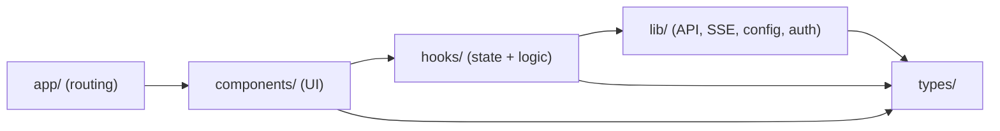

# 01 · Khởi tạo dự án Next.js + TypeScript

## 🎯 Mục tiêu

- Hiểu dự án frontend được tạo ra như thế nào và vì sao chọn các option đó.
- Nắm cấu trúc thư mục `frontend/src` sau khi có **auth**, **tài liệu** và **hội thoại**.
- Biết các script trong `package.json` và các file cấu hình quan trọng (`next.config.ts`, `tsconfig.json`, `.env.local`, `AGENTS.md`).

## 📁 File liên quan

- `frontend/package.json`
- `frontend/next.config.ts`
- `frontend/tsconfig.json`
- `frontend/.env.example`
- `frontend/AGENTS.md`

---

## 1. Tạo project bằng `create-next-app`

Dự án được tạo bằng lệnh:

```bash
npx create-next-app@latest frontend \
  --ts --tailwind --eslint --app --src-dir \
  --import-alias "@/*" --disable-git --yes
```

| Flag | Ý nghĩa | Vì sao chọn |
| --- | --- | --- |
| `--ts` | Dùng TypeScript | Bắt lỗi kiểu dữ liệu lúc build, autocomplete tốt hơn |
| `--tailwind` | Cài Tailwind CSS v4 | Viết style nhanh bằng utility class (bài 13) |
| `--eslint` | Cài ESLint + `eslint-config-next` | Phát hiện lỗi React/Next phổ biến |
| `--app` | Dùng **App Router** (`src/app/`) | Router hiện đại, hỗ trợ Server Components |
| `--src-dir` | Đặt code trong `src/` | Tách code khỏi file config ở root |
| `--import-alias "@/*"` | Import bằng `@/lib/...` | Tránh `../../../lib` khó đọc |
| `--disable-git` | Không tạo git repo con | Repo git nằm ở root monorepo |

> 💡 Dự án dùng **npm** (`package-lock.json`). Bạn có thể dùng `pnpm`, nhưng hãy thống nhất **một** package manager trong team — lockfile của các tool không dùng chung được. Dockerfile (bài 15) cũng dùng `npm ci`.

Phiên bản chính: **next 16.4.2**, **react 19.3.0**, **tailwindcss 4**, **typescript 5**, **vitest 5**.

## 2. Cấu trúc thư mục

```text
frontend/
├── src/
│   ├── proxy.ts                  # Chạy trước mỗi request trang: chặn người chưa đăng nhập (bài 07)
│   ├── app/                      # App Router: mỗi folder = 1 route
│   │   ├── layout.tsx            # Root layout (<html>, <body>, font)
│   │   ├── globals.css
│   │   ├── (auth)/               # Route group: /login, /register (layout căn giữa)
│   │   └── (app)/                # Route group: các trang cần đăng nhập
│   │       ├── layout.tsx        # AuthProvider + header
│   │       ├── page.tsx          # "/"  → chat
│   │       └── documents/page.tsx# "/documents"
│   ├── components/
│   │   ├── auth/                 # AuthForm
│   │   ├── chat/                 # ChatPage, ConversationSidebar, ChatWindow, ...
│   │   ├── documents/            # DocumentsPanel, UploadDropzone, DocumentTable
│   │   ├── layout/               # AppHeader, NavLinks, UserMenu
│   │   └── BackendStatus.tsx     # Server Component
│   ├── hooks/                    # useChat, useConversations, useDocuments, chatReducer
│   ├── lib/
│   │   ├── api/                  # client.ts (fetch + refresh), auth, documents, chat, health
│   │   ├── auth/                 # AuthProvider, safeRedirectPath
│   │   ├── config.ts, sse.ts, utils.ts
│   └── types/                    # api.ts (hợp đồng với backend), chat.ts (UI model)
├── next.config.ts                # rewrites /api → FastAPI, output standalone
├── Dockerfile
├── vitest.config.mts
└── .env.example
```

**Nguyên tắc phân lớp** (best practice):



Mũi tên chỉ hướng phụ thuộc: `lib/` **không bao giờ** import từ `components/`. Nhờ vậy `lib/api/client.ts`, `lib/sse.ts`, `hooks/chatReducer.ts` có thể test độc lập mà không cần React DOM (bài 14).

## 3. Scripts trong `package.json`

```json
"scripts": {
  "dev": "next dev",
  "build": "next build",
  "start": "next start",
  "lint": "eslint",
  "typecheck": "next typegen && tsc --noEmit",
  "test": "vitest run",
  "format": "prettier --write ."
},
```

- `dev` — dev server ở `http://localhost:3000` (Turbopack, hot reload).
- `build` / `start` — build production rồi chạy bản đã build. **Hãy thử `start` ít nhất một lần**: có những khác biệt chỉ xuất hiện ở production (ví dụ nén gzip làm SSE bị buffer — bài 05).
- `typecheck` — **`next typegen`** sinh các type tự động (`LayoutProps`, `PageProps`, danh sách route) vào `.next/`, sau đó `tsc --noEmit` mới kiểm tra được. Chạy `tsc` trực tiếp trên project mới clone sẽ báo `Cannot find name 'LayoutProps'`.
- `test` — unit test với Vitest. `format` — Prettier.

## 4. `next.config.ts`

```ts
// Read at build time (`next build` bakes rewrites into the output) and in `next dev`.
const BACKEND_URL = process.env.BACKEND_URL ?? "http://localhost:8000";

const nextConfig: NextConfig = {
  cacheComponents: true,
  partialPrefetching: true,
  // Self-contained server in .next/standalone: small Docker images (see Dockerfile).
  output: "standalone",
  turbopack: {
    rules: {
      "*.css": {
        loaders: ["@tailwindcss/turbopack"],
        as: "*.css",
      },
    },
  },
  // Backend-for-frontend proxy: the browser calls same-origin /api/v1/..., Next.js
  // forwards it to FastAPI. Cookies stay first-party and no CORS is needed.
  async rewrites() {
    return [{ source: "/api/:path*", destination: `${BACKEND_URL}/api/:path*` }];
  },
};
```

- `cacheComponents: true` — mô hình caching mới của Next 16: mặc định *không* cache; dữ liệu động phải nằm trong `<Suspense>` (bài 03).
- `partialPrefetching: true` — `<Link>` chỉ prefetch "app shell" tĩnh; docs yêu cầu đặt tường minh khi dùng Cache Components.
- `output: "standalone"` — build ra một server Node tự chứa, dùng cho Docker (bài 15).
- `rewrites()` — **trái tim của kiến trúc mới**: trình duyệt chỉ nói chuyện với Next.js, Next chuyển tiếp `/api/*` sang FastAPI. Giải thích kỹ ở bài 05.

## 5. `tsconfig.json` — alias `@/*`

```json
"paths": {
  "@/*": ["./src/*"]
}
```

`import { cn } from "@/lib/utils";` hoạt động ở mọi nơi. Vitest **không tự đọc** alias này — ta khai báo lại trong `vitest.config.mts` (bài 14). `"strict": true` đã bật sẵn — luôn giữ nó.

## 6. Biến môi trường: `.env.example` → `.env.local`

```bash
cd frontend
cp .env.example .env.local
```

```env
BACKEND_URL=http://localhost:8000
```

- Chỉ còn **một** biến, và nó **không có** tiền tố `NEXT_PUBLIC_` → chỉ server Next.js đọc được, không bao giờ lọt vào bundle của trình duyệt. Trình duyệt gọi `/api/v1/...` cùng origin (bài 04, 05).
- `.env.example` được commit; `.env.local` chứa giá trị thật, **không commit** (`.gitignore` có `.env*`).
- File `.env*` phải nằm ở `frontend/`, **không phải** trong `src/`.

## 7. `AGENTS.md` — Next 16 *không phải* Next bạn biết

Khi chạy `next dev`, Next 16 tự sinh `frontend/AGENTS.md`:

```md
## This is NOT the Next.js you know

This version has breaking changes — APIs, conventions, and file structure may all differ
from your training data. Read the relevant guide in `node_modules/next/dist/docs/` ...
```

File này dành cho AI coding agent (Claude Code, Cursor…), nhưng lời khuyên đúng cho cả người: **tài liệu đúng phiên bản nằm ngay trong `node_modules/next/dist/docs/`**. Ví dụ trong dự án này:

| Thay đổi ở Next 16 | Docs |
| --- | --- |
| `middleware.ts` đổi tên thành **`proxy.ts`** | `01-app/03-api-reference/03-file-conventions/proxy.md` |
| `rewrites` tới URL ngoài | `01-app/03-api-reference/05-config/01-next-config-js/rewrites.md` |
| Giới hạn body khi có proxy | `.../01-next-config-js/proxyClientMaxBodySize.md` |

Commit `AGENTS.md` để tránh diff lặp lại.

## ⚠️ Lỗi thường gặp

- **Trộn package manager**: `npm install` rồi `pnpm install` → hai lockfile, dependency lệch nhau.
- **`tsc` báo thiếu `LayoutProps`**: chạy `npm run typecheck` (có `next typegen`) hoặc `npm run dev` một lần.
- **Lỗi type lạ trong `.next/dev/types` sau khi xoá/đổi tên route**: type cũ còn sót — `rm -rf .next` rồi chạy lại.
- **Làm theo bài viết cũ về `middleware.ts`**: ở Next 16 file là `proxy.ts`, hàm export tên `proxy`.
- **Đặt `.env.local` trong `src/`**: Next sẽ không đọc.

## 🧪 Thực hành

1. Chạy `npm run build` và đọc bảng route: `/` và `/documents` là `◐` (Partial Prerender), `/login`, `/register` là `○` (Static), và dòng `ƒ Proxy (Middleware)`.
2. Mở `node_modules/next/dist/docs/01-app/03-api-reference/03-file-conventions/proxy.md`, đọc mục *Migration to Proxy*.
3. Đổi `BACKEND_URL` sang port sai (`:9999`), restart `npm run dev` và quan sát badge "API offline" trên header (sau khi đăng nhập).

---

⬅️ Trước: [16 · Docker & Production (backend)](../backend/16_DockerAndProduction.md) · ➡️ Tiếp: [02 · App Router: layout & page](02_AppRouterLayoutAndPage.md)
