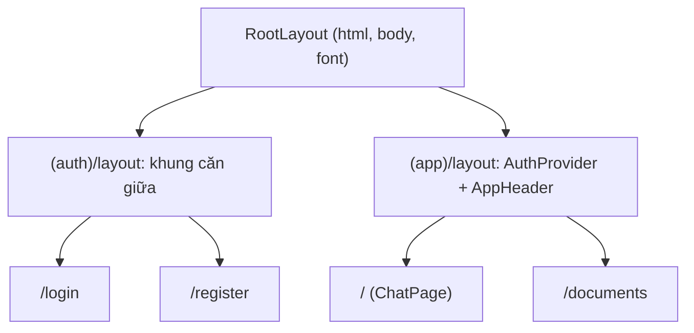

# 02 · App Router: layout, page và route group

## 🎯 Mục tiêu

- Hiểu **file-based routing** của App Router.
- Phân biệt `layout.tsx` (khung bao, giữ nguyên khi chuyển trang) và `page.tsx` (nội dung riêng của route).
- Dùng **route group** `(auth)` / `(app)` để hai nhóm trang có hai layout khác nhau mà URL không đổi.
- Dùng `Metadata`, `next/font` và type tự sinh `LayoutProps`.

## 📁 File liên quan

- `frontend/src/app/layout.tsx`
- `frontend/src/app/(auth)/layout.tsx`, `(auth)/login/page.tsx`, `(auth)/register/page.tsx`
- `frontend/src/app/(app)/layout.tsx`, `(app)/page.tsx`, `(app)/documents/page.tsx`
- Docs: `node_modules/next/dist/docs/01-app/03-api-reference/03-file-conventions/route-groups.md`

---

## 1. File-based routing

Trong App Router, **thư mục = đường dẫn URL**, các file có tên đặc biệt quyết định vai trò:

| File | Vai trò |
| --- | --- |
| `layout.tsx` | UI dùng chung, **không re-render** khi điều hướng giữa các trang con |
| `page.tsx` | UI của một route; chỉ folder có `page.tsx` mới truy cập được |
| `loading.tsx` | Fallback `<Suspense>` tự động cho cả route |
| `error.tsx` | Error boundary (bắt buộc là Client Component) |
| `not-found.tsx` | UI cho 404 |

Cây route của dự án:

```text
src/app/
├── layout.tsx                 → bọc MỌI trang (<html>, <body>)
├── (auth)/                    → "(...)" = route group, KHÔNG xuất hiện trong URL
│   ├── layout.tsx             → khung căn giữa cho form
│   ├── login/page.tsx         → /login
│   └── register/page.tsx      → /register
└── (app)/
    ├── layout.tsx             → AuthProvider + header + nav
    ├── page.tsx               → /            (chat)
    └── documents/page.tsx     → /documents
```

## 2. Route group: hai layout, một cấp URL

Trang đăng nhập không cần header, nav hay nút "Đăng xuất"; trang chat và tài liệu thì cần. Nếu chỉ có một layout, ta phải viết `if (pathname === "/login") ...` — rất dễ vỡ.

**Route group** giải quyết gọn: đặt tên thư mục trong ngoặc tròn, Next dùng nó để **nhóm** file nhưng bỏ qua khi tạo URL. `(auth)/login/page.tsx` có URL là `/login`, không phải `/auth/login`.



### Layout của nhóm `(auth)`

```tsx
// Route group "(auth)": the folder name is not part of the URL (/login, /register).
// It only lets these pages share a layout different from the app's.
export default function AuthLayout({ children }: LayoutProps<"/">) {
  return (
    <main className="flex min-h-dvh items-center justify-center px-4">
      <div className="w-full max-w-sm rounded-2xl border border-zinc-200 p-6 shadow-sm dark:border-zinc-800">
        {children}
      </div>
    </main>
  );
}
```

### Layout của nhóm `(app)`

```tsx
// Layout for every logged-in page. proxy.ts has already redirected visitors
// without a session cookie to /login before we get here.
export default function AppLayout({ children }: LayoutProps<"/">) {
  return (
    <AuthProvider>
      <div className="flex h-dvh flex-col">
        <AppHeader />
        <div className="flex min-h-0 flex-1">{children}</div>
      </div>
    </AuthProvider>
  );
}
```

- `AuthProvider` (Client Component, bài 07) chỉ bọc các trang cần đăng nhập → trang `/login` không gọi `GET /auth/me` vô ích.
- Layout **không re-render** khi chuyển giữa `/` và `/documents`: header, trạng thái user giữ nguyên, chỉ phần `children` đổi.
- `h-dvh` = 100% *dynamic viewport height* — đúng trên mobile khi thanh địa chỉ co giãn.

> ⚠️ Hai route group **không được** cùng định nghĩa một URL (ví dụ cả `(auth)/page.tsx` và `(app)/page.tsx` → hai trang `/`) — Next báo lỗi xung đột.

## 3. Root layout

```tsx
const geistSans = Geist({
  variable: "--font-geist-sans",
  subsets: ["latin", "vietnamese"],
});

export const metadata: Metadata = {
  title: "Document Assistant",
  description: "RAG document assistant: Next.js + FastAPI + LangGraph",
};

export default function RootLayout({ children }: LayoutProps<"/">) {
  return (
    <html lang="vi" className={`${geistSans.variable} ${geistMono.variable} h-full antialiased`}>
      <body className="flex min-h-full flex-col">{children}</body>
    </html>
  );
}
```

- **Root layout là bắt buộc** và là nơi duy nhất render `<html>`/`<body>`. `import "./globals.css"` cũng chỉ đặt ở đây.
- **`next/font/google`** tải font lúc build và tự host → không gọi Google Fonts lúc runtime, không layout shift. `subsets: ["latin", "vietnamese"]` để chữ "ể", "ữ" không rơi về font dự phòng.
- **`LayoutProps<"/">`** là *global type helper* do `next typegen` sinh ra — **không cần import**. Nó biết route có `params` và slot nào. Tương tự có `PageProps<"/route">`.

## 4. `page.tsx` mỏng, chỉ ghép

```tsx
import { ChatPage } from "@/components/chat/ChatPage";

export default function HomePage() {
  return <ChatPage />;
}
```

```tsx
export const metadata: Metadata = { title: "Tài liệu · Document Assistant" };

export default function DocumentsPage() {
  return (
    <main className="mx-auto w-full max-w-4xl overflow-y-auto px-4 py-6">
      <h1 className="mb-1 text-lg font-semibold">Tài liệu của bạn</h1>
      ...
      <DocumentsPanel />
    </main>
  );
}
```

- `page.tsx` giữ là **Server Component**: phần tĩnh (tiêu đề, mô tả) render sẵn trên server, phần tương tác (`ChatPage`, `DocumentsPanel`) là Client Component bên dưới (bài 03).
- Mỗi trang export `metadata` riêng để **ghi đè** `title` của root layout → tab trình duyệt hiện "Tài liệu · Document Assistant".

```tsx
// (auth)/login/page.tsx
export const metadata: Metadata = { title: "Đăng nhập · Document Assistant" };

export default function LoginPage() {
  return <AuthForm mode="login" />;
}
```

`/login` và `/register` dùng **chung** component `AuthForm` với prop `mode` — hai trang, một form (bài 07).

## 5. `<Link>` và điều hướng

Nav trong header (`components/layout/NavLinks.tsx`) dùng `next/link`:

```tsx
<Link
  key={href}
  href={href}
  aria-current={pathname === href ? "page" : undefined}
  className={cn(
    "rounded-lg px-3 py-1.5 hover:bg-zinc-100 dark:hover:bg-zinc-800",
    pathname === href && "bg-zinc-100 font-medium dark:bg-zinc-800",
  )}
>
```

- `<Link>` điều hướng **phía client** (không tải lại trang), layout giữ nguyên.
- `usePathname()` là hook client → `NavLinks` có `"use client"`, nhưng `AppHeader` bao quanh vẫn là Server Component.
- `aria-current="page"` giúp screen reader biết đang ở trang nào.

## ⚠️ Lỗi thường gặp

- **Thêm `"use client"` vào `layout.tsx`/`page.tsx`** "cho tiện" → cả cây con thành client bundle và không export được `metadata`.
- **Nghĩ rằng `(auth)` là một phần URL** → link tới `/auth/login` bị 404.
- **Đặt logic "ẩn header ở trang login" bằng `usePathname`** thay vì route group.
- **Đặt tên `Page.tsx`** (viết hoa) — tên file đặc biệt phải viết thường chính xác.

## 🧪 Thực hành

1. Tạo `src/app/(app)/settings/page.tsx` với `metadata.title = "Cài đặt"`, thêm vào mảng `LINKS` của `NavLinks` — trang mới tự có header và được bảo vệ bởi `proxy.ts`.
2. Tạo `src/app/(auth)/forgot-password/page.tsx` và để ý: `proxy.ts` sẽ chặn trang này với người chưa đăng nhập (nó không nằm trong `PUBLIC_PATHS`). Sửa `proxy.ts` cho đúng.
3. Thử đổi props của `AppLayout` thành `LayoutProps<"/khong-ton-tai">` rồi chạy `npm run typecheck`.

---

⬅️ Trước: [01 · Khởi tạo dự án](01_ProjectSetup.md) · ➡️ Tiếp: [03 · Server & Client Components](03_ServerAndClientComponents.md)
