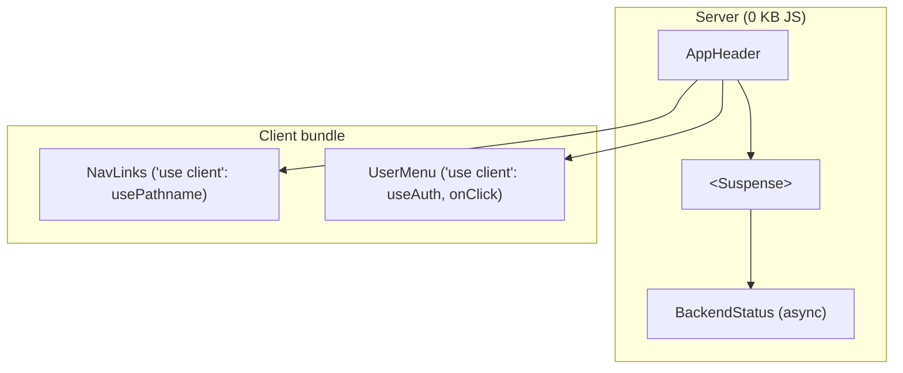

# 03 · Server Components, Client Components và Cache Components

## 🎯 Mục tiêu

- Hiểu vì sao component trong App Router **mặc định là Server Component**.
- Biết đặt ranh giới `"use client"` ở đâu cho hợp lý (header vừa có phần server, vừa có phần client).
- Viết một **async Server Component** gọi thẳng backend (`BackendStatus` + `getReadiness`) và hiểu vì sao phải bọc nó trong `<Suspense>`.
- Hiểu **`<Activity>`**: Next 16 *giấu* trang cũ thay vì gỡ bỏ khi điều hướng.

## 📁 File liên quan

- `frontend/src/components/layout/AppHeader.tsx`, `NavLinks.tsx`, `UserMenu.tsx`
- `frontend/src/components/BackendStatus.tsx`
- `frontend/src/lib/api/health.ts`, `frontend/src/lib/config.ts`
- Docs: `node_modules/next/dist/docs/01-app/02-guides/preserving-ui-state.md`, `.../05-config/01-next-config-js/cacheComponents.md`

---

## 1. Hai loại component

| | Server Component (mặc định) | Client Component (`"use client"`) |
| --- | --- | --- |
| Chạy ở đâu | Server (lúc build hoặc lúc request) | Server (render HTML lần đầu) **và** browser |
| Gửi JS xuống browser? | Không | Có |
| `useState`, `useEffect`, `onClick` | ❌ | ✅ |
| `async/await` trực tiếp trong component | ✅ | ❌ |
| Đọc biến môi trường server / gọi mạng nội bộ | ✅ | ❌ |

**Quy tắc ngón tay cái**: để mọi thứ là Server Component, chỉ thêm `"use client"` cho phần *thực sự* cần tương tác.

## 2. Header: một Server Component ghép phần server và phần client

```tsx
/** Server Component that mixes server-only (BackendStatus) and client (NavLinks, UserMenu) parts. */
export function AppHeader() {
  return (
    <header className="flex items-center justify-between gap-4 border-b ...">
      <div className="flex items-center gap-4">
        <span className="font-semibold">📄 Document Assistant</span>
        <NavLinks />
      </div>
      <div className="flex items-center gap-4">
        {/* Uncached data must stream inside <Suspense> when Cache Components is on. */}
        <Suspense fallback={<BackendStatusFallback />}>
          <BackendStatus />
        </Suspense>
        <UserMenu />
      </div>
    </header>
  );
}
```



- `NavLinks` cần `usePathname()` để tô sáng link hiện tại → client.
- `UserMenu` cần `useAuth()` (context) và nút "Đăng xuất" có `onClick` → client.
- `AppHeader` **không** cần gì của client → giữ là Server Component, nhờ đó vẫn chứa được `BackendStatus` (async). Nếu đặt `"use client"` ở `AppHeader`, `BackendStatus` bị kéo xuống client và không được `async` nữa.

> 📌 Theo docs Next: file có `"use client"` là một **boundary** — mọi thứ nó import đều vào client bundle. Vì thế `MessageBubble.tsx`, `ToolCallCard.tsx` không cần directive riêng: chúng chỉ được import từ phía client.

## 3. Async Server Component: `BackendStatus`

```tsx
export async function BackendStatus() {
  const readiness = await getReadiness();
  const ok = readiness?.status === "ok";
  const down = readiness
    ? Object.entries(readiness.checks)
        .filter(([, healthy]) => !healthy)
        .map(([name]) => name)
    : [];
  ...
      {!readiness ? "API offline" : ok ? "API ready" : `Degraded: ${down.join(", ")}`}
```

Component `await` trực tiếp — không cần `useEffect` + `useState` + loading state. Nó gọi **readiness check** của backend (`GET /api/v1/health/ready`), endpoint kiểm tra Postgres, S3 (Floci) và ChromaDB, trả về ví dụ:

```json
{"status": "degraded", "checks": {"database": true, "storage": false, "vector_store": true}}
```

→ header hiện "Degraded: storage". Rất tiện khi bạn quên `docker compose up`.

```ts
/**
 * Server-only (used by a Server Component): calls the backend directly.
 * Returns null instead of throwing, so the UI can render an "offline" state.
 * A 503 still has a JSON body telling which dependency is down.
 */
export async function getReadiness(): Promise<ReadinessResponse | null> {
  try {
    const response = await fetch(`${API_V1}/health/ready`, { cache: "no-store" });
    return (await response.json()) as ReadinessResponse;
  } catch {
    return null;
  }
}
```

- Hàm dùng `fetch` thô, **không** dùng `apiFetch`: khi degraded backend trả **503** nhưng body vẫn là JSON hữu ích, còn `apiFetch` sẽ throw với mọi status không phải 2xx.
- `API_V1` ở phía server là `${BACKEND_URL}/api/v1` — gọi **thẳng** FastAPI, không vòng qua rewrite của chính Next (bài 04).
- `return await` bên trong `try` — nếu chỉ `return fetch(...)` thì lỗi xảy ra *sau khi* rời `try` và `catch` không bắt được.

## 4. Cache Components: vì sao phải có `<Suspense>`?

Dự án bật `cacheComponents: true`:

1. Lúc `next build`, Next **prerender** mọi thứ nó có thể thành **static shell**.
2. Dữ liệu async **không cache** (readiness) không biết trước lúc build → phải **stream** lúc request.
3. `<Suspense>` đánh dấu ranh giới: `fallback` ("Checking API…") nằm trong shell, nội dung thật stream vào sau.

Bỏ `<Suspense>` → dev overlay báo **blocking-route** kèm gợi ý "Wrap in or move into Suspense".

```text
Route (app)
┌ ◐ /
├ ○ /_not-found
├ ◐ /documents
├ ○ /login
└ ○ /register

ƒ Proxy (Middleware)
```

- `◐` (Partial Prerender): `/` và `/documents` có header chứa `BackendStatus` → shell tĩnh + phần stream.
- `○` (Static): `/login`, `/register` hoàn toàn tĩnh — layout `(auth)` không có dữ liệu động.

> 💡 Với Cache Components, **mặc định là không cache** (ngược với Next 13/14). Muốn cache thì dùng `"use cache"` + `cacheLife(...)`. Health check thì **không bao giờ** nên cache.

## 5. `<Activity>`: trang cũ bị *giấu*, không bị *gỡ*

Một điều bất ngờ khi chạy test E2E dự án này: sau khi bấm link từ `/login` sang `/register`, trong DOM có **hai** form — `page.locator("input[name=email]")` khớp 2 phần tử!

Lý do (docs `cacheComponents.md`, mục *Navigation with Activity*): khi bật `cacheComponents`, Next bọc mỗi route trong React `<Activity>`. Điều hướng đi nơi khác, route cũ được đặt mode `"hidden"` (`display: none`) chứ không unmount:

- State và DOM được **giữ nguyên** (nội dung ô nhập, vị trí cuộn, `<details>` đang mở…). Quay lại thì thấy y như cũ. Next giữ tối đa 3 route.
- **Effect bị cleanup khi route bị giấu**, và chạy lại khi route hiện ra.

Hệ quả thực tế trong dự án:

| Ở đâu | Điều gì xảy ra |
| --- | --- |
| Đang ở `/` (chat) → bấm "Tài liệu" | Tin nhắn trên màn hình vẫn còn khi quay lại. Nhưng cleanup `abortRef.current?.abort()` của `useChat` chạy → stream đang chạy **bị dừng** (bài 10). |
| Quay lại `/documents` | Effect của `useDocuments` chạy lại → danh sách được tải mới; polling chỉ chạy khi trang hiển thị. |
| Test E2E | Selector phải chọn phần tử **đang hiển thị**: `getByRole(...)`, hoặc thêm `>> visible=true`. |

## ⚠️ Lỗi thường gặp

- **Dùng `useState`/`onClick` trong Server Component** → lỗi build. Tách phần tương tác ra component `"use client"` nhỏ (như `UserMenu`).
- **Đặt `"use client"` ở quá cao** (layout/header) → bundle phình to và mất khả năng `async`.
- **Quên `<Suspense>` quanh dữ liệu động** → blocking-route.
- **Gọi `fetch("/api/v1/...")` (đường dẫn tương đối) trong Server Component** → trên server không có "origin hiện tại", fetch lỗi. Dùng `API_V1` từ `lib/config.ts`.
- **Giả định component bị unmount khi chuyển trang** → với Activity, state cũ vẫn còn; dùng `key` hoặc cleanup trong `useLayoutEffect` nếu cần reset (xem `preserving-ui-state.md`).

## 🧪 Thực hành

1. `docker compose stop floci`, tải lại trang: header hiện "Degraded: storage". `docker compose start floci` rồi tải lại.
2. Thêm `await new Promise((r) => setTimeout(r, 2000));` vào đầu `BackendStatus` để thấy "Checking API…" trong khi phần còn lại của trang đã dùng được.
3. Gõ dở một câu vào ô chat, chuyển sang "Tài liệu" rồi quay lại: câu gõ dở vẫn còn — đó là `<Activity>`.

---

⬅️ Trước: [02 · App Router: layout & page](02_AppRouterLayoutAndPage.md) · ➡️ Tiếp: [04 · Types & Config](04_TypesAndConfig.md)
