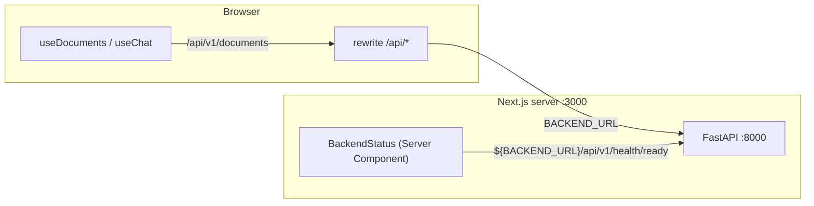

# 04 · Types dùng chung và cấu hình môi trường

## 🎯 Mục tiêu

- Mô tả "hợp đồng" (contract) API giữa backend và frontend bằng TypeScript (`types/api.ts`).
- Hiểu **discriminated union** và vì sao nó hợp với dữ liệu stream.
- Tách **API model** (`types/api.ts`) và **UI model** (`types/chat.ts`).
- Hiểu vì sao `API_V1` khác nhau giữa server và browser, và vì sao `BACKEND_URL` **không** có tiền tố `NEXT_PUBLIC_`.

## 📁 File liên quan

- `frontend/src/types/api.ts`, `frontend/src/types/chat.ts`
- `frontend/src/lib/config.ts`
- `backend/app/schemas/auth.py`, `document.py`, `chat.py`, `health.py` (phía Python tương ứng)

---

## 1. `types/api.ts` phản chiếu Pydantic schema

```ts
/**
 * The API contract. Mirrors the Pydantic schemas in `backend/app/schemas/`.
 * Keep both sides in sync when you change one of them.
 */
```

Ví dụ với tài liệu. Backend:

```python
class DocumentResponse(BaseModel):
    id: uuid.UUID
    filename: str
    content_type: str
    size_bytes: int
    status: DocumentStatus
    chunk_count: int
    error: str | None
    created_at: datetime
    # Note: `s3_key` and `owner_id` are deliberately NOT exposed.
```

Frontend:

```ts
export type DocumentStatus = "processing" | "ready" | "failed";

export interface DocumentInfo {
  id: string;
  filename: string;
  content_type: string;
  size_bytes: number;
  status: DocumentStatus;
  chunk_count: number;
  error: string | null;
  created_at: string;
}
```

Bảng chuyển đổi kiểu:

| Python / Pydantic | JSON | TypeScript |
| --- | --- | --- |
| `uuid.UUID` | chuỗi | `string` |
| `datetime` | chuỗi ISO 8601 | `string` (parse bằng `new Date(...)` khi cần) |
| `str \| None` | `null` | `string \| null` |
| `X \| None = None` (có default) | có thể vắng | `x?: X \| null` |
| `Literal["a", "b"]` / `StrEnum` | chuỗi | `"a" \| "b"` |

- Giữ nguyên **`snake_case`** như JSON (`size_bytes`, `conversation_id`) — không đổi sang camelCase ở tầng API, nếu không phải viết code chuyển đổi khắp nơi.
- Tên `DocumentInfo` (không phải `Document`) để không trùng với kiểu DOM toàn cục `Document`.
- File chia theo schema backend: `// ---- auth.py`, `// ---- document.py`, `// ---- chat.py`, `// ---- health.py` — sửa file Python nào thì biết ngay phải sửa đoạn TS nào.

> 💡 Dự án lớn hơn nên **sinh type tự động** từ `/openapi.json` của FastAPI (ví dụ `openapi-typescript`). Ở đây viết tay để dễ học.

## 2. Discriminated union cho stream event

```ts
/** Server-Sent Events emitted by `POST /api/v1/chat/stream`. */
export type StreamEvent =
  | { type: "metadata"; conversation_id: string }
  | { type: "token"; content: string }
  | { type: "tool_start"; tool_name: string; tool_input: Record<string, unknown> }
  | { type: "tool_end"; tool_name: string; content: string }
  | { type: "done"; conversation_id: string }
  | { type: "error"; content: string };
```

Field chung `type` là **discriminant**. Kiểm tra `type` → TypeScript tự **thu hẹp** (narrow) kiểu:

```ts
if (event.type === "metadata") {
  event.conversation_id; // ✅ chắc chắn có
  // event.content;      // ❌ lỗi compile
}
```

Bên Python, `StreamEvent` là **một** model với mọi field `| None`. Bên TS ta "nâng cấp" thành union: không thể quên kiểm tra `undefined`, và `switch` được kiểm tra **đầy đủ** (exhaustive — bài 09).

`metadata` mang `conversation_id` do server tạo khi bạn gửi tin nhắn đầu tiên mà không có `conversation_id`:

```ts
export interface ChatRequest {
  message: string;
  /** Omit to start a new conversation. */
  conversation_id?: string | null;
}
```

## 3. API model vs UI model

```ts
// types/chat.ts — UI model for the chat screen (what components render, not what the API sends).
export interface Message {
  id: string;
  role: "user" | "assistant";
  content: string;
  toolCalls: ToolCall[];
  status: MessageStatus;
}
```

So với `ChatMessage` của API (`{ role, content }` — chỉ có trong lịch sử hội thoại), `Message` có thêm:

- `id` — làm `key` khi render list và để reducer biết cập nhật message nào.
- `status` — `"streaming" | "done" | "error"` để hiện "…" hay viền đỏ.
- `toolCalls` — gom `tool_start` + `tool_end` thành object có `output`.

Chuyển đổi API → UI chỉ xảy ra ở **một chỗ**: `chatReducer` (bài 09, action `load`). Backend đổi format thì component không bị ảnh hưởng.

## 4. `lib/config.ts`: một URL cho server, một URL cho browser

```ts
/**
 * Where to send API requests.
 *
 * - In the browser: same-origin `/api/v1`. next.config.ts rewrites `/api/*` to the
 *   backend, so the auth cookies are first-party and there is no CORS to configure.
 * - On the server (Server Components): straight to the backend via `BACKEND_URL`.
 *
 * `BACKEND_URL` has no `NEXT_PUBLIC_` prefix, so it never ends up in the browser bundle.
 */
export const BACKEND_URL = process.env.BACKEND_URL ?? "http://localhost:8000";

export const API_V1 = typeof window === "undefined" ? `${BACKEND_URL}/api/v1` : "/api/v1";
```



- `typeof window === "undefined"` → đang chạy trên server (Node không có `window`).
- **Browser** dùng đường dẫn **tương đối** `/api/v1` → request đi tới chính Next.js (cùng origin), Next chuyển tiếp sang FastAPI (bài 05).
- **Server** không có "origin hiện tại" để ghép đường dẫn tương đối, nên gọi thẳng `BACKEND_URL`. Trong Docker, đó là `http://backend:8000` — tên service trong mạng compose, trình duyệt không thể truy cập (và không cần).

### Vì sao bỏ `NEXT_PUBLIC_API_BASE_URL`?

Phiên bản trước dùng `NEXT_PUBLIC_API_BASE_URL=http://localhost:8000`: browser gọi thẳng FastAPI. Với auth bằng cookie, cách đó gây rắc rối (cookie khác origin, CORS + `credentials: "include"`, SameSite…). Giờ browser **không cần biết** backend ở đâu.

Nhắc lại quy tắc `NEXT_PUBLIC_`:

- Chỉ biến có tiền tố `NEXT_PUBLIC_` mới dùng được ở **browser**, và giá trị bị **nhúng cứng lúc build**.
- **Không bao giờ** đặt secret vào `NEXT_PUBLIC_*` — ai cũng đọc được trong DevTools. API key LLM nằm ở `backend/.env`.
- Biến không có tiền tố (như `BACKEND_URL`) chỉ tồn tại trên server → trong bundle client, `process.env.BACKEND_URL` là `undefined`, và nhánh browser của `API_V1` cũng không dùng tới nó.

## ⚠️ Lỗi thường gặp

- **Type frontend lệch với schema backend** sau khi backend đổi field → lỗi runtime im lặng (`undefined`). Sửa cả hai trong cùng một commit.
- **Dùng `any`** cho dữ liệu từ mạng → mất lợi ích của TypeScript. Dùng `unknown` rồi narrow.
- **Đặt tên interface `Document`** → che mất kiểu DOM `Document`, lỗi khó hiểu.
- **Gọi `/api/v1/...` tương đối trong Server Component** → `TypeError: Failed to parse URL`.
- **Thêm lại `NEXT_PUBLIC_` vào `BACKEND_URL`** "cho chắc" → URL nội bộ lộ ra bundle, mà browser cũng không dùng.

## 🧪 Thực hành

1. Thêm field `page_count: number | null` vào `DocumentInfo` và chạy `npm run typecheck` — quan sát: TS không báo lỗi gì vì chưa ai dùng nó. Đó là giới hạn của type viết tay: TS **không** kiểm tra dữ liệu thật lúc runtime. Revert.
2. Mở `http://localhost:8000/docs`, so sánh schema `ConversationResponse` với interface `Conversation`.
3. Mở DevTools → tab Network trên trang `/documents`: mọi request đều tới `localhost:3000/api/v1/...`, không có request nào tới `:8000`.

---

⬅️ Trước: [03 · Server & Client Components](03_ServerAndClientComponents.md) · ➡️ Tiếp: [05 · Backend proxy với rewrites](05_BackendProxyRewrites.md)
