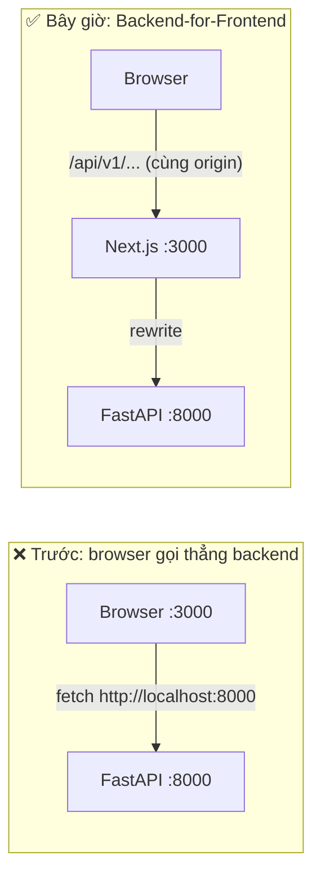

# 05 · Backend proxy với `rewrites` (Backend-for-Frontend)

## 🎯 Mục tiêu

- Hiểu vì sao trình duyệt **chỉ** nói chuyện với Next.js, còn Next.js chuyển tiếp `/api/*` sang FastAPI.
- Thấy lợi ích: cookie httpOnly là **first-party**, **không cần CORS**, header `Origin` vẫn tới backend để chống CSRF.
- Biết rằng rewrites được **"nướng" vào lúc build** → Docker cần build arg.
- Hiểu vì sao `proxy.ts` phải **bỏ qua** `/api`.
- Gỡ một bug thật: SSE bị **gzip** và **buffer** dưới `next start`, và cách sửa bằng `Cache-Control: no-transform`.

## 📁 File liên quan

- `frontend/next.config.ts`
- `frontend/src/proxy.ts` (matcher)
- `backend/app/api/v1/endpoints/chat.py` (`_no_transform`)
- `backend/app/api/deps.py` (`_check_csrf_origin`)
- Docs: `node_modules/next/dist/docs/01-app/03-api-reference/05-config/01-next-config-js/rewrites.md`, `proxyClientMaxBodySize.md`

---

## 1. Hai kiến trúc



Khi browser gọi thẳng `:8000` từ trang `:3000`, đó là request **cross-origin**:

- Backend phải cấu hình CORS, frontend phải `credentials: "include"` cho từng request.
- Cookie đăng nhập do `:8000` đặt — với tên miền thật (`app.com` vs `api.com`) sẽ là cookie **bên thứ ba**, bị trình duyệt chặn ngày càng nhiều.

Với rewrites, browser chỉ thấy **một origin**. Cookie `access_token`/`refresh_token` do "chính trang này" đặt → first-party, `SameSite=Lax` hoạt động tự nhiên, không còn CORS.

## 2. Cấu hình

```ts
// Read at build time (`next build` bakes rewrites into the output) and in `next dev`.
const BACKEND_URL = process.env.BACKEND_URL ?? "http://localhost:8000";
...
  // Backend-for-frontend proxy: the browser calls same-origin /api/v1/..., Next.js
  // forwards it to FastAPI. Cookies stay first-party and no CORS is needed.
  async rewrites() {
    return [{ source: "/api/:path*", destination: `${BACKEND_URL}/api/:path*` }];
  },
```

- `:path*` khớp **mọi** đoạn còn lại: `/api/v1/documents/123/download` → `http://localhost:8000/api/v1/documents/123/download`.
- **Rewrite** khác **redirect**: URL trên thanh địa chỉ/DevTools không đổi, Next.js đứng giữa làm proxy và trả response về.
- Method, body, header (kể cả `Cookie`), status và `Set-Cookie` đi qua nguyên vẹn → login qua proxy vẫn đặt được cookie.

### Rewrites được chốt lúc build

Comment trong code nói rõ: `next build` **ghi rewrites vào output** (routes manifest). Đổi `BACKEND_URL` lúc `next start` **không** có tác dụng với rewrites. Vì vậy `frontend/Dockerfile` nhận URL là **build argument**:

```dockerfile
ARG BACKEND_URL=http://backend:8000
ENV BACKEND_URL=$BACKEND_URL \
    NEXT_TELEMETRY_DISABLED=1
RUN npm run build
```

(Chi tiết ở bài 15.)

## 3. Header `Origin` vẫn tới backend → CSRF check hoạt động

Cookie được trình duyệt **tự động** gửi kèm — kể cả khi request do một trang web khác kích hoạt. Đó là CSRF. Backend phòng thủ bằng `SameSite=Lax` **và** kiểm tra `Origin` cho request thay đổi dữ liệu:

```python
def _check_csrf_origin(request: Request, settings: Settings) -> None:
    if request.method in SAFE_METHODS:
        return
    origin = request.headers.get("origin")
    if origin is not None and origin not in settings.cors_origins:
        raise PermissionDeniedError("Cross-site request blocked")
```

Rewrite **chuyển tiếp nguyên header `Origin`** của trình duyệt (`http://localhost:3000`), nên `POST /documents` từ trang của ta qua được, còn POST giả mạo từ `evil.example` bị chặn 403. `CORS_ORIGINS` trong backend giờ đóng vai trò "danh sách origin hợp lệ" cho CSRF hơn là cho CORS.

Kiểm tra bằng curl (cần cookie đăng nhập trong `jar.txt`):

```bash
curl -b jar.txt -H 'Origin: https://evil.example' -F file=@a.txt \
  localhost:3000/api/v1/documents          # → 403 "Cross-site request blocked"
```

## 4. `proxy.ts` phải bỏ qua `/api`

```ts
export const config = {
  // Skip API calls (proxied to FastAPI, which does its own auth), Next internals
  // and static files (anything with a dot, e.g. favicon.ico).
  matcher: ["/((?!api/|_next/static|_next/image|.*\\..*).*)"],
};
```

Hai lý do:

1. **Auth**: `proxy.ts` (bài 07) redirect người chưa đăng nhập về `/login`. Áp cho `/api/...` thì `POST /api/v1/auth/login` cũng bị redirect — không ai đăng nhập được! API tự xác thực ở FastAPI.
2. **Body bị buffer**: theo docs `proxyClientMaxBodySize`, khi proxy chạy, Next **clone và buffer body request trong bộ nhớ**, mặc định tối đa **10MB** — phần vượt quá bị cắt. Backend cho phép upload 20MB (`MAX_UPLOAD_MB`). Loại `/api` khỏi matcher → upload đi thẳng qua rewrite, không bị buffer.

## 5. Bug thật: SSE bị gom cục dưới `next start`

Dưới `npm run dev`, chat stream từng chữ. Nhưng khi chạy bản production (`next build && next start`), câu trả lời hiện ra **một lần** ở cuối. Cách đo — thêm timestamp cho từng dòng nhận được:

```bash
curl -s -N -b jar.txt --compressed -H 'Origin: http://localhost:3000' \
  -H 'Content-Type: application/json' -X POST localhost:3001/api/v1/chat/stream \
  -d '{"message":"Atlas?"}' \
| while IFS= read -r line; do
    [ -n "$line" ] && echo "$(python3 -c 'import time;print(f"{time.time()%100:.2f}")') $line"
  done
```

Với một LLM giả nhả mỗi chữ cách nhau 0.4s, kết quả **trước khi sửa**:

```text
57.52 data: {"content": "Theo "}
57.55 event: token
57.58 data: {"content": "tài "}      ← các token cách nhau ~0.03s: đến cùng một lúc
```

Header response tiết lộ thủ phạm: `Content-Encoding: gzip`. `next start` **nén** response (trình duyệt luôn gửi `Accept-Encoding: gzip`), và bộ nén gom dữ liệu thành khối lớn trước khi đẩy đi → stream bị buffer. Dev server không nén nên không thấy lỗi.

### Cách sửa: `Cache-Control: no-transform`

`no-transform` là chỉ thị HTTP chuẩn: "proxy/middleware không được biến đổi body này" — bộ nén của Next, nginx, CDN đều tôn trọng. Backend thêm nó cho endpoint SSE:

```python
def _no_transform(response: Response) -> None:
    """FastAPI already sends `Cache-Control: no-cache` for SSE. `no-transform` also tells
    proxies not to gzip the stream: compression (Next.js `next start`, CDNs) buffers the
    events, and the user would get the whole answer at once instead of token by token.

    Must be a dependency: code inside the generator body runs after headers are sent.
    """
    response.headers["Cache-Control"] = "no-transform"


@router.post(
    "/chat/stream",
    response_class=EventSourceResponse,
    dependencies=[Depends(_no_transform)],
)
```

Sau khi sửa: không còn `Content-Encoding: gzip`, header gộp thành `cache-control: no-cache, no-transform`, các token cách nhau đúng 0.4s.

> 💡 Bài học: **luôn kiểm tra streaming trên bản build production**, và đặt header chống buffer ngay tại nguồn (backend) để mọi proxy phía trước đều hiểu. Lựa chọn khác là `compress: false` trong `next.config.ts`, nhưng như vậy tắt nén cho cả HTML/JS.

## ⚠️ Lỗi thường gặp

- **Đổi `BACKEND_URL` lúc chạy container mà không build lại** → rewrites vẫn trỏ URL cũ.
- **Matcher của `proxy.ts` bắt cả `/api`** → login bị redirect, upload lớn bị cắt ở 10MB.
- **Thêm lại CORS và `credentials: "include"`** "cho chắc" → thừa; cùng origin thì cookie tự đi kèm.
- **Đặt header trong thân generator SSE** → chạy *sau khi* header đã gửi, không có tác dụng; phải dùng dependency.
- **Chỉ test streaming với `npm run dev`** → bỏ sót buffering của production.

## 🧪 Thực hành

1. Chạy `npm run build && npx next start -p 3001`, dùng lệnh curl ở mục 5 để đo khoảng cách giữa các token.
2. Tạm bỏ `dependencies=[Depends(_no_transform)]` ở backend, đo lại và quan sát `Content-Encoding: gzip`. Khôi phục.
3. Thêm rewrite thứ hai: `/docs` → `${BACKEND_URL}/docs` để mở Swagger UI qua cổng 3000. Swagger có tải được `openapi.json` không? Vì sao? (gợi ý: đường dẫn `/openapi.json` không nằm dưới `/api`).

---

⬅️ Trước: [04 · Types & Config](04_TypesAndConfig.md) · ➡️ Tiếp: [06 · API client & refresh token](06_ApiClientAndTokenRefresh.md)
