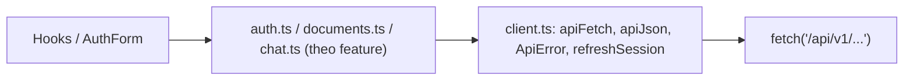
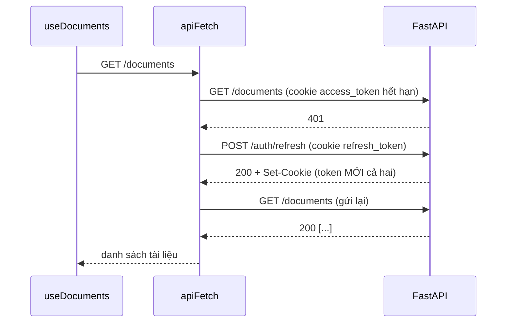

# 06 · API client: `fetch` wrapper, lỗi có kiểu và refresh token tự động

## 🎯 Mục tiêu

- Viết một lớp bọc `fetch` mỏng (`apiFetch`) xử lý URL, header, lỗi thống nhất.
- Gửi **JSON** và **FormData** (upload file) đúng `Content-Type`.
- **Tự refresh** access token khi gặp 401 rồi gửi lại request — mà không làm người dùng bị đăng xuất vì *refresh token rotation*.
- Đọc được mọi dạng lỗi của FastAPI, kể cả lỗi validation 422.

## 📁 File liên quan

- `frontend/src/lib/api/client.ts`
- `frontend/src/lib/api/auth.ts`, `documents.ts`, `chat.ts`
- `backend/app/services/auth_service.py` (rotation + reuse detection)
- `backend/app/core/exceptions.py` (format lỗi phía backend)

---

## 1. Ba tầng



Feature module rất mỏng, chỉ mô tả endpoint:

```ts
export function listDocuments(): Promise<DocumentInfo[]> {
  return apiJson("/documents");
}

/** Upload returns immediately (202) with status "processing"; ingestion runs in the background. */
export function uploadDocument(file: File): Promise<DocumentInfo> {
  const form = new FormData();
  form.append("file", file);
  return apiJson("/documents", { method: "POST", body: form });
}
```

Mọi thứ "khó" (refresh, lỗi) nằm ở `client.ts`.

## 2. `ApiError` — lỗi mang theo HTTP status

```ts
export class ApiError extends Error {
  constructor(
    message: string,
    public readonly status: number,
  ) {
    super(message);
    this.name = "ApiError";
  }
}
```

`public readonly status` là *parameter property*: khai báo + gán field trong một dòng. Nơi gọi phân biệt được `err.status === 413` (file quá lớn) với `422` (sai định dạng).

## 3. `apiFetch` — header đúng cho JSON và FormData

```ts
export async function apiFetch(path: string, options: ApiFetchOptions = {}): Promise<Response> {
  const { retryOnUnauthorized = true, ...init } = options;
  // `new Headers()` accepts every HeadersInit shape (object, array, Headers instance).
  const headers = new Headers(init.headers);
  // FormData (file upload) must set its own multipart Content-Type with the boundary.
  if (typeof init.body === "string" && !headers.has("Content-Type")) {
    headers.set("Content-Type", "application/json");
  }
  const send = () => fetch(`${API_V1}${path}`, { ...init, headers });
```

- Chỉ đặt `application/json` khi body là **chuỗi** (đã `JSON.stringify`).
- Với `FormData`, **phải để trống** `Content-Type`: trình duyệt tự đặt `multipart/form-data; boundary=----xyz`. Tự đặt `multipart/form-data` thì thiếu `boundary` → FastAPI không parse được file (422).
- `send` là một hàm để có thể **gửi lại** y hệt sau khi refresh. (Body là string/FormData nên gửi lại được; một `ReadableStream` thì không.)
- Không cần `credentials: "include"`: request cùng origin (bài 05) mặc định đã kèm cookie.

## 4. Refresh-on-401

Access token chỉ sống **15 phút** (cookie `access_token`), refresh token sống **7 ngày** (cookie `refresh_token`). Khi access token hết hạn, backend trả 401 `"Invalid or expired access token"`. Thay vì bắt người dùng đăng nhập lại, client tự đổi token mới:

```ts
  let response = await send();

  if (response.status === 401 && retryOnUnauthorized) {
    if (await refreshSession()) {
      response = await send();
    }
    if (response.status === 401) {
      sessionExpiredListeners.forEach((listener) => listener());
    }
  }
```



Người dùng không hề thấy gì. Nếu refresh cũng thất bại (refresh token hết hạn/bị thu hồi), mọi listener của `onSessionExpired` được gọi → `AuthProvider` đưa người dùng về `/login` (bài 07).

### Vì sao phải dùng chung MỘT lần refresh?

```ts
// Several requests can fail at the same time (e.g. a page loading 3 lists). They must
// share ONE refresh call: refresh tokens are single-use (rotation), so a second
// parallel refresh would present an already-used token and log the user out.

let refreshInFlight: Promise<boolean> | null = null;

export function refreshSession(): Promise<boolean> {
  refreshInFlight ??= fetch(`${API_V1}/auth/refresh`, { method: "POST" })
    .then((response) => response.ok)
    .catch(() => false)
    .finally(() => {
      refreshInFlight = null;
    });
  return refreshInFlight;
}
```

Backend áp dụng **refresh token rotation + reuse detection** (`auth_service.py`):

> *Rotate: the old refresh token is revoked and a new pair is issued. If an already-revoked token is presented, it was probably stolen and used by someone else first -> revoke ALL sessions of that user (reuse detection).*

Tưởng tượng 3 request cùng nhận 401 và **mỗi cái tự refresh**: request 1 đổi token A → B (A bị thu hồi); request 2 và 3 vẫn gửi A → backend thấy token đã thu hồi bị dùng lại → **thu hồi mọi phiên** → người dùng bị đá ra. Bảo mật tốt, nhưng do *chính client* gây ra.

Giải pháp: biến module `refreshInFlight` giữ **promise đang chạy**. `??=` chỉ gán khi đang `null` → request thứ 2, 3 nhận **cùng** promise, chờ chung một kết quả. `finally` đặt lại `null` để lần hết hạn sau refresh được tiếp. Test `"shares a single refresh between parallel requests"` (bài 14) khoá hành vi này.

> ⚠️ **Giới hạn**: biến này chỉ chia sẻ trong **một tab**. Hai tab cùng mở, cùng hết hạn, cùng refresh gần như đồng thời vẫn có thể kích hoạt reuse detection. Cách xử lý ở production: cho backend một "grace period" vài giây chấp nhận token vừa xoay, hoặc phối hợp giữa các tab bằng `BroadcastChannel` / Web Locks API (`navigator.locks.request("refresh", ...)`).

### `retryOnUnauthorized: false` cho endpoint auth

```ts
// A 401 from these endpoints means "wrong credentials", not "expired session",
// so they opt out of the refresh-and-retry logic.

export function login(body: LoginRequest): Promise<TokenResponse> {
  return apiJson("/auth/login", {
    method: "POST",
    body: JSON.stringify(body),
    retryOnUnauthorized: false,
  });
}
```

Sai mật khẩu → 401. Nếu không tắt, client sẽ refresh vô ích và gọi `onSessionExpired` — đá người dùng về `/login` trong khi họ đang ở `/login`.

## 5. Đọc lỗi từ backend

```ts
function errorMessage(body: unknown): string | null {
  if (!body || typeof body !== "object") return null;
  const { error, detail } = body as { error?: { message?: unknown }; detail?: unknown };
  if (typeof error?.message === "string") return error.message;
  if (typeof detail === "string") return detail;
  // FastAPI validation errors: [{"loc": [...], "msg": "..."}]
  if (Array.isArray(detail) && typeof detail[0]?.msg === "string") return detail[0].msg;
  return null;
}
```

| Nguồn lỗi | Body | Ví dụ |
| --- | --- | --- |
| `AppError` của ta (`exceptions.py`) | `{"error": {"code", "message"}}` | 401 "Incorrect email or password", 413 file quá lớn |
| `HTTPException` | `{"detail": "..."}` | 404 mặc định của Starlette |
| Validation 422 | `{"detail": [{"loc", "msg", ...}]}` | "value is not a valid email address" |

- `body: unknown` thay vì `any`: buộc phải kiểm tra từng bước trước khi đọc.
- `.json().catch(() => null)`: body có thể không phải JSON (proxy trả HTML 502).
- `apiFetch` trả `Response` gốc (không `.json()` ngay) — endpoint SSE cần `response.body`. `apiJson<T>` là tiện ích cho endpoint JSON.

## 6. Streaming + huỷ request

`streamChat` (trong `chat.ts`) là **async generator** dùng `apiFetch` với `signal`: được hưởng luôn refresh-on-401 trước khi stream bắt đầu.

```ts
  const response = await apiFetch("/chat/stream", {
    method: "POST",
    body: JSON.stringify(body),
    headers: { Accept: "text/event-stream" },
    signal,
  });
  if (!response.body) throw new Error("Response has no body to stream");

  for await (const { event, data } of readSseStream(response.body)) {
    // The SSE `event:` name is the discriminant; `data:` holds the JSON payload.
    yield { type: event, ...JSON.parse(data) } as StreamEvent;
  }
```

`controller.abort()` → kết nối đóng, `for await` throw `AbortError` (bài 10).

## ⚠️ Lỗi thường gặp

- **Nghĩ rằng `fetch` throw khi 4xx/5xx** → không! Phải kiểm tra `response.ok`.
- **Tự đặt `Content-Type: multipart/form-data`** → thiếu boundary, upload hỏng.
- **Mỗi request tự refresh riêng** → kích hoạt reuse detection, người dùng bị đăng xuất ngẫu nhiên.
- **Refresh cho cả `/auth/login`** → vòng lặp redirect / thông báo sai.
- **Lưu access token vào `localStorage`** để gắn header `Authorization` → script XSS đọc được. Cookie httpOnly thì JS không đọc được.

## 🧪 Thực hành

1. Đổi `ACCESS_TOKEN_TTL_MINUTES=1` trong `backend/.env`, đăng nhập, chờ 1 phút rồi mở `/documents`. Trong tab Network: `documents` 401 → `refresh` 200 → `documents` 200.
2. Trong DevTools → Application → Cookies, xoá `refresh_token` và `access_token` sau khi trang đã tải, rồi bấm sang trang khác: bạn bị đưa về `/login`.
3. Phối hợp giữa các tab bằng Web Locks: bọc lời gọi `fetch(.../auth/refresh)` trong `navigator.locks.request("auth-refresh", ...)`. Tab thứ hai phải chờ tab thứ nhất xong; khi đó cookie (dùng chung giữa các tab) đã là token mới nên không còn bị coi là "dùng lại". Mở 2 tab để thử.

---

⬅️ Trước: [05 · Backend proxy với rewrites](05_BackendProxyRewrites.md) · ➡️ Tiếp: [07 · Luồng xác thực](07_AuthenticationFlow.md)
