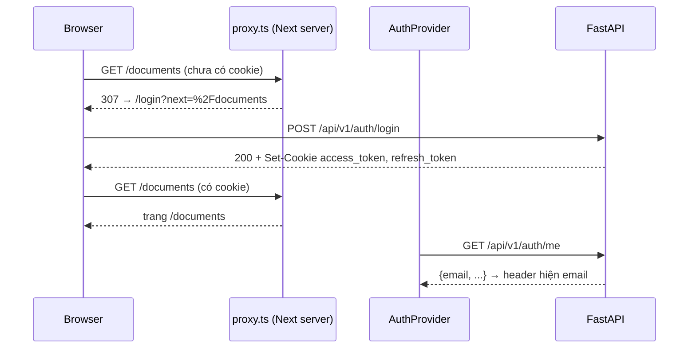

# 07 · Luồng xác thực: `proxy.ts`, `AuthProvider` và form đăng nhập

## 🎯 Mục tiêu

- Hiểu toàn bộ luồng đăng ký → đăng nhập → dùng app → hết hạn → đăng xuất ở phía frontend.
- Viết `proxy.ts` (tên mới của middleware ở Next 16) để **chặn sớm** người chưa đăng nhập — và hiểu vì sao đó chỉ là kiểm tra *lạc quan*.
- Chia sẻ user hiện tại bằng **Context** với API React 19 (`use`, `<Context value>`).
- Viết form bằng **`useActionState`** (React 19 form actions).
- Chống **open redirect** với `?next=`.

## 📁 File liên quan

- `frontend/src/proxy.ts`
- `frontend/src/lib/auth/AuthProvider.tsx`, `frontend/src/lib/auth/redirect.ts`
- `frontend/src/components/auth/AuthForm.tsx`, `frontend/src/components/layout/UserMenu.tsx`
- `backend/app/api/v1/endpoints/auth.py` (đặt cookie)

---

## 1. Bức tranh tổng thể

Backend đặt **hai cookie httpOnly** khi đăng nhập:

```python
        response.set_cookie(
            name,
            value,
            max_age=max_age,
            path="/",
            httponly=True,  # invisible to JavaScript -> an XSS bug can't steal the token
            secure=settings.cookie_secure,  # HTTPS only (required in production)
            samesite="lax",  # not sent on cross-site POSTs -> first line of CSRF defence
        )
```

`httponly=True` nghĩa là **JavaScript của ta cũng không đọc được token** — và không cần đọc. Frontend không bao giờ lưu token; trình duyệt tự đính cookie vào mọi request `/api/...` cùng origin.



## 2. `proxy.ts`: kiểm tra lạc quan

Ở Next 16, `middleware.ts` được **đổi tên thành `proxy.ts`** (hàm export tên `proxy`). Nó chạy trên server **trước** khi route được render.

```ts
const PUBLIC_PATHS = new Set(["/login", "/register"]);

export function proxy(request: NextRequest) {
  const { pathname, search } = request.nextUrl;
  // The access cookie expires after 15 min, the refresh cookie lives for days:
  // either one means "probably logged in" (the client refreshes when needed).
  const hasSession = request.cookies.has("access_token") || request.cookies.has("refresh_token");
  const isPublic = PUBLIC_PATHS.has(pathname);

  if (!hasSession && !isPublic) {
    const loginUrl = new URL("/login", request.url);
    loginUrl.searchParams.set("next", pathname + search); // come back here after login
    return NextResponse.redirect(loginUrl);
  }
  if (hasSession && isPublic) {
    return NextResponse.redirect(new URL("/", request.url));
  }
  return NextResponse.next();
}
```

- Chỉ kiểm tra cookie **có tồn tại** — không giải mã, không xác minh chữ ký. Mục đích: tránh "chớp" trang được bảo vệ cho người chưa đăng nhập, rẻ và nhanh.
- **Xác thực thật** (chữ ký JWT, hạn dùng, token bị thu hồi, user còn active) diễn ra ở FastAPI **trên mọi API call**. Kẻ gian tự tạo cookie `access_token=abc` thì qua được proxy, thấy được *khung* trang, nhưng mọi dữ liệu đều 401.
- Vì sao không xác minh JWT trong proxy? Phải chia sẻ secret với frontend, và vẫn không biết token đã bị thu hồi hay chưa (thông tin đó nằm trong DB). Một nguồn sự thật: backend.
- Có `refresh_token` mà `access_token` đã hết hạn (cookie tự xoá sau 15 phút) vẫn tính là "có phiên" — client sẽ tự refresh (bài 06).
- Đã đăng nhập mà vào `/login` → về `/`.

Không có vòng lặp redirect với cookie "chết": vào `/` → `GET /auth/me` 401 → refresh 401, và **backend xoá cookie** trong response lỗi đó → `AuthProvider` chuyển về `/login` → proxy thấy không còn cookie → hiển thị form.

## 3. `AuthProvider`: ai đang đăng nhập?

```tsx
export function AuthProvider({ children }: { children: React.ReactNode }) {
  const router = useRouter();
  const [user, setUser] = useState<User | null>(null);

  const goToLogin = useCallback(() => {
    setUser(null);
    router.replace("/login");
  }, [router]);

  useEffect(() => {
    let cancelled = false;
    getMe()
      .then((me) => !cancelled && setUser(me))
      .catch(() => !cancelled && goToLogin());
    // Any API call that fails even after a refresh ends the session.
    const unsubscribe = onSessionExpired(goToLogin);
    return () => {
      cancelled = true;
      unsubscribe();
    };
  }, [goToLogin]);
```

- "Tôi đã đăng nhập chưa?" được trả lời bằng cách **hỏi backend** (`GET /auth/me`), vì JS không đọc được cookie.
- `cancelled` chống cập nhật state sau khi effect đã cleanup (Strict Mode chạy effect 2 lần trong dev).
- Đăng ký `onSessionExpired` từ `client.ts`: bất kỳ request nào ở bất kỳ đâu thất bại *sau khi đã refresh* → về `/login`. `apiFetch` không cần biết gì về router.
- `router.replace` (không phải `push`) → nút Back không quay lại trang vừa bị đá ra.

### API Context của React 19

```tsx
  const value = useMemo(() => ({ user, logout }), [user, logout]);
  return <AuthContext value={value}>{children}</AuthContext>;
}

export function useAuth(): AuthContextValue {
  const context = use(AuthContext);
  if (!context) throw new Error("useAuth must be used inside <AuthProvider>");
  return context;
}
```

- React 19 cho phép render `<AuthContext value={...}>` trực tiếp (không cần `.Provider`).
- `use(Context)` thay cho `useContext` (và khác `useContext`, `use` được gọi trong `if`).
- `useMemo` giữ object `value` ổn định → component dùng `useAuth()` không re-render vô cớ.
- Context mặc định `null` + throw trong `useAuth` → quên bọc Provider là lỗi rõ ràng ngay, không phải `undefined` âm thầm.

## 4. `AuthForm` với `useActionState`

```tsx
  const [state, formAction, isPending] = useActionState(
    async (_previous: FormState, formData: FormData): Promise<FormState> => {
      const email = String(formData.get("email") ?? "");
      const password = String(formData.get("password") ?? "");
      try {
        if (mode === "register") {
          const fullName = String(formData.get("full_name") ?? "").trim();
          await register({ email, password, full_name: fullName || null });
        }
        // Sets the httpOnly auth cookies. Nothing to store on our side.
        await login({ email, password });
      } catch (error) {
        const message = error instanceof ApiError ? error.message : "Không kết nối được máy chủ";
        return { error: message, email };
      }
      // Read `?next=` only now (not during render): no Suspense boundary needed.
      const next = new URLSearchParams(window.location.search).get("next");
      router.replace(safeRedirectPath(next));
      return { error: null, email };
    },
    { error: null, email: "" },
  );

  return (
    <form action={formAction} className="flex flex-col gap-4">
```

- `<form action={formAction}>`: React gọi hàm với `FormData` khi submit. Không cần `useState` cho từng ô, không cần `preventDefault`.
- `useActionState` trả về **kết quả lần submit trước** (`state`), hàm action, và `isPending` (để disable nút, hiện "Đang xử lý…").
- **Đăng ký xong tự đăng nhập**: một form, hai request.
- Input **không được kiểm soát** (uncontrolled) và React **reset form** sau mỗi action. Vì thế action trả lại `email` và ô email dùng `defaultValue={state.email}` → sai mật khẩu thì email vẫn còn, chỉ ô mật khẩu bị xoá.
- Validation ở client (`type="email"`, `required`, `minLength={8}` khi đăng ký) chỉ để **UX**; backend validate lại (Pydantic `Password = Field(min_length=8, max_length=128)`).
- `autoComplete="current-password"` / `"new-password"` giúp trình quản lý mật khẩu hoạt động đúng.

### Vì sao đọc `?next=` trong action?

Nếu đọc bằng `useSearchParams()` trong lúc render, với Cache Components trang `/login` không còn tĩnh hoàn toàn và cần `<Suspense>`. Ta chỉ cần giá trị **lúc submit**, nên đọc `window.location.search` ngay trong action — trang `/login` vẫn là `○ (Static)`.

## 5. Chống open redirect: `safeRedirectPath`

```ts
/**
 * Where to go after login: the `?next=` param set by proxy.ts, if it is safe.
 *
 * Only same-site paths are allowed. Otherwise /login?next=https://evil.example would
 * turn our login page into an "open redirect" that phishing links can abuse.
 * ("//evil.example" and "/\evil.example" are protocol-relative URLs to another site.)
 */
export function safeRedirectPath(next: string | null | undefined): string {
  if (!next || !next.startsWith("/") || next.startsWith("//") || next.startsWith("/\\")) {
    return "/";
  }
  return next;
}
```

Kẻ gian gửi email: "Đăng nhập tại `https://app-cua-ban.com/login?next=https://evil.example`". Trang đăng nhập là thật, nên nạn nhân yên tâm nhập mật khẩu → bị chuyển sang trang giả mạo "phiên hết hạn, nhập lại mật khẩu". Chỉ chấp nhận đường dẫn **bắt đầu bằng một `/`** là đủ chặn — trừ `//evil.example` và `/\evil.example`, trình duyệt hiểu là "cùng giao thức, **host khác**".

## 6. Đăng xuất

```tsx
  const logout = useCallback(async () => {
    await logoutRequest().catch(() => undefined); // log out locally even if the API is down
    goToLogin();
  }, [goToLogin]);
```

`POST /auth/logout` thu hồi refresh token trong DB và xoá cookie. Kể cả khi API lỗi, ta vẫn đưa người dùng về `/login` — đăng xuất phải luôn "thành công" từ góc nhìn người dùng.

## ⚠️ Lỗi thường gặp

- **Tin `proxy.ts` là lớp bảo mật** → không phải! Mọi dữ liệu nhạy cảm phải được bảo vệ ở backend.
- **Đặt `/login` ngoài `PUBLIC_PATHS`** → vòng lặp redirect vô tận.
- **Matcher bắt cả `/api/...`** → `POST /api/v1/auth/login` bị redirect (bài 05).
- **Redirect tới `next` không kiểm tra** → open redirect.
- **Lưu `user` vào `localStorage`** để "nhớ đăng nhập" → lệch với trạng thái thật ở server; cookie + `/auth/me` là đủ.
- **Dùng `router.push` sau login** → Back quay về form đăng nhập (proxy lại đẩy đi, gây khó chịu).

## 🧪 Thực hành

1. Mở `/documents` khi chưa đăng nhập → kiểm tra URL `/login?next=%2Fdocuments`; đăng nhập → quay đúng về `/documents`.
2. Thử `/login?next=//evil.example` và `/login?next=https://evil.example`: đăng nhập xong phải về `/`.
3. Trong DevTools, thêm cookie giả `access_token=abc` khi chưa đăng nhập, mở `/`: proxy cho qua, nhưng `/auth/me` trả 401 và bạn bị đưa về `/login`. Giải thích từng bước.
4. Thêm hiển thị `user.full_name ?? user.email` trong `UserMenu`.

---

⬅️ Trước: [06 · API client & refresh token](06_ApiClientAndTokenRefresh.md) · ➡️ Tiếp: [08 · Parse Server-Sent Events](08_ParsingSSE.md)
