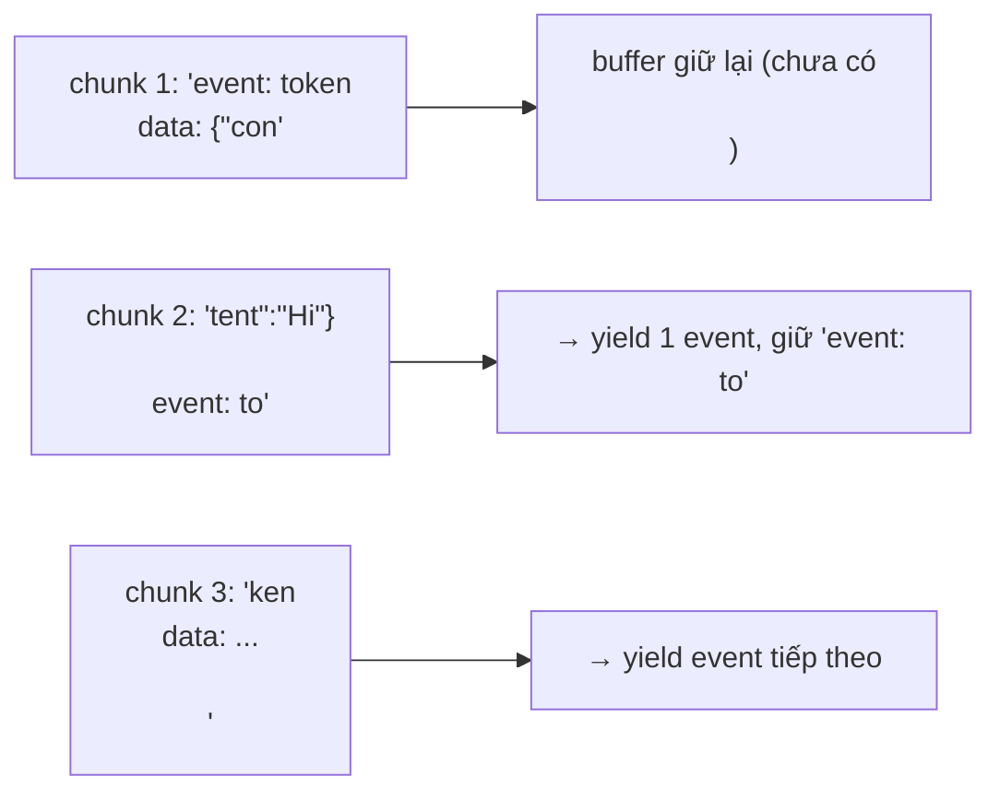

# 08 · Đọc Server-Sent Events từ `fetch`

## 🎯 Mục tiêu

- Hiểu định dạng **SSE** (`text/event-stream`) trên đường truyền.
- Biết vì sao **không dùng `EventSource`** cho endpoint chat.
- Đọc `ReadableStream` bằng `TextDecoderStream` và xử lý **chunk bị cắt ngang**.
- Viết parser dưới dạng **async generator**.

## 📁 File liên quan

- `frontend/src/lib/sse.ts`
- `frontend/src/lib/sse.test.ts`
- `backend/app/api/v1/endpoints/chat.py` (phía phát SSE)

---

## 1. SSE trông như thế nào trên đường truyền?

Backend (FastAPI `EventSourceResponse`) gửi một HTTP response **không đóng ngay**, mà ghi dần từng block text:

```text
event: metadata
data: {"conversation_id": "51e343da-..."}

event: tool_start
data: {"tool_name": "search_documents", "tool_input": {"query": "Atlas launch"}}

event: tool_end
data: {"content": "[atlas.txt] (similarity 0.82)\nProject Atlas launches in March...", "tool_name": "search_documents"}

event: token
data: {"content": "Theo "}

event: token
data: {"content": "tài liệu, "}

event: done
data: {"conversation_id": "51e343da-..."}

```

Quy tắc:

- Mỗi dòng có dạng `field: value`. Ta quan tâm `event` (tên event) và `data` (payload).
- Các event **ngăn cách bởi một dòng trống** (`\n\n`).
- Dòng bắt đầu bằng `:` là **comment** — thường dùng làm keep-alive ping, phải bỏ qua.
- Một event có thể có nhiều dòng `data:` — nối lại bằng `\n`.

## 2. Vì sao không dùng `EventSource`?

Trình duyệt có sẵn `new EventSource(url)`, nhưng:

| `EventSource` | `fetch` + tự parse |
| --- | --- |
| Chỉ hỗ trợ **GET** | Mọi method (ta cần **POST** + JSON body) |
| Không gửi được header tuỳ ý | Gửi header thoải mái (`Accept`, `Content-Type`…) |
| Tự reconnect | Tự quyết định (chat thì *không* muốn tự gửi lại) |
| Không huỷ bằng `AbortSignal` | Hỗ trợ `AbortSignal` |
| Không tự refresh token khi 401 | Đi qua `apiFetch` → refresh-on-401 (bài 06) |

Endpoint `POST /api/v1/chat/stream` nhận `{ message, conversation_id }` trong body, nên ta dùng `fetch` và tự parse — chỉ khoảng 50 dòng code.

> 💡 Một event `tool_end` chứa đoạn trích tài liệu có xuống dòng. Backend serialize `data` thành JSON nên `\n` trở thành hai ký tự `\` `n` — vẫn nằm trên **một** dòng `data:`. Đó là lý do luôn gửi JSON trong SSE thay vì text thô.

## 3. Parse một block: `parseSseBlock`

```ts
export function parseSseBlock(block: string): RawSseEvent | null {
  let event = "message";
  const dataLines: string[] = [];

  for (const line of block.split(/\r?\n/)) {
    if (!line || line.startsWith(":")) continue; // blank line or comment (keep-alive ping)
    const sep = line.indexOf(":");
    const field = sep === -1 ? line : line.slice(0, sep);
    // Per spec, a single space after the colon is not part of the value.
    const value = sep === -1 ? "" : line.slice(sep + 1).replace(/^ /, "");
    if (field === "event") event = value;
    else if (field === "data") dataLines.push(value);
  }

  return dataLines.length ? { event, data: dataLines.join("\n") } : null;
}
```

- Tên event mặc định là `"message"` (theo spec), nếu server không gửi dòng `event:`.
- Chỉ bỏ **một** khoảng trắng sau dấu `:` (`replace(/^ /, "")`) — không dùng `trim()` vì sẽ làm mất khoảng trắng có nghĩa trong dữ liệu.
- `split(/\r?\n/)` chấp nhận cả `\n` lẫn `\r\n`.
- Block chỉ có comment → trả `null`.

Hàm này **thuần** (pure): string vào, object ra — rất dễ test.

## 4. Đọc stream: `readSseStream`

```ts
export async function* readSseStream(
  stream: ReadableStream<Uint8Array<ArrayBuffer>>,
): AsyncGenerator<RawSseEvent> {
  // TextDecoderStream handles multi-byte UTF-8 characters split across chunks.
  const reader = stream.pipeThrough(new TextDecoderStream()).getReader();
  let buffer = "";

  try {
    while (true) {
      const { value, done } = await reader.read();
      if (done) break;
      buffer += value;

      // A network chunk may contain several events, or half of one: keep the remainder.
      const blocks = buffer.split(/\r?\n\r?\n/);
      buffer = blocks.pop() ?? "";
      for (const block of blocks) {
        const parsed = parseSseBlock(block);
        if (parsed) yield parsed;
      }
    }
    const last = parseSseBlock(buffer);
    if (last) yield last;
  } finally {
    reader.releaseLock();
  }
}
```

### 4.1 `TextDecoderStream` — vì sao quan trọng với tiếng Việt?

`response.body` là stream các **byte**. Chữ "ữ" trong UTF-8 chiếm 3 byte. Mạng có thể cắt chunk *giữa* 3 byte đó. Nếu tự gọi `new TextDecoder().decode(chunk)` cho từng chunk độc lập, ta sẽ nhận ký tự lỗi `�`. `TextDecoderStream` giữ lại byte dở dang và ghép với chunk sau.

### 4.2 Buffer cho event bị cắt ngang

Một chunk mạng **không** tương ứng với một event. Có thể nhận:



Thủ thuật: `split` theo dòng trống, phần tử **cuối cùng** có thể chưa hoàn chỉnh → `blocks.pop()` đưa nó trở lại `buffer` chờ chunk sau. Khi stream kết thúc, xử lý nốt phần còn lại.

Test `sse.test.ts` (bài 14) mô phỏng đúng tình huống này:

```ts
streamOf(
  "event: token\nda",
  'ta: {"content":"Hel"}\n\nevent: tok',
  'en\ndata: {"content":"lo"}\n\n',
),
```

### 4.3 `try/finally` + `releaseLock`

Nếu bên dùng dừng vòng `for await` sớm (ví dụ `break`, hoặc request bị abort), generator chạy khối `finally` → trả lại khoá của reader. Đây là cách dọn dẹp tài nguyên chuẩn cho generator.

## 5. Async generator — tóm tắt

```ts
async function* numbers() {
  yield 1;
  await sleep(100);
  yield 2;
}
for await (const n of numbers()) console.log(n);
```

- Generator là **lazy**: chỉ đọc chunk tiếp theo khi bên dùng xin giá trị tiếp → tự nhiên có *backpressure*.
- Có thể **xếp chồng**: `readSseStream` (byte → event thô) → `streamChat` (event thô → `StreamEvent` có kiểu, bài 06) → `useChat` (event → state, bài 10). Mỗi tầng một trách nhiệm.

## ⚠️ Lỗi thường gặp

- **Tách theo `\n` thay vì `\n\n`** → mỗi dòng bị coi là một event.
- **Giả định một chunk = một event** → JSON.parse lỗi ngẫu nhiên khi mạng chậm.
- **Decode từng chunk riêng lẻ** → ký tự `�` trong tiếng Việt/Nhật.
- **Dùng `trim()`** cho value → token `" chào"` mất khoảng trắng đầu, chữ dính vào nhau.
- **Token đến dồn cục ở production nhưng dev thì không** → không phải lỗi parser mà là proxy nén gzip (bài 05).

## 🧪 Thực hành

1. Thêm test: block có hai dòng `data:` (`"data: a\ndata: b"`) phải cho `data === "a\nb"`.
2. Thêm test: một chữ tiếng Việt bị cắt giữa byte (dùng `TextEncoder` encode `"ữ"` rồi chia `Uint8Array` làm 2 chunk) vẫn decode đúng.
3. Xem SSE thô qua proxy của Next (endpoint cần đăng nhập, nên lưu cookie trước):

   ```bash
   curl -c jar.txt -H 'content-type: application/json' -d '{"email":"you@example.com","password":"..."}' localhost:3000/api/v1/auth/login
   curl -N -b jar.txt -H 'Origin: http://localhost:3000' -H 'content-type: application/json' \
     -d '{"message":"Tóm tắt tài liệu"}' localhost:3000/api/v1/chat/stream
   ```

---

⬅️ Trước: [07 · Luồng xác thực](07_AuthenticationFlow.md) · ➡️ Tiếp: [09 · Quản lý state với useReducer](09_StateWithUseReducer.md)
