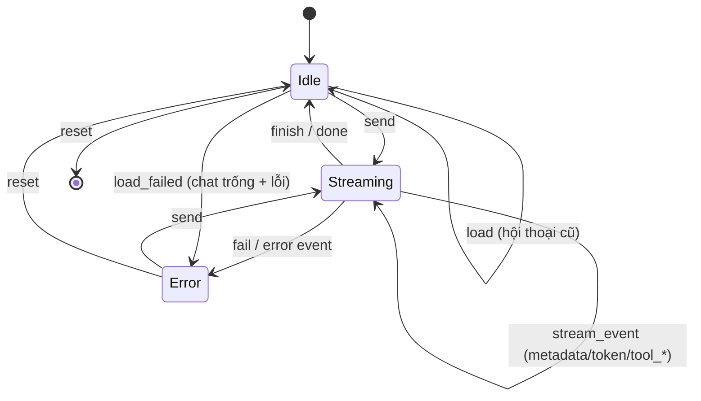

# 09 · Quản lý state chat bằng reducer thuần

## 🎯 Mục tiêu

- Hiểu khi nào nên dùng `useReducer` thay cho nhiều `useState`.
- Viết **reducer thuần** (pure function): không React, không `fetch`, dễ test.
- Cập nhật state **bất biến** (immutable) cho mảng lồng nhau.
- Dùng `switch` trên discriminated union để TypeScript kiểm tra **đủ mọi trường hợp**.
- Nạp lại một hội thoại cũ từ server bằng action `load` (gộp tin nhắn để giống lúc stream) và xử lý lỗi bằng `load_failed`.

## 📁 File liên quan

- `frontend/src/hooks/chatReducer.ts`
- `frontend/src/hooks/chatReducer.test.ts`
- `frontend/src/types/api.ts` (`StreamEvent`, `ChatMessage`), `frontend/src/types/chat.ts` (`Message`)

---

## 1. Vì sao reducer?

State của chat gồm nhiều phần **phụ thuộc nhau**:

```ts
export interface ChatState {
  messages: Message[];
  /** null until the server assigns one (first `metadata` event). */
  conversationId: string | null;
  isStreaming: boolean;
  error: string | null;
}
```

Khi có event `error`, ta phải đổi *cùng lúc* `isStreaming`, `error`, và `status` của một message. Với 4 `useState` riêng, rất dễ quên một chỗ, hoặc các update bị render ra trạng thái lỡ dở. Reducer gom **mọi chuyển trạng thái** về một hàm:

```text
(state hiện tại, action) => state mới
```



## 2. Actions

```ts
export type ChatAction =
  | { type: "send"; userMessage: Message; assistantMessage: Message }
  | { type: "stream_event"; messageId: string; event: StreamEvent }
  | { type: "finish"; messageId: string }
  | { type: "fail"; messageId: string; error: string }
  | { type: "load"; conversationId: string; messages: ChatMessage[] }
  | { type: "load_failed"; error: string }
  | { type: "reset" };
```

Lại là **discriminated union** (bài 04). Mỗi action mô tả *điều đã xảy ra*, không mô tả *cách đổi state*. Lưu ý `send` mang theo cả `assistantMessage` rỗng: ta tạo sẵn bong bóng trợ lý (status `"streaming"`) để token có chỗ đổ vào, và để UI hiện "…" ngay lập tức.

Tại sao `id` được tạo **bên ngoài** reducer (trong `useChat` bằng `crypto.randomUUID()`)? Vì reducer phải **thuần**: cùng input → cùng output. Gọi random/thời gian/fetch bên trong reducer sẽ phá vỡ điều đó (và React Strict Mode gọi reducer 2 lần trong dev để phát hiện lỗi này).

## 3. Cập nhật bất biến

React so sánh state cũ và mới **bằng tham chiếu** (`Object.is`). Nếu ta sửa trực tiếp `m.content += ...` thì tham chiếu không đổi → React không re-render. Vì vậy luôn tạo object/mảng mới:

```ts
function updateMessage(
  messages: Message[],
  id: string,
  update: (message: Message) => Message,
): Message[] {
  return messages.map((m) => (m.id === id ? update(m) : m));
}
```

Helper nhỏ này giúp: chỉ message có `id` khớp được tạo mới, các message khác giữ nguyên tham chiếu (React có thể bỏ qua render chúng).

```ts
case "token":
  return {
    ...state,
    messages: updateMessage(state.messages, messageId, (m) => ({
      ...m,
      content: m.content + event.content,
    })),
  };
```

## 4. Xử lý từng stream event

```ts
function applyStreamEvent(state: ChatState, messageId: string, event: StreamEvent): ChatState {
  switch (event.type) {
    case "metadata":
      return { ...state, conversationId: event.conversation_id };
    ...
    case "error":
      return chatReducer(state, { type: "fail", messageId, error: event.content });
    case "done":
      return chatReducer(state, { type: "finish", messageId });
  }
}
```

- `metadata` — lưu `conversation_id` do backend tạo ở tin nhắn đầu tiên. Tin nhắn sau gửi kèm id này → backend nạp lại lịch sử từ Postgres checkpointer, agent nhớ hội thoại.
- `error` / `done` **tái sử dụng** action `fail` / `finish` → một nguồn sự thật duy nhất.

### Exhaustive switch

Hàm khai báo trả về `ChatState` nhưng không có `default`. Với `strict: true`, nếu bạn thêm một loại event mới vào `StreamEvent` mà quên thêm `case`, TypeScript báo lỗi *"Function lacks ending return statement"*. Đây là cách để compiler nhắc ta cập nhật reducer mỗi khi contract API thay đổi.

### `tool_start`: chèn ngắt đoạn

```ts
case "tool_start":
  return {
    ...state,
    messages: updateMessage(state.messages, messageId, (m) => ({
      ...m,
      // Text before and after a tool call comes from two separate LLM turns:
      // add a paragraph break so they don't run together.
      content: m.content && !m.content.endsWith("\n") ? `${m.content}\n\n` : m.content,
      toolCalls: [...m.toolCalls, { name: event.tool_name, input: event.tool_input }],
    })),
  };
```

Agent (LangGraph) có thể nói "Để tôi tìm trong tài liệu." → gọi `search_documents` → nói tiếp "Theo tài liệu, Atlas ra mắt vào tháng 3". Đó là **hai lượt LLM** nhưng ta hiển thị trong **một** bong bóng. Không có `\n\n`, chữ sẽ dính: "…trong tài liệu.Theo tài liệu…" (lỗi thật đã gặp khi chạy thử!).

### `tool_end`: ghép output vào đúng tool call

```ts
// Attach the output to the first pending call with the same name.
const index = m.toolCalls.findIndex(
  (t) => t.name === event.tool_name && t.output === undefined,
);
```

Nếu LLM gọi `search_documents` hai lần (hai câu truy vấn khác nhau), output thứ nhất gắn vào call thứ nhất chưa có output.

## 5. `finish` không ghi đè `error`

```ts
case "finish":
  return {
    ...state,
    isStreaming: false,
    messages: updateMessage(state.messages, action.messageId, (m) =>
      // Don't let a late "finish" overwrite an earlier "error".
      m.status === "streaming" ? { ...m, status: "done" } : m,
    ),
  };
```

Trình tự thực tế: backend gửi event `error` → stream đóng → `useChat` luôn dispatch `finish` sau vòng lặp. Nếu `finish` đặt mù quáng `status: "done"`, viền đỏ báo lỗi sẽ biến mất. Test `"keeps the error status if finish arrives afterwards"` bảo vệ đúng hành vi này.

## 6. `load`: nạp lại hội thoại cũ

Khi người dùng bấm một hội thoại trong sidebar, `useChat` gọi `GET /conversations/{id}/messages` và dispatch:

```ts
    case "load":
      return {
        ...initialChatState,
        conversationId: action.conversationId,
        messages: historyToMessages(action.conversationId, action.messages),
      };
    case "load_failed":
      return { ...initialChatState, error: action.error };
```

- `...initialChatState` trước: xoá sạch `error`, `isStreaming` của hội thoại trước.
- `load_failed` (ví dụ hội thoại đã bị xoá ở tab khác → 404): về **chat trống** và hiện lỗi trong `role="alert"`, thay vì tiếp tục hiển thị hội thoại cũ như thể đã chuyển sang hội thoại mới.

### `historyToMessages`: lịch sử trông giống lúc stream

```ts
/**
 * Server history -> UI messages.
 *
 * One agent turn can contain several AI messages (text before a tool call, then the
 * final answer). While streaming they end up in ONE bubble, so merge consecutive
 * assistant messages here too: a reloaded conversation looks the same as a live one.
 * History has no tool calls: only the text of each turn is stored for display.
 */
function historyToMessages(conversationId: string, history: ChatMessage[]): Message[] {
  const messages: Message[] = [];
  for (const { role, content } of history) {
    const last = messages.at(-1);
    if (role === "assistant" && last?.role === "assistant") {
      messages[messages.length - 1] = { ...last, content: `${last.content}\n\n${content}` };
      continue;
    }
    messages.push({
      id: `${conversationId}-${messages.length}`,
      role,
      content,
      toolCalls: [],
      status: "done",
    });
  }
  return messages;
}
```

- Đây là **nơi duy nhất** chuyển API model (`ChatMessage`: `{ role, content }`) sang UI model (`Message`) — bài 04.
- `ChatService.messages` ở backend chỉ giữ phần **text** của `HumanMessage` và `AIMessage` (bỏ `ToolMessage` và tool call). Một lượt mà LLM nói "Để tôi tìm…" → gọi `search_documents` → trả lời, được lưu thành **hai** `AIMessage` liên tiếp. Không gộp lại thì khi nạp lại sẽ hiện **hai** bong bóng trợ lý, trong khi lúc stream chỉ có một.
- Gộp bằng `\n\n` — đúng ngắt đoạn mà `tool_start` chèn khi stream → hội thoại nạp lại trông **y hệt** lúc đang chat (chỉ thiếu thẻ tool, vì lịch sử không lưu tool call → `toolCalls: []`).
- `messages` là mảng **cục bộ** do hàm tự tạo, nên gán `messages[i] = ...` không vi phạm tính bất biến của state; còn object cũ thì vẫn được thay bằng object mới (`{ ...last, content }`).
- `id` suy ra **tất định** từ `conversationId` + vị trí trong mảng kết quả → duy nhất, reducer vẫn thuần (không `crypto.randomUUID()`). Lịch sử cũ không đổi thứ tự nên vị trí là an toàn. Test kiểm tra điều này: `new Set(ids).size === 3` (key React không trùng).

## ⚠️ Lỗi thường gặp

- **Mutate state** (`state.messages.push(...)`, `m.content += ...`) → UI không cập nhật hoặc cập nhật sai.
- **Side effect trong reducer** (`fetch`, `crypto.randomUUID()`, `Date.now()`) → kết quả khác nhau mỗi lần gọi.
- **Thêm `default: return state`** → mất kiểm tra exhaustive, event mới bị bỏ qua âm thầm.
- **Dùng index mảng thay cho `id`** để tìm message → sai khi danh sách thay đổi.

## 🧪 Thực hành

1. Thêm action `{ type: "retry" }` xoá message trợ lý bị lỗi cuối cùng và đặt lại `error: null`. Viết test trước.
2. Thêm field `startedAt`/`finishedAt` vào `Message` để hiển thị thời gian trả lời — nhớ: thời gian phải được truyền qua action, không gọi `Date.now()` trong reducer.
3. Thử xoá `case "done"` (hoặc `case "load_failed"`) và chạy `npm run typecheck` để thấy exhaustive check hoạt động.
4. Viết thêm test cho `load`: sau `load`, `error` phải về `null` dù state trước đó có lỗi (gợi ý: bắt đầu từ state sau `load_failed`).

---

⬅️ Trước: [08 · Parse Server-Sent Events](08_ParsingSSE.md) · ➡️ Tiếp: [10 · Custom hooks](10_CustomHooks.md)
