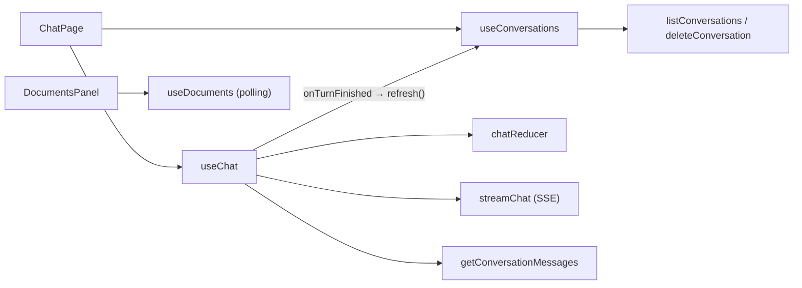

# 10 · Custom hooks: `useChat`, `useConversations`, `useDocuments`

## 🎯 Mục tiêu

- Đóng gói logic vào **custom hook** để component chỉ lo hiển thị.
- Dùng `useReducer`, `useRef`, `useCallback`, `useEffect` đúng mục đích.
- Huỷ/tách request bằng `AbortController` (nút "Dừng", đổi hội thoại, unmount).
- Chống race condition khi đổi hội thoại nhanh bằng một bộ đếm (`viewRef`), và không để lỗi async "rơi" mất.
- Báo cho component cha khi một lượt trả lời xong (`onTurnFinished`) mà không gây *stale closure*.
- **Polling** danh sách tài liệu trong khi backend còn đang xử lý.

## 📁 File liên quan

- `frontend/src/hooks/useChat.ts`
- `frontend/src/hooks/useConversations.ts`
- `frontend/src/hooks/useDocuments.ts`
- `frontend/src/hooks/chatReducer.ts` (bài 09), `frontend/src/lib/api/*.ts` (bài 06)

---

## 1. Bức tranh tổng thể



Hook là "cầu nối" giữa thế giới **bất đồng bộ** (network) và thế giới **thuần** (reducer, component).

## 2. `useChat`: state, ref và option

```ts
interface UseChatOptions {
  /** Called after every answer, e.g. to refresh the conversation list. */
  onTurnFinished?: () => void;
}

export function useChat({ onTurnFinished }: UseChatOptions = {}) {
  const [state, dispatch] = useReducer(chatReducer, initialChatState);
  const abortRef = useRef<AbortController | null>(null);
  // Refs (not state) so the callbacks below always see the latest values
  // without being re-created on every change.
  const conversationIdRef = useRef<string | null>(null);
  const onTurnFinishedRef = useRef(onTurnFinished);
  // Bumped whenever the visible conversation changes: a slow `load()` response for
  // a conversation the user already left must not overwrite the current one.
  const viewRef = useRef(0);

  useEffect(() => {
    conversationIdRef.current = state.conversationId;
    onTurnFinishedRef.current = onTurnFinished;
  });
```

| | `useState`/`useReducer` | `useRef` |
| --- | --- | --- |
| Thay đổi có re-render không? | Có | Không |
| Dùng cho | Dữ liệu hiển thị trên UI | "Hộp" giữ giá trị giữa các lần render: controller, timer, DOM node, giá trị mới nhất |

- `AbortController` không bao giờ hiển thị → `useRef`.
- `conversationId` nằm trong reducer state (sidebar cần tô sáng hội thoại đang mở) **và** được chép vào ref để `sendMessage` luôn đọc giá trị mới nhất.
- `onTurnFinished` do cha truyền vào, có thể là hàm mới mỗi lần render. Lưu vào ref → `sendMessage` không phải phụ thuộc vào nó. Effect **không có** dependency array → chạy sau *mỗi* render, ref luôn mới.
- `viewRef` là một **bộ đếm "lượt xem"**: tăng mỗi khi màn hình chat chuyển sang nội dung khác (mục 4).

## 3. `sendMessage`

```ts
  const sendMessage = useCallback(async (text: string) => {
    const content = text.trim();
    if (!content || abortRef.current) return;

    viewRef.current++; // the user moved on: ignore a pending load()
    const userMessage = createMessage("user", content);
    const assistantMessage = createMessage("assistant", "");
    dispatch({ type: "send", userMessage, assistantMessage });

    const controller = new AbortController();
    abortRef.current = controller;
    // False once `reset()`/`load()` has dropped this request: its late events must
    // not leak into another conversation.
    const isCurrent = () => abortRef.current === controller;

    try {
      const events = streamChat(
        { message: content, conversation_id: conversationIdRef.current },
        controller.signal,
      );
      for await (const event of events) {
        if (!isCurrent()) return;
        dispatch({ type: "stream_event", messageId: assistantMessage.id, event });
      }
      if (isCurrent()) dispatch({ type: "finish", messageId: assistantMessage.id });
    } catch (error) {
      if (!isCurrent()) return;
      if (controller.signal.aborted) {
        dispatch({ type: "finish", messageId: assistantMessage.id });
      } else {
        const message = error instanceof Error ? error.message : "Something went wrong";
        dispatch({ type: "fail", messageId: assistantMessage.id, error: message });
      }
    } finally {
      if (isCurrent()) abortRef.current = null;
      onTurnFinishedRef.current?.();
    }
  }, []);
```

- `abortRef.current` khác `null` → đang có request → **chặn gửi chồng**.
- `conversation_id: conversationIdRef.current` — lần đầu là `null` → backend tạo hội thoại mới và trả id trong event `metadata`.
- **Phân biệt "dừng" và "lỗi"**: bấm Dừng → `AbortError`; kiểm tra `controller.signal.aborted` để coi là kết thúc bình thường, giữ phần text đã nhận.
- **`isCurrent()` chống race condition**: đổi hội thoại khi đang stream → request cũ bị "tách" khỏi `abortRef`; các event muộn của nó bị bỏ qua thay vì đổ vào hội thoại mới.
- `finally` gọi `onTurnFinishedRef.current?.()` → `ChatPage` làm mới sidebar: hội thoại mới xuất hiện, hội thoại vừa chat nhảy lên đầu (`updated_at` mới).
- `useCallback(..., [])` hợp lệ vì hàm chỉ dùng `dispatch` (ổn định) và **ref**.

## 4. `detach`, `stop`, `reset`, `load`

```ts
  /** Drop the in-flight request (if any) so its late events are ignored. */
  const detach = useCallback(() => {
    viewRef.current++;
    const controller = abortRef.current;
    abortRef.current = null; // detach first, so the request is no longer "current"
    controller?.abort();
  }, []);

  // Stop streaming but keep the partial answer.
  const stop = useCallback(() => abortRef.current?.abort(), []);

  const reset = useCallback(() => {
    detach();
    dispatch({ type: "reset" });
  }, [detach]);

  const load = useCallback(
    async (conversationId: string) => {
      detach();
      const view = viewRef.current;
      try {
        const { messages } = await getConversationMessages(conversationId);
        if (view === viewRef.current) dispatch({ type: "load", conversationId, messages });
      } catch (error) {
        const message = error instanceof Error ? error.message : "Không tải được hội thoại";
        if (view === viewRef.current) dispatch({ type: "load_failed", error: message });
      }
    },
    [detach],
  );
```

- `stop` — abort nhưng **vẫn là request hiện tại** → `catch` dispatch `finish`, giữ phần trả lời dở.
- `detach` — *tách* request khỏi `abortRef` **trước** khi abort → `isCurrent()` của nó thành `false` → im lặng thoát. `reset` (Cuộc trò chuyện mới) và `load` (mở hội thoại cũ) đều cần hành vi này. Nó cũng tăng `viewRef`.
- `load` gọi API rồi dispatch `load` (bài 09). Nếu access token hết hạn, `apiFetch` tự refresh (bài 06).

### Vì sao cần `viewRef`? Hai race condition của `load`

`isCurrent()` chỉ bảo vệ **stream**; request `GET /conversations/{id}/messages` của `load` không đi qua `abortRef`. Không có `viewRef`:

```text
t=0   bấm hội thoại A → load(A) gửi request (chậm, 800ms)
t=1   bấm hội thoại B → load(B) gửi request (nhanh, 100ms)
t=101 response B → hiển thị B ✔
t=800 response A → dispatch load(A) → màn hình đổi sang A ✘ (người dùng đang chọn B)
```

Với `viewRef`, mỗi `load` **chụp** giá trị bộ đếm ngay sau `detach()` (`const view = viewRef.current`). Khi response về, chỉ dispatch nếu bộ đếm **chưa đổi**, tức là người dùng chưa làm gì khác. Ở ví dụ trên, `load(B)` đã tăng bộ đếm → response A bị bỏ qua.

Bộ đếm tăng ở **ba** chỗ — mọi hành động đổi nội dung khung chat:

| Hành động | Tăng ở | Response `load` đang chờ |
| --- | --- | --- |
| Mở hội thoại khác (`load`) | `detach()` | bị bỏ qua |
| "Cuộc trò chuyện mới" (`reset`) | `detach()` | bị bỏ qua (không "nhảy" khỏi chat mới) |
| Gửi tin nhắn (`sendMessage`) | đầu hàm | bị bỏ qua (không xoá tin nhắn vừa gửi) |

- Tại sao là **bộ đếm** chứ không phải lưu `conversationId` đang chờ? Bấm A → B → A: hai request cho A cùng id, so sánh id không phân biệt được request nào là mới nhất. Bộ đếm thì luôn tăng.
- Đây là ref chứ không phải state: không cần re-render khi nó đổi, và `load` (đã `useCallback`) luôn đọc giá trị mới nhất.
- Request cũ vẫn chạy tới cùng (ta chỉ **bỏ qua** kết quả). Muốn huỷ hẳn thì truyền `AbortSignal` cho `getConversationMessages` — với một request JSON nhỏ, bỏ qua là đủ.

### Lỗi khi nạp: `load_failed`

`ChatPage` gọi `void chat.load(id)` — không ai `await` promise này. Nếu `load` để lỗi bay ra (404 khi hội thoại đã bị xoá ở tab khác, mất mạng…), đó là một **unhandled rejection**: không gì hiện trên UI, chỉ một dòng đỏ trong console. Vì vậy `load` tự `catch` và dispatch `load_failed` → khung chat về trống và hiện lỗi trong `role="alert"` (bài 11). Lỗi cũng chỉ được hiển thị nếu người dùng chưa chuyển đi (`view === viewRef.current`).

> Quy tắc: hàm async được gọi kiểu "bắn rồi quên" (`void fn()`) phải **tự xử lý lỗi** bên trong.

### Cleanup và `<Activity>`

```ts
  // Abort any in-flight request when the component unmounts.
  useEffect(() => () => abortRef.current?.abort(), []);
```

Với Cache Components, chuyển từ `/` sang `/documents` **không unmount** trang chat mà giấu nó đi (bài 03) — nhưng **effect vẫn bị cleanup**. Nên rời trang khi đang stream sẽ dừng câu trả lời (phần đã nhận vẫn giữ, vì đây là `abort` chứ không phải `detach`). Backend vẫn lưu lượt hội thoại vào checkpointer, nên mở lại hội thoại từ sidebar là thấy đầy đủ.

## 5. `useConversations`: dữ liệu cho sidebar

```ts
export function useConversations() {
  const [conversations, setConversations] = useState<Conversation[]>([]);

  const refresh = useCallback(async () => {
    try {
      setConversations(await listConversations());
    } catch {
      // Non-critical: keep the previous list (an expired session is handled globally).
    }
  }, []);

  useEffect(() => {
    // Initial load: fetching on mount is a legitimate effect (syncing with the server).
    // eslint-disable-next-line react-hooks/set-state-in-effect
    void refresh();
  }, [refresh]);

  const remove = useCallback(async (id: string) => {
    await deleteConversation(id);
    setConversations((list) => list.filter((c) => c.id !== id));
  }, []);
```

- Lỗi khi tải danh sách bị nuốt có chủ đích: sidebar không quan trọng bằng khung chat; phiên hết hạn đã có `onSessionExpired` lo (bài 07).
- Rule ESLint `react-hooks/set-state-in-effect` cảnh báo "setState trong effect" (thường là dấu hiệu của state dư thừa). Ở đây là đồng bộ với server lúc mount — trường hợp hợp lệ, nên tắt rule **cho đúng một dòng** kèm lý do.
- `setConversations((list) => ...)` dạng **hàm cập nhật** → luôn dựa trên state mới nhất, không cần đưa `conversations` vào dependency.
- `void refresh()` — nói rõ "cố ý không await promise này" (rule `no-floating-promises`).

## 6. `useDocuments`: polling khi đang xử lý

Upload trả về **202** với `status: "processing"`; backend cắt chunk + tạo embedding ở background. UI phải tự hỏi lại cho tới khi xong:

```ts
const POLL_INTERVAL_MS = 2000;

  const isProcessing = documents?.some((d) => d.status === "processing") ?? false;
  useEffect(() => {
    if (!isProcessing) return;
    const id = setInterval(() => void refresh(), POLL_INTERVAL_MS);
    return () => clearInterval(id);
  }, [isProcessing, refresh]);
```

- `isProcessing` là **giá trị suy ra** (derived), không phải state riêng.
- Effect phụ thuộc vào **boolean** chứ không phải mảng `documents`: mỗi lần poll trả mảng mới nhưng `isProcessing` vẫn `true` → interval **không** bị tạo lại. Khi tài liệu cuối cùng sang `ready`/`failed`, `isProcessing` thành `false` → cleanup xoá interval, hết polling.
- `documents` khởi tạo là `null` (đang tải) để phân biệt với `[]` (chưa có tài liệu nào).

```ts
  const upload = useCallback(async (file: File) => {
    setError(null);
    try {
      const created = await uploadDocument(file);
      setDocuments((list) => [created, ...(list ?? [])]);
    } catch (e) {
      setError(e instanceof Error ? e.message : "Tải lên thất bại");
    }
  }, []);
```

Thêm ngay tài liệu vừa tạo vào đầu danh sách (status `processing`) → polling tự bật, không cần tải lại cả trang.

> 💡 Polling đơn giản và đủ dùng cho bài học. Ở production có thể thay bằng SSE/WebSocket đẩy trạng thái, hoặc thư viện như TanStack Query (`refetchInterval`).

## ⚠️ Lỗi thường gặp

- **Lưu `AbortController` trong `useState`** → re-render thừa.
- **Đọc state trong `useCallback(..., [])`** → *stale closure*: luôn thấy giá trị của lần render đầu. Dùng ref.
- **Không phân biệt abort với lỗi** → bấm "Dừng" hiện thông báo lỗi đỏ.
- **Đặt `documents` vào dependency của effect polling** → interval bị xoá/tạo lại sau mỗi lần poll.
- **Quên `clearInterval` trong cleanup** → polling chạy mãi, kể cả khi đã rời trang.
- **Tắt rule ESLint cho cả file** thay vì một dòng có giải thích.
- **Dispatch kết quả của request async mà không kiểm tra người dùng còn ở đó không** → response chậm ghi đè màn hình hiện tại.
- **`void asyncFn()` mà hàm không tự `catch`** → unhandled rejection, lỗi im lặng trên UI.

## 🧪 Thực hành

1. Tái hiện race condition: DevTools → Network → throttling "Slow 4G", bấm nhanh hai hội thoại. Rồi tạm xoá điều kiện `view === viewRef.current` trong `load` và thử lại — màn hình "nhảy" về hội thoại bấm trước. Khôi phục.
2. Mở cùng một hội thoại ở hai tab, xoá nó ở tab 1, rồi bấm vào nó trong sidebar (chưa refresh) ở tab 2 → thấy thông báo lỗi 404 và khung chat trống.
3. Sidebar vẫn hiện hội thoại đã bị xoá sau `load_failed`. Hãy gọi `refresh()` của `useConversations` khi `load` thất bại (gợi ý: thêm option `onLoadFailed`, cùng mẫu với `onTurnFinished`).
4. Tạm dừng polling khi tab trình duyệt bị ẩn (gợi ý: `document.visibilityState` + sự kiện `visibilitychange`).

---

⬅️ Trước: [09 · Quản lý state với useReducer](09_StateWithUseReducer.md) · ➡️ Tiếp: [11 · Chat components](11_ChatComponents.md)
