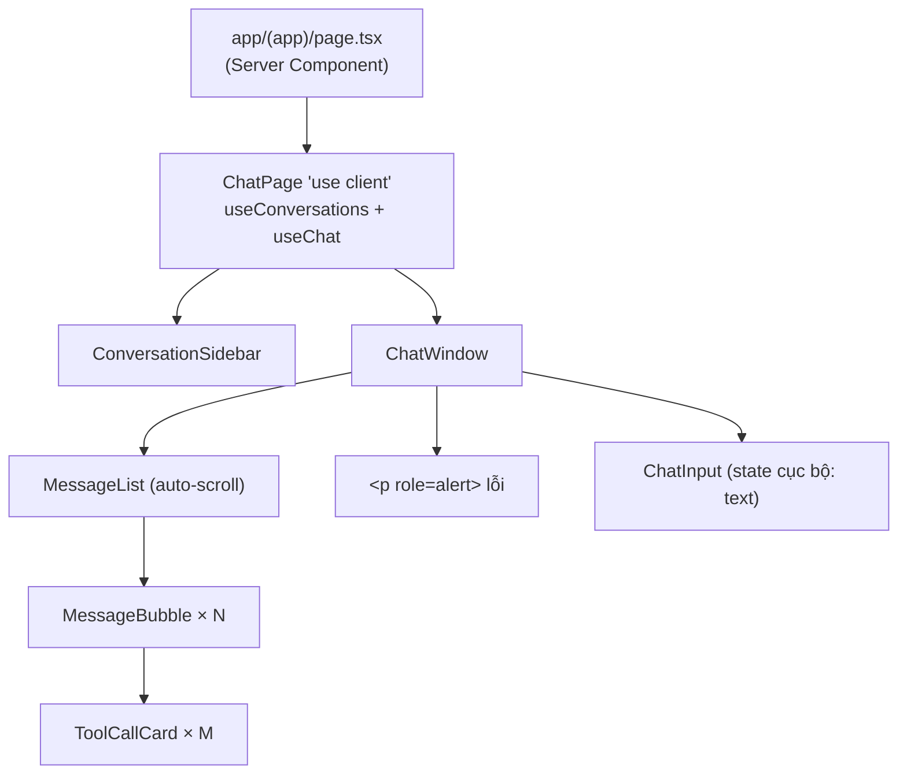

# 11 · Các component của màn hình chat

## 🎯 Mục tiêu

- Tách component thành **container** (có state, gọi hook) và **presentational** (chỉ nhận props, hiển thị).
- Ghép sidebar hội thoại và khung chat bằng **một** nguồn state.
- Viết input **controlled**, xử lý Enter / Shift+Enter và bộ gõ tiếng Việt (IME).
- Tự cuộn khi stream, render list với `key` đúng, hiển thị kết quả `search_documents` gọn gàng.
- Áp dụng các nguyên tắc **accessibility** cơ bản.

## 📁 File liên quan

- `frontend/src/app/(app)/page.tsx`, `frontend/src/app/(app)/layout.tsx`
- `frontend/src/components/chat/ChatPage.tsx`
- `frontend/src/components/chat/ConversationSidebar.tsx`
- `frontend/src/components/chat/ChatWindow.tsx`, `MessageList.tsx`, `MessageBubble.tsx`, `ToolCallCard.tsx`, `ChatInput.tsx`

---

## 1. Cây component



- `page.tsx` chỉ là `return <ChatPage />` — vẫn là Server Component, nhỏ nhất có thể.
- **Container** duy nhất: `ChatPage` — biết *dữ liệu đến từ đâu*.
- Mọi component còn lại là **presentational**: nhận props, trả JSX. `ChatWindow`, `ConversationSidebar`, `MessageBubble` không có `"use client"` nhưng vẫn chạy ở client vì được import từ bên trong client boundary (bài 03).

## 2. `ChatPage` — nơi ghép nối

```tsx
/** Client boundary of the chat screen: wires the sidebar and the chat together. */
export function ChatPage() {
  const { conversations, refresh, remove } = useConversations();
  // After each answer the list is refreshed: a new conversation appears / moves to the top.
  const chat = useChat({ onTurnFinished: refresh });

  async function handleDelete(id: string) {
    await remove(id);
    if (id === chat.conversationId) chat.reset();
  }

  return (
    <>
      <ConversationSidebar
        conversations={conversations}
        activeId={chat.conversationId}
        onSelect={(id) => void chat.load(id)}
        onNew={chat.reset}
        onDelete={(id) => void handleDelete(id)}
      />
      <ChatWindow
        messages={chat.messages}
        isStreaming={chat.isStreaming}
        error={chat.error}
        onSend={chat.sendMessage}
        onStop={chat.stop}
      />
    </>
  );
}
```

- Hai hook nói chuyện với nhau **qua `ChatPage`**: `useChat` không import `useConversations`, chỉ nhận một callback `onTurnFinished` (bài 10). Hook nào cũng test/tái sử dụng riêng được.
- `activeId={chat.conversationId}` — sidebar tô sáng hội thoại đang mở. Tin nhắn đầu tiên của hội thoại mới: `metadata` đặt `conversationId` → lượt kết thúc → `refresh()` → hội thoại xuất hiện ở đầu danh sách, đã được tô sáng.
- Xoá hội thoại **đang mở** → `reset()` để khung chat không hiển thị một hội thoại đã không còn tồn tại.
- `onSelect={(id) => void chat.load(id)}` — "bắn rồi quên" là an toàn vì `load` **tự bắt lỗi** (dispatch `load_failed`) và tự bỏ qua response đến muộn khi người dùng đã bấm sang hội thoại khác (`viewRef`, bài 10). `ChatPage` không cần `try/catch` hay cờ "đang tải".
- Fragment `<>...</>` vì `(app)/layout.tsx` đã bọc `{children}` trong `<div className="flex min-h-0 flex-1">` → sidebar và khung chat nằm cạnh nhau.

> Đừng gọi `useChat()` ở cả `ConversationSidebar` lẫn `ChatWindow` để "lấy state": mỗi lần gọi hook tạo ra một state **riêng**, không chia sẻ. Gọi một lần ở container, truyền xuống bằng props.

## 3. `ConversationSidebar`

```tsx
    <aside className="hidden w-64 shrink-0 flex-col gap-2 overflow-y-auto border-r border-zinc-200 p-3 md:flex dark:border-zinc-800">
      ...
        {conversations.map((c) => (
          <li key={c.id} className="group flex items-center">
            <button
              type="button"
              onClick={() => onSelect(c.id)}
              aria-current={c.id === activeId ? "true" : undefined}
              title={c.title}
              ...
            >
              {c.title}
            </button>
            <button
              type="button"
              onClick={() => onDelete(c.id)}
              aria-label={`Xoá "${c.title}"`}
              className="px-2 text-zinc-400 opacity-0 group-hover:opacity-100 hover:text-red-600 focus:opacity-100"
            >
              ×
            </button>
```

- `hidden md:flex` — ẩn trên điện thoại, hiện từ màn hình `md` (768px). (Thực hành: thêm nút mở sidebar trên mobile.)
- `aria-current="true"` — screen reader biết mục nào đang chọn; style tô sáng đi kèm bằng `cn(..., c.id === activeId && "bg-zinc-100 font-medium")`.
- Nút "×" chỉ là ký tự → **bắt buộc** có `aria-label` có nghĩa, nếu không screen reader đọc "times".
- `group` + `group-hover:opacity-100` — nút xoá chỉ hiện khi rê chuột vào dòng; `focus:opacity-100` để người dùng bàn phím (Tab) vẫn thấy nó.
- `truncate` + `title` — tiêu đề dài bị cắt "…", rê chuột xem đầy đủ. Tiêu đề do backend đặt từ tin nhắn đầu tiên.

## 4. `ChatWindow` — presentational

```tsx
/** Presentational: state lives in useChat (see ChatPage). */
export function ChatWindow({ messages, isStreaming, error, onSend, onStop }: ChatWindowProps) {
  return (
    <section className="mx-auto flex min-h-0 w-full max-w-3xl flex-1 flex-col px-4 pb-4">
      <MessageList messages={messages} />

      {error && (
        <p role="alert" className="mb-2 rounded-md bg-red-50 px-3 py-2 text-sm text-red-700 ...">
          {error}
        </p>
      )}

      <ChatInput onSend={onSend} onStop={onStop} isStreaming={isStreaming} />
    </section>
  );
}
```

- `role="alert"` khiến screen reader **đọc ngay** thông báo lỗi khi nó xuất hiện. Cùng một chỗ hiển thị cả lỗi stream (`fail`) lẫn lỗi nạp hội thoại (`load_failed`) — `ChatWindow` chỉ biết có `error`, không cần biết nó từ đâu.
- `min-h-0` + `flex-1`: mẹo flexbox để vùng tin nhắn co lại và cuộn được thay vì đẩy ô nhập ra ngoài màn hình (chi tiết ở bài 13).

## 5. `MessageList` — render list + auto scroll

```tsx
  // Keep the newest token in view while the answer streams in.
  useEffect(() => {
    bottomRef.current?.scrollIntoView({ behavior: "smooth", block: "end" });
  }, [messages]);

  if (messages.length === 0) {
    return (
      <div className="flex flex-1 items-center justify-center text-center text-sm text-zinc-500">
        <p>
          Hỏi về tài liệu bạn đã tải lên, ví dụ:{" "}
          <em>&quot;Tóm tắt các điểm chính của hợp đồng&quot;</em> hoặc{" "}
```

- Một `div` rỗng ở cuối list làm "mỏ neo" (`useRef` giữ **DOM node**); mỗi token → reducer tạo mảng mới → cuộn tới mỏ neo.
- **Empty state** gợi ý câu hỏi *về tài liệu* — nhắc người dùng rằng agent trả lời dựa trên tài liệu họ đã tải lên (bài 12).
- `key={message.id}` — key ổn định, duy nhất; **không** dùng index.
- `aria-live="polite"` — screen reader thông báo nội dung mới mà không ngắt lời.

## 6. `MessageBubble` và `ToolCallCard`

```tsx
  const isUser = message.role === "user";
  const isThinking = message.status === "streaming" && !message.content;
```

Biến *derived* tính ngay trong render — không lưu thành state riêng.

- `whitespace-pre-wrap` giữ `\n` trong câu trả lời (kể cả `\n\n` reducer chèn ở `tool_start`, bài 09).
- `message.content` render dạng **text**: React tự escape, LLM có trả `<script>` cũng không chạy. Muốn render Markdown thì dùng thư viện (ví dụ `react-markdown`) — **đừng** dùng `dangerouslySetInnerHTML` với output của LLM. Điều này càng quan trọng với RAG: nội dung tài liệu người dùng tải lên có thể được LLM trích lại nguyên văn.
- `message.status === "error" && "ring-2 ring-red-500"` — viền đỏ cho bong bóng lỗi.

```tsx
    <details className="rounded-md border border-zinc-200 bg-zinc-50 px-3 py-2 font-mono text-xs ...">
      {/* Retrieved passages can be long: collapsed by default, click to inspect. */}
      <summary className="flex cursor-pointer items-center gap-2 text-zinc-500">
        <span aria-hidden>{pending ? "⏳" : "🔎"}</span>
        <span className="font-semibold text-zinc-700 dark:text-zinc-300">{toolCall.name}</span>
        <span className="truncate">({JSON.stringify(toolCall.input)})</span>
      </summary>
      {!pending && (
        <pre className="mt-2 max-h-64 overflow-y-auto whitespace-pre-wrap text-zinc-600 dark:text-zinc-400">
          {toolCall.output}
        </pre>
      )}
    </details>
```

- Output của `search_documents` là **các đoạn trích** từ tài liệu — có thể dài vài nghìn ký tự. `<details>`/`<summary>` là phần tử HTML gốc: **thu gọn mặc định**, bấm để mở, có sẵn bàn phím + accessibility, không cần state.
- `max-h-64 overflow-y-auto` giới hạn chiều cao khi mở; `<pre>` + `whitespace-pre-wrap` giữ xuống dòng nhưng vẫn ngắt dòng dài.
- Người dùng thấy **agent đã tìm gì** (`{"query": "..."}`) và **tìm được gì** → kiểm chứng được câu trả lời, không phải "tin mù".
- Emoji `aria-hidden` vì chỉ trang trí.

## 7. `ChatInput` — controlled textarea

```tsx
  // Enter = send, Shift+Enter = new line. Ignore Enter while an IME (e.g. Vietnamese,
  // Japanese input) is composing, otherwise the half-typed word gets sent.
  function handleKeyDown(event: KeyboardEvent<HTMLTextAreaElement>) {
    if (event.key === "Enter" && !event.shiftKey && !event.nativeEvent.isComposing) {
      event.preventDefault();
      submit();
    }
  }
```

- **Controlled**: `value={text}` + `onChange` → dễ xoá sau khi gửi (`setText("")`), dễ disable nút khi rỗng. State `text` là **cục bộ**: gõ phím không re-render danh sách tin nhắn.
- Với bộ gõ tiếng Nhật (và một số kiểu gõ tiếng Việt trên macOS), Enter dùng để **chốt chữ** đang soạn. Không kiểm tra `isComposing` → tin nhắn bị gửi khi chữ còn dở.
- `<form onSubmit>` + `<button type="submit">`, `<label htmlFor="chat-input" className="sr-only">` — ẩn với mắt nhưng screen reader vẫn đọc.
- Khi đang stream, nút **Gửi** đổi thành **Dừng** (`type="button"` để không submit form).

> So sánh với `AuthForm` (bài 07): form đăng nhập dùng input **uncontrolled** + `useActionState` vì chỉ cần giá trị lúc submit; ô chat cần controlled vì phải biết nội dung *khi đang gõ* (disable nút Gửi).

## ⚠️ Lỗi thường gặp

- **Gọi `useChat()` ở nhiều component** → mỗi nơi một state riêng, sidebar và khung chat lệch nhau.
- **Để `useChat` tự import `useConversations`** → hai hook dính chặt, khó test; dùng callback.
- **`key={index}`** cho danh sách thay đổi → state/animation gắn nhầm phần tử.
- **Nút icon không có `aria-label`** → screen reader đọc vô nghĩa.
- **Bỏ qua `isComposing`** → người dùng IME gửi nhầm tin.
- **`dangerouslySetInnerHTML` với nội dung LLM/tài liệu** → lỗ hổng XSS.

## 🧪 Thực hành

1. Thêm `confirm("Xoá cuộc trò chuyện này?")` trước khi xoá (giống bảng tài liệu ở bài 12).
2. Trên mobile sidebar bị ẩn: thêm nút ☰ trong header khung chat mở sidebar dạng drawer.
3. Chỉ auto-scroll khi người dùng đang ở gần cuối danh sách (để họ cuộn lên đọc trong lúc stream).
4. Tự focus lại `textarea` sau khi stream kết thúc (gợi ý: `useRef<HTMLTextAreaElement>` + `useEffect` theo `isStreaming`).

---

⬅️ Trước: [10 · Custom hooks](10_CustomHooks.md) · ➡️ Tiếp: [12 · Trang tài liệu](12_DocumentsPage.md)
