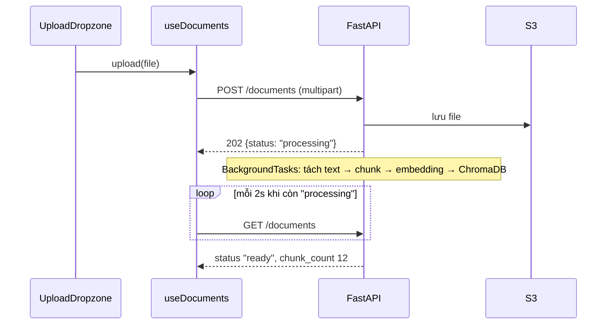

# 12 · Trang tài liệu: upload, trạng thái xử lý, tải về

## 🎯 Mục tiêu

- Ghép trang `/documents`: Server Component bọc một client component nhỏ.
- Làm vùng **kéo-thả + chọn file** chỉ bằng HTML gốc (`<label>` + `<input type="file">`).
- Upload **nhiều file**, hiển thị trạng thái `processing → ready/failed` (polling ở bài 10).
- Tải file về qua **presigned URL** của S3 — và hiểu vì sao dùng `window.open` chứ không phải `fetch`.
- Hiểu validation phía client chỉ là **UX**, không phải bảo mật.

## 📁 File liên quan

- `frontend/src/app/(app)/documents/page.tsx`
- `frontend/src/components/documents/DocumentsPanel.tsx`, `UploadDropzone.tsx`, `DocumentTable.tsx`
- `frontend/src/hooks/useDocuments.ts`, `frontend/src/lib/api/documents.ts`, `frontend/src/lib/utils.ts`
- `backend/app/api/v1/endpoints/documents.py`, `backend/app/services/document_service.py`

---

## 1. Luồng dữ liệu



**202 Accepted** nghĩa là "đã nhận, đang xử lý": request upload trả về ngay sau khi lưu file, việc tạo embedding (có thể mất hàng chục giây) chạy sau. UI không bị treo, và tài liệu xuất hiện tức thì trong bảng với nhãn vàng `processing`.

## 2. Server page, client panel

```tsx
export const metadata: Metadata = { title: "Tài liệu · Document Assistant" };

export default function DocumentsPage() {
  return (
    <main className="mx-auto w-full max-w-4xl overflow-y-auto px-4 py-6">
      <h1 className="mb-1 text-lg font-semibold">Tài liệu của bạn</h1>
      ...
      <DocumentsPanel />
    </main>
  );
}
```

- Tiêu đề, mô tả, `metadata` là nội dung tĩnh → ở Server Component, được prerender.
- `DocumentsPanel` (`"use client"`) là client boundary: gọi `useDocuments()` một lần, truyền `upload` / `documents` / `remove` xuống `UploadDropzone` và `DocumentTable` — cùng mẫu container/presentational như `ChatPage` (bài 11).
- `overflow-y-auto` vì `(app)/layout.tsx` cố định chiều cao `h-dvh`: trang tự cuộn bên trong, header đứng yên.

## 3. `UploadDropzone`

```tsx
// Must match the backend allow-list (app/ingestion/loaders.py). The backend checks
// again: client-side checks are only for a nicer UX, never for security.
const ACCEPT = ".pdf,.txt,.md";
```

```tsx
    <label
      onDragOver={(e) => {
        e.preventDefault();
        setIsDragging(true);
      }}
      onDragLeave={() => setIsDragging(false)}
      onDrop={handleDrop}
      className={cn(
        "flex cursor-pointer flex-col items-center gap-1 rounded-2xl border-2 border-dashed ...",
        isDragging && "border-blue-500 bg-blue-50 dark:bg-blue-950",
        isUploading && "pointer-events-none opacity-60",
      )}
    >
      ...
      <input ref={inputRef} type="file" accept={ACCEPT} multiple className="sr-only"
        onChange={(e: ChangeEvent<HTMLInputElement>) => void uploadAll(e.target.files)} />
    </label>
```

- **Toàn bộ vùng là một `<label>`** bọc `<input type="file">`: bấm vào đâu cũng mở hộp chọn file, không cần `inputRef.current.click()`. Input dùng `sr-only` (ẩn với mắt, vẫn truy cập được bằng bàn phím/screen reader) chứ **không** `display: none`.
- `onDragOver` **phải** `preventDefault()`, nếu không trình duyệt không cho thả và sẽ tự mở file trong tab. `onDrop` cũng `preventDefault()` vì lý do tương tự.
- `accept` chỉ lọc hộp chọn file; kéo-thả vẫn nhận mọi loại. Đó là lý do comment nhấn mạnh: **backend kiểm tra lại**.

```tsx
  async function uploadAll(files: FileList | null) {
    if (!files?.length) return;
    setIsUploading(true);
    try {
      for (const file of Array.from(files)) await onUpload(file);
    } finally {
      setIsUploading(false);
      if (inputRef.current) inputRef.current.value = ""; // allow re-selecting the same file
    }
  }
```

- Upload **tuần tự** (`for ... await`) thay vì `Promise.all`: nhẹ cho backend, thứ tự dễ đoán. Mỗi file thành công được thêm ngay vào đầu bảng.
- `FileList` không phải mảng → `Array.from`.
- Reset `value` của input: chọn lại **cùng một file** lần hai sẽ không bắn `onChange` nếu value không đổi.
- `useRef` ở đây giữ **DOM node** (bài 10 so sánh ref với state).

## 4. Backend kiểm tra gì?

```python
        # Decide the type from the extension allow-list, never trust the client's header.
        content_type = EXTENSION_TO_CONTENT_TYPE.get(PurePath(filename).suffix.lower())
        if content_type is None:
            allowed = ", ".join(EXTENSION_TO_CONTENT_TYPE)
            raise ValidationFailedError(f"Unsupported file type. Allowed: {allowed}")

        # Read at most max+1 bytes so a huge upload can't exhaust memory.
        data = await file.read(self._max_bytes + 1)
        if len(data) > self._max_bytes:
            raise PayloadTooLargeError(f"File exceeds {self._max_bytes // (1024 * 1024)} MB")
```

| Trường hợp | Status | Thông báo hiện trong `role="alert"` |
| --- | --- | --- |
| `.exe`, `.docx`… | 422 | `Unsupported file type. Allowed: .pdf, .txt, .md` |
| File > 20MB (`MAX_UPLOAD_MB`) | 413 | `File exceeds 20 MB` |
| File rỗng | 422 | `File is empty` |
| Tách text thất bại (PDF scan, hỏng) | 202, sau đó `failed` | rê chuột vào nhãn đỏ để xem `error` |

`apiFetch` biến mọi status lỗi thành `ApiError` với message lấy từ body (bài 06); `useDocuments.upload` bắt và đặt `error`. Upload 20MB đi được qua Next nhờ `proxy.ts` **không** bắt `/api` (giới hạn buffer 10MB, bài 05).

## 5. `DocumentTable`

```tsx
const STATUS_STYLE: Record<DocumentStatus, string> = {
  processing: "bg-amber-100 text-amber-800 dark:bg-amber-950 dark:text-amber-300",
  ready: "bg-green-100 text-green-800 dark:bg-green-950 dark:text-green-300",
  failed: "bg-red-100 text-red-800 dark:bg-red-950 dark:text-red-300",
};
```

`Record<DocumentStatus, string>` buộc có **đủ** mọi trạng thái: backend thêm `"queued"` vào union ở `types/api.ts` mà quên style → `npm run typecheck` báo lỗi. Cùng ý tưởng với exhaustive switch ở bài 09.

```tsx
  if (documents === null) return <p className="text-sm text-zinc-500">Đang tải…</p>;
  if (documents.length === 0) return <p className="text-sm text-zinc-500">Chưa có tài liệu nào.</p>;
  ...
              <span
                className={cn("rounded-full px-2 py-0.5 text-xs", STATUS_STYLE[d.status])}
                title={d.error ?? undefined}
              >
                {d.status}
              </span>
            </td>
            <td className="py-2 text-zinc-500">{d.status === "ready" ? d.chunk_count : "—"}</td>
```

- Ba trạng thái hiển thị: **đang tải** (`null`), **rỗng** (`[]`), **có dữ liệu** — lý do `useDocuments` khởi tạo bằng `null`.
- `title={d.error ?? undefined}` — `null` không phải giá trị hợp lệ cho thuộc tính HTML, `undefined` thì React bỏ hẳn thuộc tính.
- Số chunk chỉ có nghĩa khi `ready`.
- `formatBytes(d.size_bytes)` (trong `lib/utils.ts`): `1536 → "1.5 KB"`.
- Xoá dùng `confirm(...)` — đơn giản, chặn luồng, nhưng đủ để tránh bấm nhầm. Backend xoá các chunk trong ChromaDB, file trên S3, rồi mới tới bản ghi trong Postgres (dữ liệu dẫn xuất trước, bản ghi gốc sau cùng → lỗi giữa chừng thì xoá lại được).

## 6. Tải về bằng presigned URL

```tsx
  async function download(id: string) {
    // Ask the API for a short-lived presigned S3 URL, then let the browser fetch from S3.
    const { url } = await getDownloadUrl(id);
    window.open(url, "_blank", "noopener");
  }
```

- API kiểm tra quyền sở hữu rồi trả một URL S3 **có chữ ký**, hết hạn sau 5 phút (`X-Amz-Expires=300` trong query). File đi thẳng S3 → trình duyệt, **không** chảy qua FastAPI hay Next.
- Ta lấy URL **ngay lúc bấm**, không lưu sẵn trong danh sách: URL cũ hơn 5 phút sẽ trả `403 Request has expired`.
- `noopener` → tab mới không truy cập được `window.opener` của app.

### Vì sao không `fetch(url)` rồi tạo blob?

Khi chạy thử E2E, gọi `fetch()` tới presigned URL (S3 giả lập Floci ở `localhost:4566`) thất bại:

```text
Access to fetch at 'http://localhost:4566/...' from origin 'http://localhost:3000'
has been blocked by CORS policy: No 'Access-Control-Allow-Origin' header is present
```

S3 là **origin khác**, `fetch` cần S3 trả header CORS. Còn **điều hướng** (mở tab mới, `<a href>`) không phải request CORS → luôn chạy. Backend ký kèm `ResponseContentDisposition: attachment; filename="..."` vào URL, nên S3 trả header `Content-Disposition` khiến trình duyệt **tải xuống** với đúng tên file gốc (thay vì tên key `documents/<uuid>`). Muốn dùng `fetch` (ví dụ để hiện tiến trình), phải cấu hình CORS cho bucket.

> 💡 `window.open` sau một `await`: trình duyệt chỉ cho mở popup trong vài giây sau thao tác của người dùng. API ở đây trả lời nhanh nên ổn; nếu chậm, popup có thể bị chặn.

## ⚠️ Lỗi thường gặp

- **Tin `accept=".pdf"`** là đủ để chặn file lạ → kéo-thả và curl bỏ qua nó. Backend phải kiểm tra.
- **Quên `preventDefault()` trong `onDragOver`** → thả file làm trình duyệt mở file thay vì upload.
- **`display: none` cho input file** → mất khả năng truy cập bằng bàn phím; dùng `sr-only`.
- **Không reset `input.value`** → chọn lại cùng file không có tác dụng.
- **Cache presigned URL** trong state → hết hạn sau 5 phút.
- **`fetch` presigned URL** khi bucket chưa bật CORS → lỗi CORS khó hiểu.

## 🧪 Thực hành

1. Upload một file `.docx` (đổi tên từ `.txt`) bằng kéo-thả: quan sát lỗi 422. Tạo file 21MB (`mkfile 21m big.txt` trên macOS) → 413.
2. Hiển thị tiến độ "Đang tải lên 2/5…" trong `UploadDropzone` khi chọn nhiều file.
3. Lấy presigned URL, chờ hơn 5 phút rồi mở → lỗi gì? Giải thích vì sao code hiện tại không gặp lỗi này.
4. Thay `confirm()` bằng hộp thoại `<dialog>` HTML gốc (`showModal()`).

---

⬅️ Trước: [11 · Chat components](11_ChatComponents.md) · ➡️ Tiếp: [13 · Styling với Tailwind](13_StylingWithTailwind.md)
