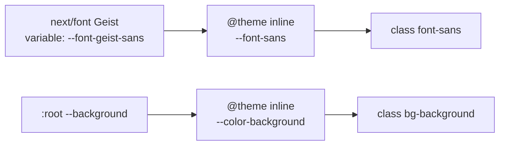

# 13 · Styling với Tailwind CSS v4

## 🎯 Mục tiêu

- Hiểu cách Tailwind v4 được cấu hình **trong CSS** (không còn `tailwind.config.js`).
- Dùng CSS variables + `@theme inline` để tạo design token (màu, font).
- Hỗ trợ dark mode bằng `prefers-color-scheme` và variant `dark:`.
- Ghép class có điều kiện bằng helper `cn()`, map trạng thái → màu bằng `Record`.
- Dựng layout toàn màn hình (header cố định, sidebar, vùng cuộn) bằng flexbox.

## 📁 File liên quan

- `frontend/src/app/globals.css`
- `frontend/src/lib/utils.ts`
- `frontend/next.config.ts` (loader `@tailwindcss/turbopack`)
- Các component trong `frontend/src/components/`

---

## 1. Utility-first là gì?

Thay vì viết class CSS riêng (`.message-bubble { ... }`), ta ghép các class nhỏ, mỗi class làm **một việc**:

```tsx
<div className="whitespace-pre-wrap rounded-2xl px-4 py-2 text-sm leading-relaxed">
```

| Class | CSS tương đương |
| --- | --- |
| `rounded-2xl` | `border-radius: 1rem` |
| `px-4 py-2` | padding ngang 1rem, dọc 0.5rem |
| `text-sm` | font-size 0.875rem |
| `whitespace-pre-wrap` | giữ xuống dòng `\n` |

Ưu điểm: không phải đặt tên class, style nằm ngay cạnh markup, Tailwind chỉ sinh CSS cho class **thực sự được dùng** → file CSS nhỏ.

## 2. Cấu hình trong CSS: `globals.css`

```css
@import "tailwindcss";
```

Một dòng này nạp toàn bộ Tailwind v4 (base, utilities). Tailwind v4 **tự quét** source code để tìm class — không cần khai báo `content: [...]` như v3.

Trong dự án, Tailwind chạy qua loader Turbopack (do `create-next-app` sinh ra):

```ts
turbopack: {
  rules: {
    "*.css": {
      loaders: ["@tailwindcss/turbopack"],
      as: "*.css",
    },
  },
},
```

> Nhiều tài liệu (kể cả docs Next) hướng dẫn dùng `@tailwindcss/postcss` + `postcss.config.mjs`. Cả hai đều đúng; dự án này giữ nguyên cấu hình mặc định của `create-next-app`.

## 3. Design tokens: CSS variables + `@theme inline`

```css
:root {
  --background: #ffffff;
  --foreground: #171717;
}

@theme inline {
  --color-background: var(--background);
  --color-foreground: var(--foreground);
  --font-sans: var(--font-geist-sans);
  --font-mono: var(--font-geist-mono);
}
```

- `:root { --background }` — biến CSS thường, có thể đổi theo theme.
- `@theme` — khai báo **theme của Tailwind**. Biến tên `--color-*` sinh ra utility màu: `--color-background` → `bg-background`, `text-background`, `border-background`… Biến `--font-sans` → class `font-sans`.
- `inline` — utility dùng thẳng giá trị `var(--background)` thay vì tham chiếu biến theme. Cần thiết khi token trỏ tới biến khác (như ở đây), để khi `--background` đổi trong dark mode thì utility đổi theo.
- `--font-geist-sans` đến từ `next/font` trong `layout.tsx` (option `variable`, bài 02) → chuỗi liên kết: `next/font` → CSS variable → Tailwind token → class.



## 4. Dark mode

Có hai cơ chế đang phối hợp:

**(a) CSS variables đổi theo hệ điều hành:**

```css
@media (prefers-color-scheme: dark) {
  :root {
    --background: #0a0a0a;
    --foreground: #ededed;
  }
}

body {
  background: var(--background);
  color: var(--foreground);
  font-family: var(--font-sans), system-ui, sans-serif;
}
```

**(b) Variant `dark:` trên từng phần tử:**

```tsx
"bg-zinc-100 text-zinc-900 dark:bg-zinc-800 dark:text-zinc-100"
```

Trong Tailwind v4, `dark:` mặc định cũng dựa trên `prefers-color-scheme: dark`. Nên khi bạn bật dark mode trong macOS/Windows, cả nền trang lẫn bong bóng chat đều đổi.

> Muốn có nút bật/tắt dark mode thủ công? Khai báo `@custom-variant dark (&:where(.dark, .dark *));` trong `globals.css` rồi thêm class `dark` vào `<html>`.

## 5. Class có điều kiện: `cn()`

```ts
/** Join class names, skipping falsy values: cn("a", cond && "b") */
export function cn(...classes: Array<string | false | null | undefined>): string {
  return classes.filter(Boolean).join(" ");
}
```

Dùng trong `MessageBubble`:

```tsx
className={cn(
  "whitespace-pre-wrap rounded-2xl px-4 py-2 text-sm leading-relaxed",
  isUser
    ? "bg-blue-600 text-white"
    : "bg-zinc-100 text-zinc-900 dark:bg-zinc-800 dark:text-zinc-100",
  message.status === "error" && "ring-2 ring-red-500",
)}
```

`cond && "class"` trả về `false` khi điều kiện sai → `filter(Boolean)` loại bỏ. Gọn hơn nhiều so với nối chuỗi template.

> Trong dự án lớn, người ta thường dùng `clsx` + `tailwind-merge` (để class sau ghi đè class trước, ví dụ `px-2` vs `px-4`). Ở đây một hàm 3 dòng là đủ.

### Map trạng thái → màu

Nhãn trạng thái tài liệu (bài 12) không ghép tên class động mà tra bảng:

```ts
const STATUS_STYLE: Record<DocumentStatus, string> = {
  processing: "bg-amber-100 text-amber-800 dark:bg-amber-950 dark:text-amber-300",
  ready: "bg-green-100 text-green-800 dark:bg-green-950 dark:text-green-300",
  failed: "bg-red-100 text-red-800 dark:bg-red-950 dark:text-red-300",
};
// cn("rounded-full px-2 py-0.5 text-xs", STATUS_STYLE[d.status])
```

Mỗi class được **viết đầy đủ** trong source → Tailwind quét thấy và sinh CSS (xem lỗi `` `bg-${color}-500` `` bên dưới); `Record` buộc có đủ mọi trạng thái.

`lib/utils.ts` còn chứa `formatBytes` (`1536 → "1.5 KB"`) — không liên quan styling, nhưng cùng là helper hiển thị thuần, có test ở bài 14.

## 6. Layout toàn màn hình

```tsx
// app/(app)/layout.tsx
      <div className="flex h-dvh flex-col">
        <AppHeader />
        <div className="flex min-h-0 flex-1">{children}</div>
      </div>
```

```text
┌──────────── AppHeader (cao tự nhiên) ────────────┐
├─ Sidebar w-64 ─┬──── ChatWindow flex-1 ──────────┤
│ overflow-y-auto│  MessageList flex-1 overflow-y  │
│                │  ChatInput (đứng yên ở đáy)     │
└────────────────┴─────────────────────────────────┘
       h-dvh: đúng bằng chiều cao màn hình
```

- `h-dvh` — *dynamic viewport height*: trên mobile không bị thanh địa chỉ che như `h-screen` (`100vh`).
- `flex-col` + `flex-1` — header lấy chiều cao của nó, phần còn lại cho nội dung.
- **`min-h-0`** — mặc định flex item có `min-height: auto` = "không nhỏ hơn nội dung". Thiếu nó, danh sách tin nhắn dài đẩy cả trang dài ra thay vì cuộn bên trong. Đây là lỗi flexbox phổ biến nhất.
- Mỗi vùng tự cuộn (`overflow-y-auto`): sidebar, `MessageList`, `<main>` của trang tài liệu.

| Class | Dùng ở | Vì sao |
| --- | --- | --- |
| `h-dvh` | `(app)/layout.tsx` | Chiều cao viewport động, đúng trên mobile |
| `mx-auto max-w-3xl` | `ChatWindow` | Căn giữa, giới hạn độ rộng dễ đọc |
| `flex-1 min-h-0` | layout, `ChatWindow` | Cho phép vùng con co lại và cuộn |
| `hidden md:flex` | `ConversationSidebar` | Responsive: ẩn trên mobile |
| `group` / `group-hover:` | dòng hội thoại | Hiện nút xoá khi rê chuột vào **cha** |
| `sr-only` | label textarea, input file | Ẩn với mắt, còn với screen reader |
| `max-w-[85%]` | `MessageBubble` | Giá trị tuỳ ý (arbitrary value) bằng `[...]` |
| `border-dashed` + `isDragging &&` | `UploadDropzone` | Phản hồi trực quan khi kéo file |

## ⚠️ Lỗi thường gặp

- **Ghép tên class động**: `` `bg-${color}-500` `` → Tailwind quét source không thấy class đầy đủ nên **không sinh CSS**. Luôn viết đủ tên class (`isError ? "bg-red-500" : "bg-green-500"`).
- **Tìm `tailwind.config.js`** theo tài liệu v3 — trong v4, cấu hình nằm trong CSS (`@theme`).
- **Dùng màu cứng** (`#0a0a0a`) rải rác trong component thay vì token → khó đổi theme.
- **Quên `dark:` variant** cho một phần tử → chữ đen trên nền đen ở dark mode.

## 🧪 Thực hành

1. Thêm token `--color-brand` vào `@theme inline` và thay `bg-blue-600` trong bong bóng user bằng `bg-brand`.
2. Thêm nút toggle dark mode thủ công bằng `@custom-variant` (gợi ý: một Client Component nhỏ thêm/bỏ class `dark` trên `document.documentElement`).
3. Bật dark mode của hệ điều hành và kiểm tra mọi component (ToolCallCard, thông báo lỗi) đều dễ đọc.

---

⬅️ Trước: [12 · Trang tài liệu](12_DocumentsPage.md) · ➡️ Tiếp: [14 · Testing & chất lượng code](14_TestingAndQuality.md)
