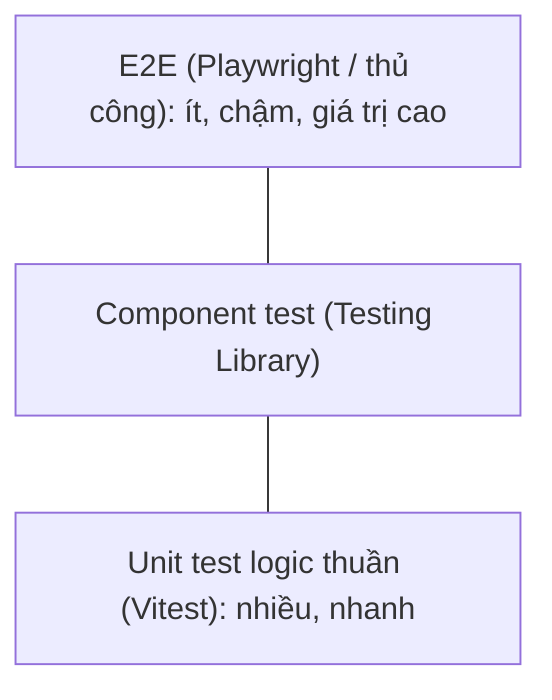

# 14 · Testing và chất lượng code

## 🎯 Mục tiêu

- Cấu hình **Vitest** cho dự án Next.js + TypeScript.
- Test **logic thuần** trước (parser SSE, reducer, redirect, utils).
- **Mock `fetch`** để test luồng refresh token mà không cần backend.
- Dùng ESLint, Prettier, `typecheck` làm "lưới an toàn" trước khi commit.
- Chạy toàn bộ stack và đi qua checklist kiểm thử thủ công.

## 📁 File liên quan

- `frontend/vitest.config.mts`
- `frontend/src/lib/sse.test.ts`, `src/hooks/chatReducer.test.ts`, `src/lib/api/client.test.ts`, `src/lib/auth/redirect.test.ts`, `src/lib/utils.test.ts`
- `frontend/eslint.config.mjs`, `frontend/.prettierrc`
- `Makefile` (ở root)

---

## 1. Kim tự tháp test — bắt đầu từ đáy



Code được thiết kế để phần **khó và dễ sai nhất** là hàm thuần hoặc chỉ phụ thuộc `fetch`:

| File test | Bảo vệ điều gì | Bài |
| --- | --- | --- |
| `sse.test.ts` | Event bị cắt giữa các chunk mạng | 08 |
| `chatReducer.test.ts` | Mọi chuyển trạng thái chat, `load` lịch sử (gộp bong bóng), `load_failed` | 09 |
| `client.test.ts` | Refresh-on-401, chia sẻ một lần refresh, lỗi 422 | 06 |
| `redirect.test.ts` | Chống open redirect | 07 |
| `utils.test.ts` | `cn`, `formatBytes` | 13 |

```bash
$ npm test
 Test Files  5 passed (5)
      Tests  24 passed (24)
   Duration  130ms
```

Chưa tới một giây, không cần browser, không cần backend.

## 2. Cấu hình Vitest

```ts
// vitest.config.mts
export default defineConfig({
  resolve: {
    // Same alias as tsconfig.json "paths".
    alias: { "@": fileURLToPath(new URL("./src", import.meta.url)) },
  },
  test: {
    include: ["src/**/*.test.ts"],
  },
});
```

- Vitest không tự đọc `paths` trong `tsconfig.json` → khai báo lại alias `@`.
- **Đuôi `.mts`**: `package.json` không có `"type": "module"`, nên file `.ts` bị coi là CommonJS và Vite in cảnh báo khi nạp config ESM. `.mts` nói rõ "đây là ES module" → hết cảnh báo, không phải đổi `type` của cả dự án.
- Test đặt **cạnh** file được test (`sse.ts` ↔ `sse.test.ts`).
- Môi trường mặc định là Node — Node 22 có sẵn `fetch`, `Response`, `ReadableStream`. Test component cần thêm `jsdom` + `@testing-library/react`.

## 3. Test reducer với kịch bản RAG

```ts
  it("builds the assistant message from a full stream", () => {
    const state = run([
      { type: "metadata", conversation_id: "c1" },
      { type: "token", content: "Let me search." },
      { type: "tool_start", tool_name: "search_documents", tool_input: { query: "Atlas lead" } },
      { type: "tool_end", tool_name: "search_documents", content: "[atlas.txt] Minh Tran" },
      { type: "token", content: "The lead " },
      { type: "token", content: "is Minh Tran" },
      { type: "done", conversation_id: "c1" },
    ]);

    expect(state.conversationId).toBe("c1");
    expect(state.messages[1]).toMatchObject({
      content: "Let me search.\n\nThe lead is Minh Tran",
```

Helper `run` "phát lại" chuỗi event như backend gửi. Một test kiểm tra cùng lúc: lưu `conversation_id`, chèn `\n\n` ở `tool_start`, ghép output vào đúng tool call.

Lịch sử được test với **cùng kịch bản**, để chắc chắn hội thoại nạp lại trông giống lúc stream:

```ts
      messages: [
        { role: "user", content: "Who leads Atlas?" },
        { role: "assistant", content: "Let me search." }, // text before the tool call
        { role: "assistant", content: "Minh Tran." }, // final answer, same turn
        { role: "user", content: "Thanks" },
      ],
    });
    expect(state.conversationId).toBe("c1");
    expect(state.messages.map((m) => [m.role, m.content, m.status])).toEqual([
      ["user", "Who leads Atlas?", "done"],
      ["assistant", "Let me search.\n\nMinh Tran.", "done"],
      ["user", "Thanks", "done"],
    ]);
    expect(new Set(state.messages.map((m) => m.id)).size).toBe(3); // unique React keys
```

Test `"shows an error and an empty chat when loading fails"` kiểm tra `load_failed`: bắt đầu từ một state đang có tin nhắn, kết quả phải là `messages: []`, `conversationId: null` và có `error`.

> Bộ đếm `viewRef` trong `useChat` (bài 10) chưa có test tự động: nó cần render hook và hai promise về theo thứ tự đảo ngược — xem thực hành 2.

## 4. Mock `fetch` để test refresh token

```ts
/** Replace global fetch with a fake that answers by URL. */
function mockFetch(handler: (url: string) => Response) {
  const fetchMock = vi.fn(async (input: RequestInfo | URL) => handler(String(input)));
  vi.stubGlobal("fetch", fetchMock);
  return fetchMock;
}

afterEach(() => vi.unstubAllGlobals());
```

- `vi.stubGlobal` thay `globalThis.fetch`; `afterEach(vi.unstubAllGlobals)` trả lại bản gốc → các test không ảnh hưởng nhau.
- Mock ở **ranh giới** (`fetch`), không mock `apiFetch` — ta muốn test chính logic trong `apiFetch`.

```ts
  it("shares a single refresh between parallel requests", async () => {
    const seen = new Set<string>();
    const fetchMock = mockFetch((url) => {
      if (url.endsWith("/auth/refresh")) return json(200);
      // First call of each path fails, the retry succeeds.
      if (seen.has(url)) return json(200);
      seen.add(url);
      return json(401);
    });

    await Promise.all([apiFetch("/a"), apiFetch("/b"), apiFetch("/c")]);

    const refreshCalls = fetchMock.mock.calls.filter(([url]) => String(url).endsWith("/refresh"));
    expect(refreshCalls).toHaveLength(1);
  });
```

Đây là test quan trọng nhất của client: nếu ai đó "đơn giản hoá" `refreshSession` và bỏ `refreshInFlight`, test đỏ ngay — thay vì người dùng bị đăng xuất ngẫu nhiên vì reuse detection (bài 06). Các test còn lại: refresh rồi gửi lại đúng thứ tự URL, gọi `onSessionExpired` khi refresh thất bại, **không** refresh khi `retryOnUnauthorized: false`, đọc message lỗi 422 của FastAPI.

## 5. `it.each` cho bảng dữ liệu

```ts
  it.each([null, "", "https://evil.example", "//evil.example", "/\\evil.example", "javascript:x"])(
    "falls back to / for %j",
    (next) => {
      expect(safeRedirectPath(next)).toBe("/");
    },
  );
```

Mỗi phần tử thành **một test riêng** có tên (`falls back to / for "//evil.example"`). Thêm một payload tấn công mới = thêm một phần tử. `utils.test.ts` dùng cùng cách cho `formatBytes`: `512 → "512 B"`, `1536 → "1.5 KB"`, `5 MiB → "5.0 MB"`.

## 6. Lưới an toàn tĩnh

| Lệnh | Công cụ | Bắt được gì |
| --- | --- | --- |
| `npm run lint` | ESLint 9 flat config + `eslint-config-next` (core-web-vitals, typescript) | Rules of Hooks, thiếu dependency, `set-state-in-effect`… |
| `npm run typecheck` | `next typegen && tsc --noEmit` | Sai kiểu, quên `case`, thiếu key trong `Record<DocumentStatus, …>`, route sai trong `LayoutProps` |
| `npm run format` | Prettier (`printWidth: 100`) | Chấm dứt tranh cãi về format |
| `npm run build` | Next.js | Lỗi prerender, thiếu `<Suspense>` quanh dữ liệu động |

```bash
make lint   # backend (ruff, mypy) + frontend (eslint, tsc)
make test   # pytest + vitest — không cần Docker
```

## 7. Chạy toàn bộ stack (dev)

```bash
make install
cp backend/.env.example backend/.env           # điền ANTHROPIC_API_KEY, OPENAI_API_KEY (embedding)
cp frontend/.env.example frontend/.env.local   # BACKEND_URL=http://localhost:8000
make infra-up       # Postgres, Floci (S3), ChromaDB trong Docker
make migrate        # alembic upgrade head

# Hai terminal
make dev-backend    # FastAPI  → http://localhost:8000/docs
make dev-frontend   # Next.js  → http://localhost:3000
```

### Checklist kiểm thử thủ công

1. Mở `/` → bị đưa tới `/login`. Vào **Đăng ký** → tự đăng nhập, về `/`; header hiện email, badge "API online".
2. `/documents`: kéo thả một `.md` → nhãn vàng `processing` → vài giây sau xanh `ready`, có số chunk. Bấm **Tải về** → file tải xuống đúng tên.
3. Quay lại chat, hỏi về nội dung file → thẻ 🔎 `search_documents` xuất hiện, mở ra thấy đoạn trích; câu trả lời stream từng chữ.
4. Sidebar có hội thoại mới (được tô sáng). Bấm "+ Cuộc trò chuyện mới" rồi bấm lại hội thoại cũ → lịch sử nạp lại, mỗi lượt trả lời vẫn là **một** bong bóng như lúc stream.
5. DevTools → Application → Cookies: xoá `access_token`, gửi tin nhắn → Network: `401` → `refresh 200` → gửi lại thành công, không bị đá ra.
6. **Đăng xuất** → `/login`. Mở `/documents` → `/login?next=%2Fdocuments`.
7. Chạy bản production (`npm run build && npm start`) và kiểm tra lại bước 3 — streaming phải vẫn từng chữ (bài 05).

## ⚠️ Lỗi thường gặp

- **`Cannot find module '@/...'` trong test** → thiếu alias trong `vitest.config.mts`.
- **Quên `vi.unstubAllGlobals()`** → mock `fetch` rò sang test khác, lỗi phụ thuộc thứ tự chạy.
- **Test gọi backend thật** → chậm, phụ thuộc mạng, tốn tiền LLM. Mock ở ranh giới.
- **Chỉ chạy `tsc`** mà không `next typegen` → lỗi `LayoutProps` giả.
- **Chỉ kiểm thử với `npm run dev`** → bỏ sót lỗi chỉ có ở bản build (gzip SSE, rewrites chốt lúc build).

## 🧪 Thực hành

1. Viết test cho `useDocuments` polling: cài `jsdom` + `@testing-library/react`, dùng `vi.useFakeTimers()` và `renderHook`; kiểm tra `listDocuments` được gọi lại sau 2s khi còn `processing` và dừng khi `ready`.
2. Test race condition của `useChat.load` bằng `renderHook`: mock `getConversationMessages` để request A resolve **sau** request B (`vi.fn` trả về promise tự điều khiển), gọi `load("A")` rồi `load("B")`, resolve B rồi A → `result.current.conversationId` phải là `"B"`.
3. Test `ChatInput`: gõ chữ, nhấn Enter → `onSend` được gọi; Shift+Enter → không gọi.
4. Thêm GitHub Actions chạy `make lint` và `make test` cho mỗi pull request.
5. Viết một test Playwright cho bước 1–2 của checklist.

---

⬅️ Trước: [13 · Styling với Tailwind](13_StylingWithTailwind.md) · ➡️ Tiếp: [15 · Docker & triển khai](15_DockerAndDeployment.md)
