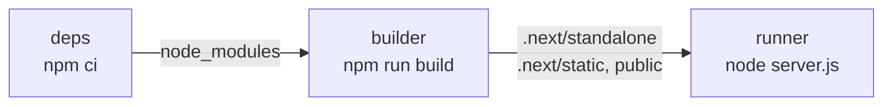
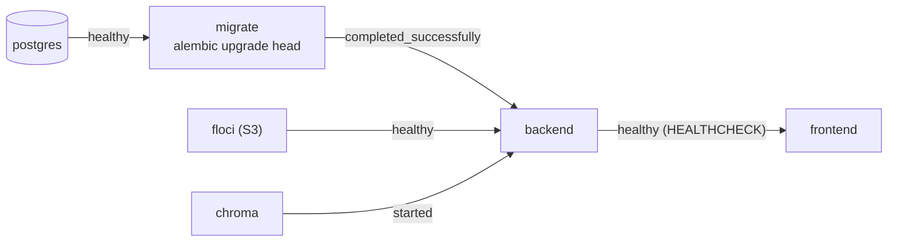

# 15 · Docker và triển khai frontend

## 🎯 Mục tiêu

- Hiểu `output: "standalone"` và vì sao nó làm image nhỏ đi nhiều lần.
- Đọc từng stage của `frontend/Dockerfile` (multi-stage build).
- Truyền `BACKEND_URL` đúng lúc: **build arg**, không phải biến môi trường lúc chạy.
- Chạy cả hệ thống bằng `docker compose` với thứ tự khởi động có điều kiện.
- Nắm checklist khi đưa lên production: HTTPS, cookie `Secure`, cùng domain.

## 📁 File liên quan

- `frontend/Dockerfile`, `frontend/.dockerignore`
- `frontend/next.config.ts` (`output: "standalone"`)
- `docker-compose.yml`, `Makefile` (ở root)
- `backend/Dockerfile` (`HEALTHCHECK`)

---

## 1. `output: "standalone"`

```ts
  // Self-contained server in .next/standalone: small Docker images (see Dockerfile).
  output: "standalone",
```

`next build` lần theo các `import` thực sự được dùng và chép **chỉ** những file đó vào `.next/standalone/`, kèm một `server.js` tối giản. Image cuối không cần `node_modules` đầy đủ (TypeScript, ESLint, Vitest, Tailwind… chỉ cần lúc build).

Hai thư mục **không** được chép tự động — Dockerfile phải tự copy:

- `public/` (favicon, svg)
- `.next/static/` (JS/CSS đã build, có hash trong tên file)

## 2. Dockerfile: ba stage



```dockerfile
# ---- deps -----------------------------------------------------------------------------
FROM node:22-alpine AS deps
WORKDIR /app
COPY package.json package-lock.json ./
RUN npm ci
```

- Chỉ copy `package*.json` trước → layer `npm ci` được **cache** cho tới khi dependency đổi. Sửa một component không phải cài lại package.
- `npm ci` (không phải `npm install`): cài **đúng** theo `package-lock.json`, lỗi nếu lock lệch.

```dockerfile
# ---- builder --------------------------------------------------------------------------
FROM node:22-alpine AS builder
WORKDIR /app
COPY --from=deps /app/node_modules ./node_modules
COPY . .
# Rewrites (/api/* -> backend) are resolved at BUILD time, so the backend URL is a
# build argument. Inside docker compose the backend is reachable as http://backend:8000.
ARG BACKEND_URL=http://backend:8000
ENV BACKEND_URL=$BACKEND_URL \
    NEXT_TELEMETRY_DISABLED=1
RUN npm run build
```

- `BACKEND_URL` là `ARG` vì rewrites được **chốt vào output** khi build (bài 05). Truyền `-e BACKEND_URL=...` lúc `docker run` sẽ không đổi được đích của `/api/*`.
- `ENV` copy giá trị ARG thành biến môi trường để `next.config.ts` (`process.env.BACKEND_URL`) đọc được trong `npm run build`.
- `next/font/google` tải font Geist **lúc build** → bước build cần mạng.

```dockerfile
# ---- runtime --------------------------------------------------------------------------
FROM node:22-alpine AS runner
WORKDIR /app
ENV NODE_ENV=production \
    NEXT_TELEMETRY_DISABLED=1 \
    PORT=3000 \
    HOSTNAME=0.0.0.0

COPY --from=builder --chown=node:node /app/public ./public
COPY --from=builder --chown=node:node /app/.next/standalone ./
COPY --from=builder --chown=node:node /app/.next/static ./.next/static

# The official image ships an unprivileged "node" user.
USER node
EXPOSE 3000
CMD ["node", "server.js"]
```

- Stage cuối bắt đầu **từ image sạch**: source code, `node_modules` đầy đủ, cache build đều bị bỏ lại.
- `HOSTNAME=0.0.0.0` — mặc định server chỉ nghe `localhost` **bên trong container** → từ bên ngoài không truy cập được.
- `USER node` + `--chown=node:node` — không chạy bằng root; lỡ có lỗ hổng thì kẻ tấn công cũng chỉ có quyền user thường.
- `CMD ["node", "server.js"]` dạng mảng (exec form) → Node là PID 1, nhận `SIGTERM` khi `docker stop` để tắt gọn.

## 3. `.dockerignore`

```text
node_modules
.next
.env*
!.env.example
*.tsbuildinfo
```

- `node_modules`, `.next` từ máy bạn (có thể khác hệ điều hành — macOS vs Alpine) không được lọt vào build context; image tự cài/tự build.
- `.env*` — **không bao giờ** đưa secret vào image (ai có image là đọc được). `!.env.example` giữ lại file mẫu.
- Build context nhỏ hơn → `docker build` gửi ít dữ liệu hơn, nhanh hơn.

## 4. `docker compose`: chạy cả hệ thống

```yaml
  frontend:
    profiles: ["app"]
    build:
      context: ./frontend
      args:
        BACKEND_URL: http://backend:8000
    ports:
      - "3000:3000"
    depends_on:
      backend:
        condition: service_healthy
```



- `http://backend:8000` — trong mạng của compose, service gọi nhau bằng **tên service**. Trình duyệt không bao giờ thấy URL này: nó chỉ gọi `localhost:3000/api/...`, Next.js chuyển tiếp bên trong mạng Docker.
- `condition: service_healthy` — frontend chỉ khởi động khi backend **thực sự trả lời**, nhờ `HEALTHCHECK` trong `backend/Dockerfile`:

```dockerfile
HEALTHCHECK --interval=10s --timeout=3s --retries=5 \
    CMD python -c "import urllib.request; urllib.request.urlopen('http://127.0.0.1:8000/api/v1/health')"
```

  (image Python slim không có `curl`, nên dùng chính Python.)
- `migrate` là service **chạy một lần**: áp migration rồi thoát; backend chờ `service_completed_successfully`.
- `profiles: ["app"]` — `make infra-up` chỉ bật hạ tầng để dev; `make up` mới bật cả app.

```bash
make up     # docker compose --profile app up -d --build --wait
make down   # docker compose --profile app down
```

`--wait` chờ mọi service healthy rồi mới trả lệnh → mở `http://localhost:3000` là dùng được ngay.

## 5. Lên production

| Việc | Vì sao |
| --- | --- |
| **HTTPS** + `COOKIE_SECURE=true` ở backend | Cookie `Secure` chỉ gửi qua HTTPS; token không bị nghe lén |
| Frontend và API **cùng domain** (`app.com` + `app.com/api` qua rewrites) | Cookie first-party, không CORS, `SameSite=Lax` hoạt động (bài 05) |
| `CORS_ORIGINS` của backend = origin thật (`https://app.com`) | Đây là danh sách cho CSRF check `Origin` |
| `BACKEND_URL` là địa chỉ **nội bộ** (không public) | Backend không cần mở ra Internet |
| `S3_PUBLIC_ENDPOINT_URL` là địa chỉ trình duyệt tới được | Presigned URL được mở bởi **trình duyệt** (bài 12) |
| Kiểm tra streaming trên bản build | Proxy/CDN phía trước có thể nén/buffer SSE; `no-transform` giúp, nhưng hãy đo |
| Build lại image khi đổi `BACKEND_URL` | Rewrites chốt lúc build |

Nếu có reverse proxy (nginx, load balancer) trước Next.js: tắt buffering cho `/api/v1/chat/stream` (nginx: `proxy_buffering off;`) và tăng timeout đọc — một câu trả lời dài có thể kéo dài cả phút.

## ⚠️ Lỗi thường gặp

- **Quên copy `.next/static` / `public`** → trang hiện ra nhưng không có CSS/JS, favicon 404.
- **Truyền `BACKEND_URL` lúc chạy** thay vì build arg → mọi `/api/*` trỏ tới URL lúc build (thường là `localhost:8000` — trong container là chính nó → 502/ECONNREFUSED).
- **Thiếu `HOSTNAME=0.0.0.0`** → container chạy nhưng `curl localhost:3000` từ máy host bị từ chối kết nối.
- **`COPY . .` không có `.dockerignore`** → `.env.local` (secret) và `node_modules` macOS lọt vào image.
- **Chạy bằng root** trong container production.
- **`depends_on` không có `condition`** → frontend khởi động khi backend chưa sẵn sàng, request đầu tiên lỗi.

## 🧪 Thực hành

1. `make up`, rồi `docker image ls` — so kích thước image frontend với thư mục `frontend/node_modules` (`du -sh`).
2. `docker compose exec frontend id` → xác nhận đang chạy bằng user `node`, không phải `root`.
3. Build image với `--build-arg BACKEND_URL=http://nowhere:8000`, chạy lại và quan sát lỗi khi đăng nhập. Sau đó thử `-e BACKEND_URL=http://backend:8000` lúc chạy: có sửa được không? Vì sao?
4. Thêm `HEALTHCHECK` cho image frontend (gợi ý: `node -e "fetch('http://127.0.0.1:3000/login').then(r=>process.exit(r.ok?0:1))"`).

---

⬅️ Trước: [14 · Testing & chất lượng code](14_TestingAndQuality.md) · ➡️ Tiếp: [00 · Tổng quan](../00_Overview.md)
