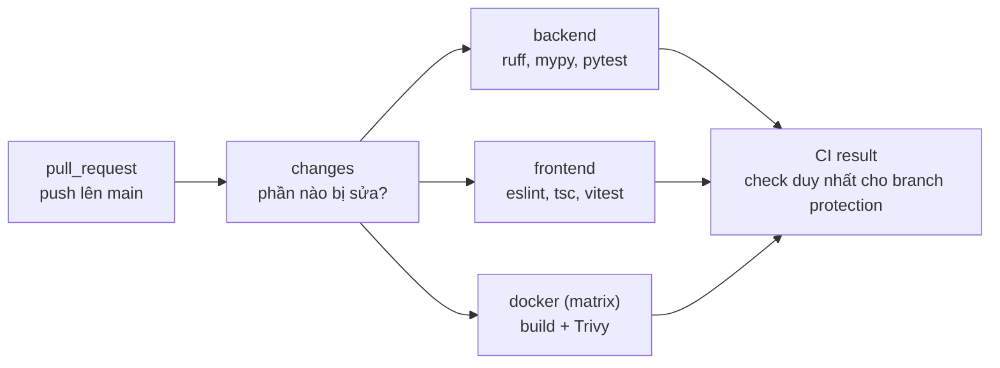

# 01 · Continuous Integration với GitHub Actions

## 🎯 Mục tiêu

- Hiểu CI là gì và giải quyết vấn đề gì.
- Đọc hiểu `.github/workflows/ci.yml`: trigger, job, step, `needs`, `if`, matrix, cache.
- Chỉ chạy phần bị thay đổi mà **không** làm kẹt branch protection.
- Build Docker image và quét lỗ hổng bằng Trivy trong CI.
- Giữ an toàn cho chính CI: quyền tối thiểu, ghim action theo SHA, Dependabot.

## 📁 File liên quan

- `.github/workflows/ci.yml`
- `.github/dependabot.yml`
- `Makefile` (`lint-backend`, `lint-frontend`, `test-backend`, `test-frontend`)
- `backend/pyproject.toml` (`[tool.coverage.*]`)
- `frontend/Dockerfile` (stage runtime xoá `npm`)
- `docs/adr/0001-ci-github-actions.md`: lý do cho từng quyết định trong bài này

---

## 1. CI là gì?

**Continuous Integration**: mỗi khi có code mới (mở PR, push lên `main`), một máy chủ tự động lấy code về, cài đặt, rồi chạy lint, test và build. Kết quả hiện ngay trên PR: ✅ hoặc ❌.

| Không có CI | Có CI |
| --- | --- |
| Phải nhớ chạy `make lint`, `make test` trước khi merge | Máy luôn chạy, không ai quên |
| "Máy em chạy được mà" (do có sẵn `.env`, `node_modules` cũ…) | Chạy trên máy **sạch**, giống môi trường deploy |
| Lỗi Dockerfile chỉ lộ ra lúc deploy | Image được build ở mỗi PR |
| Merge xong mới biết `main` hỏng | Branch protection chặn merge khi CI đỏ |

**GitHub Actions** là dịch vụ CI của GitHub. Mỗi file YAML trong `.github/workflows/` là một **workflow**:

```text
workflow (ci.yml)
└── job (chạy trên một máy ảo riêng, song song với job khác nếu không có `needs`)
    └── step (một lệnh shell `run:` hoặc một action có sẵn `uses:`)
```

## 2. Bức tranh tổng thể



`backend`, `frontend` và `docker` cùng `needs: changes` nên chạy **song song** sau khi `changes` xong.

## 3. Trigger, quyền và concurrency

```yaml
on:
  pull_request:
  push:
    branches: [main]

permissions:
  contents: read

concurrency:
  group: ci-${{ github.event.pull_request.number || github.ref }}
  cancel-in-progress: ${{ github.event_name == 'pull_request' }}
```

- `on`: chạy cho mọi PR và mọi push lên `main`.
- `permissions`: mỗi job nhận một `GITHUB_TOKEN`. Mặc định token này có thể có quyền ghi vào repo. Ta hạ xuống **chỉ đọc**. Lỡ một bước bị chèn mã độc thì nó cũng không push code hay sửa release được.
- `concurrency`: push thêm commit vào PR khi CI lần trước còn đang chạy → huỷ lần trước, vì kết quả của nó không còn ý nghĩa. Run trên `main` không bao giờ bị huỷ.
- `${{ ... }}` là **expression** của GitHub Actions, được tính *trước khi* gửi lệnh cho shell. Khác với `$VAR` là biến môi trường do shell đọc.

## 4. Job `changes`: chỉ kiểm tra phần bị sửa

PR chỉ sửa một file `.tsx` thì không cần chạy pytest và build image backend.

```yaml
  changes:
    permissions:
      contents: read
      pull-requests: read
    outputs:
      services: ${{ steps.result.outputs.services }}
    steps:
      - uses: dorny/paths-filter@ceb8a2b8f2d89434be7ff52d3de7ec3738c5cc9d # v4.0.3
        if: github.event_name == 'pull_request'
        id: filter
        with:
          filters: |
            backend:
              - 'backend/**'
              - 'Makefile'
              - '.github/workflows/ci.yml'
            frontend:
              - 'frontend/**'
              - 'Makefile'
              - '.github/workflows/ci.yml'
      - id: result
        env:
          EVENT: ${{ github.event_name }}
          CHANGED: ${{ steps.filter.outputs.changes }}
        run: |
          if [ "$EVENT" = "push" ]; then CHANGED='["backend","frontend"]'; fi
          echo "services=$CHANGED" >> "$GITHUB_OUTPUT"
```

- `paths-filter` hỏi GitHub API danh sách file của PR (vì vậy cần `pull-requests: read`) và trả ra `changes`: một mảng JSON tên các filter khớp, ví dụ `["frontend"]`.
- Sửa `Makefile` hoặc chính `ci.yml` thì chạy cả hai: thay đổi đó có thể làm hỏng bất kỳ job nào.
- Push lên `main` luôn chạy **tất cả**: `main` luôn được kiểm tra đầy đủ, và cache tạo trên `main` được các PR dùng lại (PR đọc được cache của `main`, nhưng không đọc được cache của PR khác).
- Ghi vào file `$GITHUB_OUTPUT` là cách một step trả **output**. `outputs:` của job đưa nó ra cho các job sau đọc qua `needs.changes.outputs.services`.
- Truyền `${{ ... }}` vào shell qua `env:` thay vì viết thẳng vào `run:`. Viết thẳng thì giá trị bị dán vào script trước khi chạy; nếu giá trị đến từ người ngoài (tên branch, tiêu đề PR) thì đó là lỗ hổng *script injection*.

Các job sau dùng output này:

```yaml
  backend:
    needs: changes
    if: contains(fromJSON(needs.changes.outputs.services), 'backend')
```

### Vì sao không dùng `on.paths`?

GitHub có sẵn cách lọc ở mức workflow:

```yaml
on:
  pull_request:
    paths: ["backend/**"]   # ❌ không dùng
```

Khi PR không sửa file nào khớp, **cả workflow không chạy**. Nếu check của nó là bắt buộc trong branch protection, PR bị kẹt mãi ở "Expected — Waiting for status to be reported" và không merge được. Còn một job bị **skip** do `if:` thì GitHub tính là **thành công**.

## 5. Job `backend`

```yaml
  backend:
    env:
      UV_LOCKED: "1"
    steps:
      - uses: actions/checkout@3d3c42e5aac5ba805825da76410c181273ba90b1 # v7.0.1
        with:
          persist-credentials: false
      - uses: astral-sh/setup-uv@68559e99cc807c1eb7e9238fd43a15bba460eec2 # v10.3.3
        with:
          working-directory: backend
          enable-cache: true
      - name: Install dependencies
        working-directory: backend
        run: uv sync
      - name: Lint (ruff, mypy)
        run: make lint-backend
      - name: Test (pytest + coverage)
        run: make test-backend PYTEST_ARGS="--cov --cov-report=term --cov-report=markdown-append:$GITHUB_STEP_SUMMARY"
```

- `actions/checkout`: máy ảo bắt đầu **trống**, bước này clone repo về. `persist-credentials: false`: không để token lại trong `.git/config` sau khi clone.
- `setup-uv` cài `uv` và **cache** thư mục package đã tải. Lần sau `uv sync` lấy từ cache thay vì tải lại LangChain, boto3… Cache được khoá theo nội dung `uv.lock`: lock đổi thì cache mới được tạo.
- `UV_LOCKED=1` tương đương thêm `--locked` cho **mọi** lệnh `uv`: nếu `uv.lock` không khớp `pyproject.toml` (ví dụ sửa `pyproject.toml` mà quên chạy `uv lock`), CI fail thay vì âm thầm resolve lại.
- `uv sync` ở đây cài cả nhóm `dev` (pytest, ruff, mypy), khác với Dockerfile dùng `--no-dev`.
- Python được chọn theo `backend/.python-version` (3.12).

### CI và máy bạn chạy cùng một lệnh

`make lint` và `make test` được tách thành từng phần:

```makefile
test: test-backend test-frontend

PYTEST_ARGS ?=

test-backend:
	cd backend && uv run pytest $(PYTEST_ARGS)

lint: lint-backend lint-frontend

lint-backend:
	cd backend && uv run ruff check . && uv run ruff format --check . && uv run mypy app scripts tests
```

CI gọi `make lint-backend`, đúng lệnh bạn gõ ở máy. Thêm một bước lint mới vào `Makefile` thì CI tự có, không phải sửa hai nơi rồi để chúng lệch nhau.

`PYTEST_ARGS ?=` khai báo biến rỗng mặc định. Ở máy, `make test-backend` chạy pytest như cũ; CI truyền thêm cờ coverage.

### Coverage

```toml
[tool.coverage.run]
source = ["app"]

[tool.coverage.report]
fail_under = 80
```

- `--cov` bật đo coverage cho `source = ["app"]`: bao nhiêu phần trăm dòng code trong `app/` được test chạy qua.
- `--cov-report=markdown-append:$GITHUB_STEP_SUMMARY`: ghi bảng coverage vào **job summary**, trang tóm tắt hiện ngay trên giao diện của run.
- `fail_under = 80`: tổng coverage dưới 80% thì pytest trả exit code khác 0 → job đỏ. Baseline lúc thêm CI là **85%**. Ngưỡng chỉ nên tăng dần theo thời gian.
- Ngưỡng chỉ áp dụng khi có `--cov`, nên chạy một test riêng lẻ ở máy (`pytest tests/test_chat.py::...`) không bị fail vì coverage thấp.

> Coverage cao không có nghĩa là test tốt: nó chỉ cho biết dòng nào **chưa** từng chạy. Dùng nó để tìm chỗ thiếu test, đừng chạy theo con số.

## 6. Job `frontend`

```yaml
      - uses: actions/setup-node@949feb2413d6458794dcd2491c4babbbce0c15c1 # v7.1.0
        with:
          node-version: "22" # same major as frontend/Dockerfile
          cache: npm
          cache-dependency-path: frontend/package-lock.json
      - name: Install dependencies
        working-directory: frontend
        run: npm ci
      - run: make lint-frontend
      - run: make test-frontend
```

- `cache: npm` cache thư mục `~/.npm` (nơi npm lưu package đã tải), khoá theo `package-lock.json`.
- **`npm ci`**, không phải `npm install`: cài **đúng** những gì trong `package-lock.json`, báo lỗi nếu lock lệch với `package.json`, và xoá `node_modules` cũ trước khi cài. Đây là vai trò tương đương `--locked` của uv.
- `lint-frontend` chạy `npm run typecheck` = `next typegen && tsc --noEmit`: bước `typegen` sinh `LayoutProps`/`PageProps` trước khi `tsc` kiểm tra kiểu ([frontend/02](../frontend/02_AppRouterLayoutAndPage.md)).

## 7. Job `docker`: build và quét image

```yaml
  docker:
    if: needs.changes.outputs.services != '[]'
    strategy:
      fail-fast: false
      matrix:
        service: ${{ fromJSON(needs.changes.outputs.services) }}
    steps:
      - uses: actions/checkout@... # v7.0.1
      - uses: docker/setup-buildx-action@... # v4.4.1
      - uses: docker/build-push-action@... # v7.4.0
        with:
          context: ${{ matrix.service }}
          push: false
          load: true
          tags: ai-agent-fullstack/${{ matrix.service }}:ci
          cache-from: type=gha,scope=${{ matrix.service }}
          cache-to: type=gha,mode=max,scope=${{ matrix.service }}
      - uses: aquasecurity/trivy-action@... # v0.36.0
        with:
          image-ref: ai-agent-fullstack/${{ matrix.service }}:ci
          scanners: vuln
          severity: CRITICAL,HIGH
          ignore-unfixed: true
          exit-code: "1"
```

### Matrix

`matrix` nhân một job thành nhiều bản, mỗi bản một giá trị. Danh sách lấy thẳng từ output của `changes`:

| PR sửa | `services` | Job docker được tạo |
| --- | --- | --- |
| `backend/` | `["backend"]` | `Docker (backend)` |
| cả hai | `["backend","frontend"]` | `Docker (backend)`, `Docker (frontend)` |
| chỉ `tutorial/` | `[]` | không có (job bị skip nhờ `if`, vì matrix rỗng là lỗi) |

`fail-fast: false`: image backend lỗi thì vẫn để image frontend chạy xong, để thấy hết lỗi trong một lần.

### Build

- `push: false`: chỉ build, chưa đẩy image lên registry nào. Đẩy image là việc của CD (khi làm phần Terraform/ECR).
- `load: true`: nạp image vào Docker của máy runner để bước Trivy đọc được.
- `cache-from` / `cache-to: type=gha`: lưu **layer cache** của Docker ([backend/16](../backend/16_DockerAndProduction.md) mục 0) vào cache của GitHub Actions. Máy runner mỗi lần là máy mới, không có cache này thì layer `uv sync` / `npm ci` chạy lại từ đầu mọi lần. `mode=max` lưu cache của **mọi** stage (cả `builder`), không chỉ stage cuối. `scope` tách cache của hai image để chúng không ghi đè nhau.

### Trivy

[Trivy](https://trivy.dev) đọc danh sách package trong image (gói Debian/Alpine, `.venv`, `node_modules`) rồi đối chiếu với cơ sở dữ liệu lỗ hổng (CVE).

- `severity: CRITICAL,HIGH` + `ignore-unfixed: true`: chỉ fail với lỗ hổng nghiêm trọng **đã có bản vá**, tức là sửa được ngay bằng cách nâng version. Lỗ hổng chưa có bản vá chỉ gây nhiễu.
- `exit-code: "1"`: tìm thấy thì job đỏ.
- `scanners: vuln`: chỉ quét lỗ hổng, tắt quét secret (xem phần dưới).
- Bước cuối ghi bảng kết quả vào job summary, kể cả khi scan fail (`if: always()`).

### Lần scan đầu tiên tìm ra gì

Đây là lý do nên có scan. Lần chạy đầu, trên image build từ code hiện tại:

| Image | Phát hiện | Nguyên nhân | Cách sửa |
| --- | --- | --- | --- |
| backend | ~75 lỗ hổng OS (openssl, perl, util-linux…) | Image `python:3.12-slim` **cũ trong cache local** | Không cần sửa code: `docker build --pull` lấy base image mới thì sạch. CI luôn pull bản mới |
| backend | `certifi` (CRITICAL), `filelock`, `pypdf` (HIGH) | Version trong `uv.lock` đã có bản vá | `uv lock --upgrade-package certifi --upgrade-package filelock --upgrade-package pypdf` |
| backend | 11 "secret" CRITICAL kiểu GCP service account | Docstring ví dụ trong SDK `anthropic`: **báo nhầm** | `scanners: vuln`. Secret trong code của mình do GitHub secret scanning của repo phụ trách |
| frontend | 10 lỗ hổng HIGH (`brace-expansion`, `sigstore`, `pacote`…) | Nằm trong **`npm` có sẵn** của `node:22-alpine`, app không hề dùng | Xoá `npm`/`npx` ở stage runtime ([frontend/15](../frontend/15_DockerAndDeployment.md)) |

Bài học: phần lớn kết quả không đến từ code của mình, mà từ base image và công cụ đi kèm. Cách giảm bền vững nhất là **bớt thứ không cần** trong image.

## 8. `CI result`: một check cho branch protection

```yaml
  ci-result:
    name: CI result
    if: always()
    needs: [changes, backend, frontend, docker]
    steps:
      - env:
          RESULTS: ${{ join(needs.*.result, ' ') }}
        run: |
          echo "Job results: $RESULTS"
          for result in $RESULTS; do
            if [ "$result" = "failure" ] || [ "$result" = "cancelled" ]; then exit 1; fi
          done
```

- `if: always()`: chạy cả khi job trước fail. Không có dòng này, một job fail sẽ làm `ci-result` bị **skip**, và skip lại được tính là thành công!
- `needs.*.result` là kết quả của từng job: `success`, `failure`, `cancelled` hoặc `skipped`. `skipped` (không có gì để kiểm tra) được coi là ổn.
- Branch protection chỉ cần yêu cầu **một** check: `CI result`. Thêm job mới thì chỉ cần thêm vào `needs`, không phải sửa cài đặt repo.

### Bật branch protection

Làm một lần trên GitHub, sau khi workflow đã chạy ít nhất một lần (để GitHub biết tên check):

1. **Settings → Rules → Rulesets → New branch ruleset**.
2. Target: branch mặc định (`main`).
3. Bật **Require a pull request before merging**.
4. Bật **Require status checks to pass**, thêm check **`CI result`**, và bật **Require branches to be up to date before merging**.
5. Bật **Block force pushes**.

Từ đó, PR có CI đỏ không merge được, và không ai push thẳng lên `main`.

## 9. An toàn cho chính CI (supply chain)

CI chạy code của **người khác** (các action) với quyền truy cập repo của bạn. Đã có những vụ action phổ biến bị chiếm quyền và tag của nó bị trỏ sang code đánh cắp secret.

- **Ghim action theo commit SHA**: `uses: actions/checkout@3d3c42e…  # v7.0.1`. Tag `v7` có thể bị dời sang commit khác; một SHA thì luôn trỏ đúng một nội dung. Comment `# v7.0.1` để người đọc biết version.
- **Quyền tối thiểu**: `contents: read` cho cả workflow; chỉ job `changes` xin thêm `pull-requests: read`. Lưu ý: khai báo `permissions` ở mức job **thay thế** hoàn toàn mức workflow, nên phải lặp lại `contents: read`.
- **`persist-credentials: false`** khi checkout.
- **Không đưa `${{ }}` thẳng vào `run:`**, mà truyền qua `env:` (mục 4).

### Dependabot

Ghim SHA thì action không tự cập nhật, `uv.lock` và `package-lock.json` cũng vậy. `.github/dependabot.yml` giao việc đó cho Dependabot: mỗi tuần nó mở PR cập nhật, và PR đó chạy qua CI như mọi thay đổi khác.

```yaml
  - package-ecosystem: uv
    directory: /backend
    schedule:
      interval: weekly
    cooldown:
      default-days: 7
    groups:
      python-minor-patch:
        update-types: [minor, patch]
```

- Bốn ecosystem: `uv` (backend), `npm` (frontend), `github-actions` (SHA trong workflow), `docker` (base image trong hai Dockerfile).
- `groups`: gộp các bản minor/patch thành **một** PR mỗi tuần thay vì hàng chục PR. Bản major vẫn tách riêng vì đó là bản hay làm vỡ code.
- `cooldown: 7 ngày`: không đề xuất bản vừa phát hành dưới một tuần. Bản bị chèn mã độc thường bị phát hiện và gỡ trong vài ngày.

## 10. Đo thời gian CI

Ghi lại thời gian từ trang **Actions** của repo, để thấy cache giúp được bao nhiêu:

| Job | Lần đầu (cache trống) | Lần sau (có cache) |
| --- | --- | --- |
| Backend (lint + test) | | |
| Frontend (lint + test) | | |
| Docker (backend) | | |
| Docker (frontend) | | |
| **Tổng (wall-clock)** | | |

Số đo tham khảo ở máy local: `make lint` ~7 s, `pytest --cov` ~15 s, build image backend lần đầu ~90 s.

## ⚠️ Lỗi thường gặp

- **Dùng `on.paths` cho workflow có check bắt buộc** → PR không sửa file khớp bị kẹt "Waiting for status" mãi.
- **Quên `if: always()` ở job tổng hợp** → job trước fail, job tổng hợp bị skip, branch protection coi là xanh.
- **Khai báo `permissions` ở job mà quên `contents: read`** → `actions/checkout` lỗi vì không có quyền đọc repo.
- **Sửa `pyproject.toml` mà quên `uv lock`** → CI fail ở `uv sync` (`UV_LOCKED`). Chạy `uv lock` rồi commit cả `uv.lock`.
- **`npm install` trong CI** → có thể âm thầm sửa `package-lock.json`, và CI không còn chạy đúng những gì đã khoá.
- **Test phụ thuộc file `.env` trên máy bạn** → xanh ở máy, đỏ trên CI. `conftest.py` của project thay mọi dịch vụ ngoài nên không cần `.env` ([backend/15](../backend/15_Testing.md)).
- **CI đỏ vì Trivy dù không sửa gì** → một CVE mới vừa được công bố. Đọc bảng trong job summary, nâng package hoặc merge PR Dependabot tương ứng. Đây là CI làm đúng việc của nó.
- **Trivy lỗi `TOOMANYREQUESTS` khi tải database** → registry giới hạn lượt tải; chạy lại job thường là đủ.

## 🧪 Thực hành

1. Push branch lên GitHub, mở PR và xem tab **Checks**. Mở job summary của job backend để xem bảng coverage, và của job docker để xem bảng Trivy. Điền bảng ở mục 10 qua hai lần chạy.
2. Mở một PR chỉ sửa một file `.md` trong `tutorial/`: các job backend/frontend/docker phải là **skipped**, và `CI result` vẫn xanh.
3. Cố tình làm hỏng: thêm một dòng sai format vào một file Python (ví dụ thừa khoảng trắng) và push. Job nào đỏ, ở bước nào? Sửa lại bằng `uv run ruff format`.
4. Bật branch protection theo mục 8, rồi thử merge một PR đang đỏ.
5. Đặt `fail_under = 90` rồi chạy `make test-backend PYTEST_ARGS="--cov"`: pytest báo `FAIL Required test coverage of 90.0% not reached. Total coverage: 84.89%`. Tìm module có coverage thấp nhất trong bảng (ví dụ `app/agents/llm.py`), viết thêm test, rồi đặt lại ngưỡng.
6. Chạy Trivy ở máy với image cũ và image mới để tự thấy khác biệt ở mục 7:
   ```bash
   docker build -t rag-backend backend                 # dùng base image trong cache local
   docker build --pull -t rag-backend-fresh backend    # tải base image mới nhất
   for img in rag-backend rag-backend-fresh; do
     docker run --rm -v /var/run/docker.sock:/var/run/docker.sock aquasec/trivy:0.70.0 \
       image --quiet --scanners vuln --severity CRITICAL,HIGH --ignore-unfixed "$img"
   done
   ```

---

⬅️ Trước: [Frontend 15 · Docker & Deployment](../frontend/15_DockerAndDeployment.md) · ➡️ Tiếp: (02 · Evaluation, sắp có)
